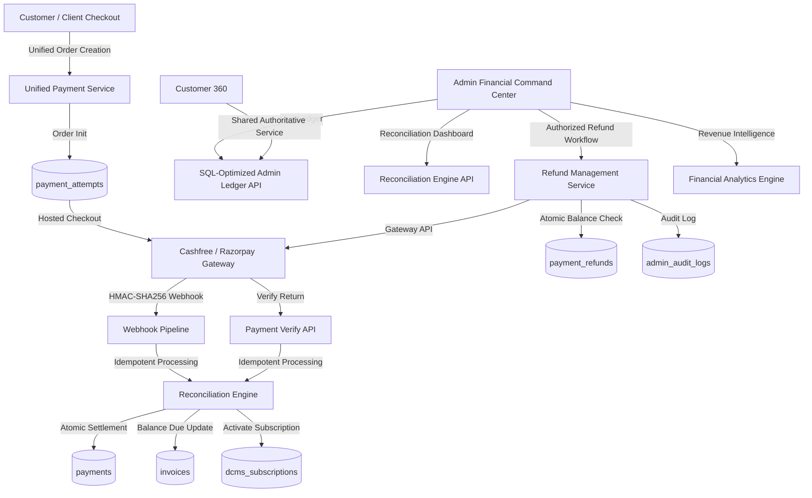

# CWP DETAILERS — FINANCIAL SYSTEM ARCHITECTURAL AUDIT
**Document:** Deep Financial System, Cashfree Payment Gateway, Ledger, Reconciliation & Revenue Intelligence Audit  
**Phase:** Phase 26 — Financial Command Center & Payment Operations  
**Date:** 2026-11-14  
**Author:** Principal Fintech Product Architect & Payment Systems Specialist  
**Canonical Baseline:** PRD v5.7 -> Target PRD v5.8  

---

## Executive Summary

An exhaustive, forensic audit of the CWP Detailers multi-city financial and payment architecture was conducted across database schemas, payment gateway clients, order creation pipelines, webhook listeners, billing ledger synchronizations, Customer 360 views, Admin screens, and reporting engines.

The platform already possesses a solid operational foundation:
- Cashfree and Razorpay multi-gateway support with config-driven active gateway switching (`ACTIVE_PAYMENT_GATEWAY`).
- Cryptographic HMAC-SHA256 signature verification with timing attack protection (`timingSafeEqual`) and drift-safe timestamp gating.
- Server-authoritative payable calculation from `invoicesTable` and `getCustomerOutstandingDues()`, preventing client tampering.
- An initial Admin Payment Ledger (`/admin/payments/ledger`) showing settled payments and gateway attempts with 30s auto-refresh polling and CSV export.

However, significant financial and reconciliation vulnerabilities, structural omissions, and operational bottlenecks were identified:
1. **Absence of a Formal Refund Lifecycle & Table:** No structured `payment_refunds` schema exists. Refunds are tracked only as an enum status on `paymentsTable` with no over-refund prevention, no refundable balance validation, and zero integration with Cashfree Refund APIs (`POST /orders/{order_id}/refunds`).
2. **True Cross-System Reconciliation Gap:** `reconcileCashfreePayment()` in `cashfreeService.ts` handles isolated *payment capture recording* for a single order upon webhook/verify return. It does not perform system-wide three-way reconciliation (Internal DB vs Gateway vs Booking Engine) or classify mismatches (Amount Mismatch, Status Mismatch, Missing Internal, Missing Gateway, Settlement Pending).
3. **In-Memory Ledger Pagination & Bloat Risk:** `routes/admin-ledger.ts` loads all `paymentsTable` rows and all non-paid `paymentAttemptsTable` rows into Node.js heap memory before in-memory filtering and slicing. Under multi-city production transaction volume, this poses memory exhaustion and slow API responses.
4. **Customer 360 & Admin Ledger Data Disconnect:** In `routes/customers.ts`, `GET /customers/:id/payments` selects raw rows from `paymentsTable` only, completely omitting gateway attempts, Cashfree/Razorpay Order IDs, payment statuses, and invoice links present in the Admin Ledger.
5. **Missing Financial Reporting Definitions & Revenue Breakdown:** Current analytics conflate booking pipeline values with actual cash collected and lack net collected metrics (Gross - Refunds), service-wise breakdown, and city/branch collection efficiency metrics.

---

## 1. Existing Capabilities

### 1.1 Gateway Integration & Order Creation
- **Dual Gateway Support:** Multi-gateway redundancy supports Cashfree and Razorpay via `ACTIVE_PAYMENT_GATEWAY` in `.env` without code deployment.
- **Fail-Safe Environment Routing:** `resolveCashfreeEnvironment` auto-routes test keys (`TEST...`, `cfsk_ma_test_...`) to Cashfree Sandbox (`sandbox.cashfree.com/pg`) and live keys (`cfsk_ma_prod_...`) to Production.
- **Server-Authoritative Payable Pricing:** Orders reject client-provided prices; amounts are resolved strictly from `invoicesTable.balanceDue` or customer outstanding dues.
- **Client Idempotency Protection:** Client-supplied idempotency keys are stored in `payment_attempts.idempotency_key` and prevent duplicate gateway order creation.
- **DCMS Subscription Flow:** Enrolls customers with `pending_payment` subscriptions, generating a checkout session without assigning cleaners until payment is confirmed.

### 1.2 Webhook Processing Pipeline
- **HMAC-SHA256 Signature Verification:** Verified against raw request body (`req.rawBody` captured in `app.ts`) using `crypto.timingSafeEqual` with buffer length validation.
- **Timestamp Drift Protection:** Enforces 300-second maximum age and 60-second future tolerance to prevent replay attacks.
- **Database Transaction Safety:** `reconcileCashfreePayment` executes inside PostgreSQL `db.transaction()` with row-level locking (`for("update")`) on `payment_attempts`.
- **Payment Success Idempotency:** Duplicate webhooks for already-paid attempts short-circuit safely without duplicate payments or balance double-deductions.
- **Late Failure Protection:** If a `PAYMENT_FAILED_WEBHOOK` arrives after an order is already marked `paid`, it is ignored, preventing retroactive cancellation of confirmed payments.

### 1.3 Admin Payment Ledger (`/admin/payments/ledger`)
- Provides 7 top summary KPI cards in IST (Today Collected, Today Txns, This Month, Pending, Failed, Total Collected, Outstanding Dues).
- Filter toolbar by status, method, city, branch, and date preset.
- 30-second background polling via React Query (`refetchInterval: 30000`).
- Streaming CSV export with sanitized quotes and IST timestamps.
- Forensic Drawer (`TransactionDetailsDrawer`) displaying copyable identifiers and raw JSON payloads.

---

## 2. Missing Capabilities

### 2.1 Formal Refund Management Engine
- **No Dedicated Refund Schema:** No table records partial or full refund requests, refund reasons, Cashfree refund IDs, or refund status lifecycle (`initiated`, `pending`, `succeeded`, `failed`).
- **No Server-Side Over-Refund Guard:** No calculation checking `amountPaid - sum(refunds) >= requestedAmount`.
- **No Cashfree Refund API Integration:** `CashfreeClient` lacks `createRefund`, `getRefund`, and webhook handlers for `REFUND_STATUS_WEBHOOK`.
- **No Authorized Admin Refund Modal:** Admins cannot initiate or inspect refunds from the ledger.

### 2.2 Payment Reconciliation Engine
- No mechanism to perform automated or on-demand 3-way reconciliation:
  1. Internal CWP Payments Ledger (`paymentsTable` & `invoicesTable`)
  2. Gateway Settlement & Payment Records (`payment_attempts` & Cashfree APIs)
  3. Booking Commercial Records (`bookingsTable`)
- No classification into industry-standard reconciliation categories:
  - `MATCHED`: Exact match across internal, gateway, and invoice amounts.
  - `INTERNAL_WITHOUT_GATEWAY`: Manual/cash payment without verified gateway record.
  - `GATEWAY_WITHOUT_INTERNAL`: Gateway captured payment with no corresponding invoice credit.
  - `AMOUNT_MISMATCH`: Payment amount differs from invoice balance.
  - `STATUS_MISMATCH`: Gateway status differs from internal status.
  - `DUPLICATE_TRANSACTION`: Multiple payment rows referencing the same gateway order.
  - `REFUND_MISMATCH`: Gateway reports refund unreflected internally.
  - `SETTLEMENT_PENDING`: Payment captured but bank settlement pending.

### 2.3 Revenue Intelligence
- Missing granular financial definitions:
  - Gross Payment Volume (GPV)
  - Net Collected Amount (Gross Collected - Refunds)
  - Gateway Settlement vs Booking Value vs Collected Cash
  - Service-wise breakdown (Daily Car Cleaning vs Car Wash vs Detailing vs Solar Care)
  - City & Branch Collection Efficiency

### 2.4 Customer 360 Financial Cohesion
- `GET /api/customers/:id/payments` fetches raw `paymentsTable` rows without linking to gateway order IDs, booking references, or payment attempt statuses.

---

## 3. Duplicate Structures & Architectural Inefficiencies

1. **Dual Storage of Transactions:** `paymentsTable` (settled payments) and `payment_attempts` (gateway sessions). While separation of intent vs settlement is good financial practice, uniting them in-memory via JavaScript array concatenation and sorting in `admin-ledger.ts` scales poorly.
2. **Missing Direct Booking Link on Attempts:** `payment_attempts` stores `invoice_id` and `subscription_id`, but lacks `booking_id`. Looking up a booking requires joining `invoicesTable`.

---

## 4. Data Integrity & Reconciliation Risks

| Risk | Impact | Likelihood | Mitigation |
| :--- | :--- | :--- | :--- |
| **In-Memory Pagination Blowup** | Server CPU/Memory saturation under high transaction volume. | High | Implement SQL-level unified pagination with `UNION ALL` or normalized views. |
| **Silent Over-Refunding** | Issuing refund greater than transaction balance. | Medium | Enforce atomic server-side refundable balance verification with DB locks. |
| **Frontend Success Assumption** | Frontend redirect treated as payment confirmation. | Low (Mitigated) | Verified: Checkout requires authoritative server verification before marking paid. |
| **Unreconciled Gateway Drops** | Customer abandons checkout at gateway; status stays `initiated`. | Medium | Add automated reconciliation job syncing stale attempts (>30 mins) via Cashfree GET `/orders/{id}`. |

---

## 5. Security & RBAC Audit

1. **Role Gating:** `requireAdminRole` restricts the central ledger to `superadmin` and `central_admin`. Branch managers are correctly restricted from central financial exports (`SEC-028`, `SEC-029`).
2. **Customer PII Masking:** Customer phone numbers are currently exposed in full on the ledger table and CSV exports. Restricted roles should see masked phone numbers (`98765*****`), while central superadmins can view or export full PII with an audit log.
3. **Audit Logging:** Administrative refunds and manual reconciliation adjustments must be logged in `admin_audit_logs`.

---

## 6. Recommended Architecture for Phase 26

### Proposed Action Plan
1. **Database Migration (`086_payment_refunds_and_reconciliation.sql`):**
   - Create `payment_refunds` table with unique refund references, amount, status, gateway IDs, and audit references.
   - Add `booking_id`, `refund_status`, `refunded_amount` to `payment_attempts`.
   - Add composite indexes for date, status, city, branch, and customer lookups.
2. **Cashfree Refund Client & Webhook Expansion:**
   - Add `createRefund` and `getRefund` in `CashfreeClient`.
   - Add `REFUND_STATUS_WEBHOOK` processing in `cashfreeService.ts`.
3. **Reconciliation Engine (`paymentReconciliationService.ts`):**
   - Three-way reconciliation across Internal, Gateway, and Invoices.
   - Categorization: Matched, Missing Gateway, Missing Internal, Amount Mismatch, Status Mismatch, Duplicate, Refund Mismatch.
   - Authoritative manual reconciliation action with audit trail.
4. **Modernized Admin Payment Ledger & Drawers:**
   - Server-side SQL pagination and composable filtering (date, city, branch, service type, payment status, refund status, method).
   - Display all 16 required fields including IST timestamps, customer phone with permission masking, booking reference, and refund status.
   - Payment Detail Drawer with chronological timeline (Gateway vs Internal events).
5. **Admin Refund Workflow:**
   - Authorized refund modal with refundable balance check, reason capture, confirmation, and immutable audit logging.
6. **Revenue Intelligence Dashboard:**
   - GPV, Successful Amount, Failed Amount, Refund Amount, Net Collected, Success Rate %, ATV, City-wise, Branch-wise, Service-wise breakdowns.
7. **Customer 360 Financial Integration:**
   - Synchronize `GET /customers/:id/payments` with the authoritative ledger service and enrich `Customer360Overview.tsx`.
8. **Automated Verification:**
   - Write comprehensive unit & integration tests covering ledger, webhooks, reconciliation, refunds, and security.
