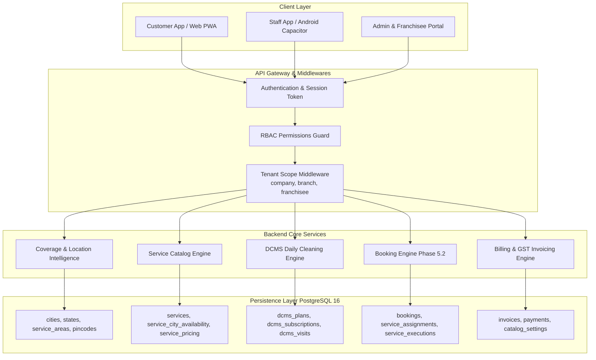
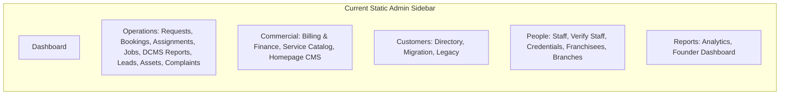
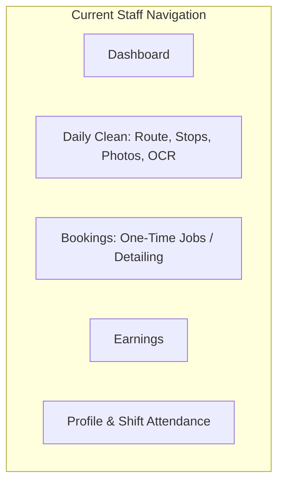
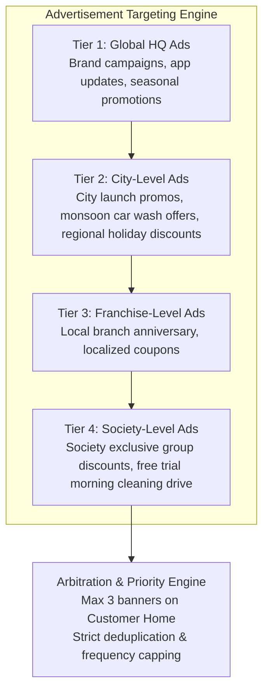
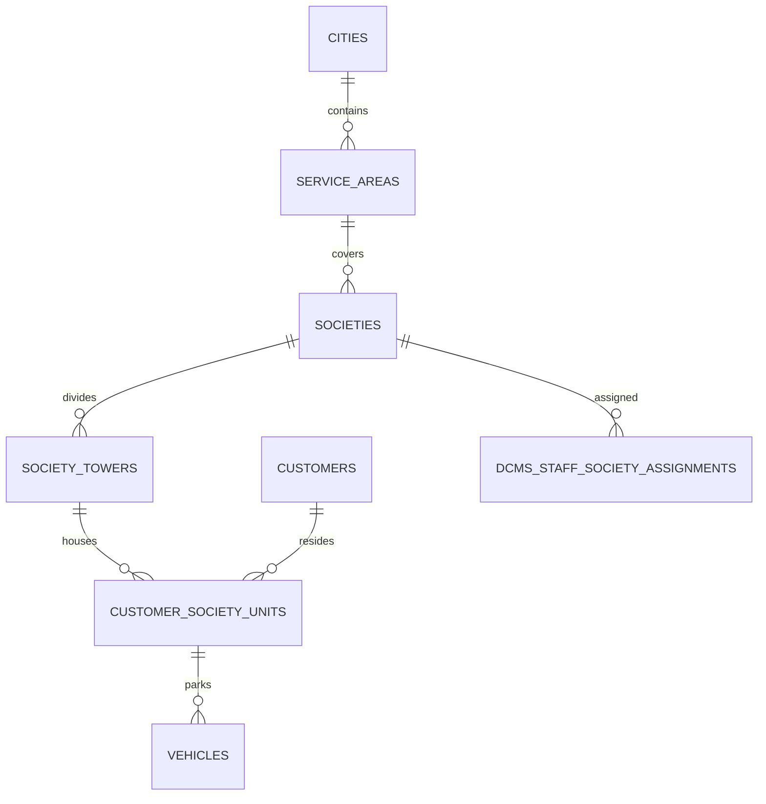
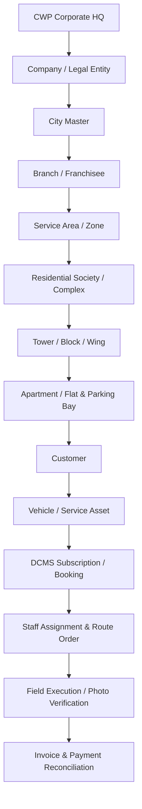
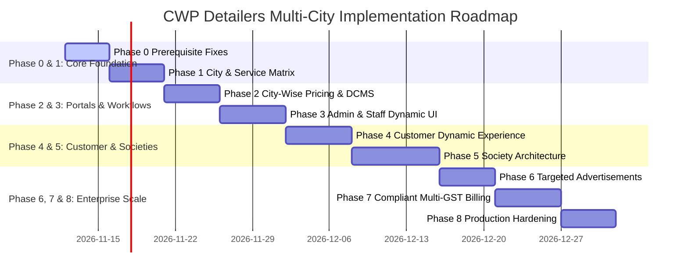

# CWP DETAILERS — MULTI-CITY, FRANCHISE, SOCIETY & CITY-WISE SERVICE ARCHITECTURE
## Complete Codebase Audit & Implementation Readiness Assessment

**Document Version:** 1.0.0  
**Audit Date:** November 2026  
**Operating Mode:** Integrity Mode — Development (Strictly Read-Only Audit & Analysis)  
**Target Codebase:** CWP Detailers Monorepo (`artifacts/api-server`, `artifacts/cwp-platform`, `lib/db`, `scripts`)  

---

## 1. Executive Summary

CWP Detailers is evolving from a single-city hub (headquartered in Varanasi, Uttar Pradesh) into a multi-city, franchise-enabled, residential society-centric doorstep automotive and clean-energy care platform. The immediate business objective is the launch of **Noida, Uttar Pradesh**, as a streamlined, single-service territory offering **exclusively Daily Car Cleaning**, with plans to expand subsequent service lines (Doorstep Car Wash, Detailing, Ceramic Coating, Paint Protection Film (PPF), Rooftop Solar Panel Cleaning) on a city-by-city, franchise-by-franchise, and society-by-society basis.

This audit evaluates the architectural readiness of the existing codebase to support multi-city operations, franchise independence, society-level cluster management, city-specific pricing, and dynamic role-based user experiences across Customer, Staff, and Admin portals.

### High-Level Verdict

| Architectural Domain | Current Status | Readiness Score | Primary Blocker |
| :--- | :--- | :--- | :--- |
| **Multi-City Database Modeling** | Partially Implemented / Fragmented | **45%** | Inconsistent city representation (`cityId` integer vs raw `city` string); circular foreign keys between `branches` and `franchisees`; missing city links in DCMS plans, invoices, and customers. |
| **City-Specific Service Availability** | Partially Implemented | **50%** | `service_city_availability` exists in DB but is completely ignored by Customer Homepage, Service Details, and direct booking APIs without `serviceId`. |
| **Residential Society Architecture** | Not Implemented | **0%** | Zero tables, models, or APIs exist for Societies, Towers, Blocks, Flats, Parking Slots, or Society Managers. |
| **Advertisement & Promotional Engine** | Not Implemented | **0%** | Zero tables or models exist for banner delivery, campaign scheduling, or multi-tier ad targeting (Global/City/Franchise/Society). |
| **City-Wise Pricing & Rate Cards** | Partially Implemented | **55%** | Vehicle matrix and solar slabs support city overrides, but DCMS daily cleaning plans have no city scoping; franchisees cannot override pricing; fallback defaults to Varanasi. |
| **City/Franchise Invoicing & GST** | Weak / Global Monolith | **25%** | Invoice settings are hardcoded to a single Varanasi address and UP state code (`09`); document numbering is a single global counter (`CWP/{fy}/{n}`); non-compliant with multi-entity GST. |
| **Admin Portal Multi-City Adaptation** | Static Monolith | **20%** | Sidebar navigation, dashboards, and job orchestration statically display all services and modules globally with no city filter or city-specific feature toggling. |
| **Staff Portal Multi-City Adaptation** | Semi-Adaptive | **60%** | Staff roles restrict daily route vs bookings, but navigation statically renders "Bookings" tab for all staff; route stops lack society/tower/parking data. |
| **Customer App Experience** | Hardcoded / Static Discovery | **30%** | Homepage and Product Detail pages render hardcoded in-memory TypeScript arrays with Varanasi-specific copy and fixed pricing, completely disconnected from city availability. |
| **Security & Tenant Scoping** | Moderately Secure | **65%** | Robust `companyId`, `branchId`, and `franchiseeId` filters exist, but `cityId` is completely absent from `TenantScope`; direct API requests can book disabled services. |

**Overall Multi-City Readiness Score: 35 / 100 — Significant Architectural Blockers Exist.**  
The platform **cannot be safely launched in Noida in its current state** without immediate remediation of the P0 vulnerabilities and architectural gaps documented herein.

---

## 2. Current Architecture Overview

The CWP Detailers application is structured as a **pnpm monorepo** consisting of:
1. **Database Layer (`lib/db`)**: PostgreSQL 16 managed via Drizzle ORM, with 63 applied SQL migrations, 58 schema definition files, and Drizzle Zod schemas.
2. **Backend API Server (`artifacts/api-server`)**: Express.js REST API with TypeScript, built via `esbuild`, utilizing session-cookie and Bearer token authentication, custom RBAC permissions middleware (`permissions.ts`), tenant-scoping middleware (`tenantScope.ts`), and localized service engines (`dcms`, `booking`, `coverage`, `billing`, `location-intelligence`).
3. **Frontend Platform (`artifacts/cwp-platform`)**: React 19 single-page application built with Vite and Tailwind CSS, utilizing `wouter` for routing, `@tanstack/react-query` for server-state caching, Lucide icons, and Shadcn/UI component primitives.
4. **Mobile Hybrid Wrappers (`artifacts/cwp-customer-app` & `artifacts/cwp-staff-app`)**: Capacitor Android shells wrapping the responsive web platform with native camera, geolocation, and push notification bridges.



---

## 3. Existing Implementations

The audit revealed several well-designed subsystems that provide a solid foundation for multi-city expansion:

1. **Relational Geography Baseline (`lib/db/src/schema/city-masters.ts`)**:
   - `statesTable`: State master (`id`, `name`, `code`, `isActive`).
   - `citiesTable`: City master (`id`, `stateId`, `name`, `slug`, `isActive`).
   - `serviceAreasTable`: Sub-city zones (`id`, `cityId`, `name`, `isActive`).
   - `pincodesTable`: Postal codes (`id`, `serviceAreaId`, `pincode`, `latitude`, `longitude`, `isActive`).
2. **City Service Availability Schema (`lib/db/src/schema/service-catalog.ts`)**:
   - `serviceCityAvailabilityTable`: Maps `serviceId` to `cityId` with `basePriceOverride` and `isActive`.
   - `serviceCityContentTable`: Stores per-city SEO metadata (`seoTitle`, `seoDescription`, `schemaData`, `benefits`).
3. **Location Intelligence Platform (`artifacts/api-server/src/lib/location-intelligence`)**:
   - Multi-stage pipeline executing `AddressValidator` → `PinValidator` → `CityValidator` → `ServiceAreaValidator` → `ServiceValidator`.
   - Coordinates-to-city resolution with caching (`CoverageCache.ts`).
4. **City-Aware Dynamic Pricing Engine (`artifacts/api-server/src/lib/dynamicPricing.ts` & `catalog/pricingEngine.ts`)**:
   - `servicePricingTable` supports `cityId` overrides for vehicle category and seating capacity combinations.
   - `solarPricingSlabsTable` supports `cityId` overrides for rooftop solar panel slabs.
5. **Tenant Scoping Architecture (`artifacts/api-server/src/middlewares/tenantScope.ts`)**:
   - Automatic query filtering and row isolation via `companyId`, `branchId`, and `franchiseeId`.
   - Prevents cross-franchise data leakage for bookings, leads, customers, and staff.
6. **DCMS Daily Route Execution (`artifacts/api-server/src/lib/dcms/dailyRouteService.ts`)**:
   - High-throughput daily route optimization and photo/OCR plate-verification workflows (`visitService.ts`).
   - Operational role separation: staff assigned the `daily_car_cleaner` operational role have streamlined workflows.

---

## 4. Missing Implementations

Despite the foundations above, the following critical components are **completely missing**:

1. **Residential Society & Cluster Domain**:
   - No data model for `societies`, `society_towers` (or wings/blocks), `customer_society_units` (flats/apartments), or parking slot identifiers.
   - No society-level service availability, pricing, or exclusive partnership flags.
   - Staff daily cleaning stops lack physical tower, wing, floor, or parking bay attributes.
2. **Advertisement & Promotional Banner Engine**:
   - No data tables, schemas, or APIs for ads, banners, promotions, click targets, or display priorities.
   - No hierarchy for Global vs. City vs. Franchise vs. Society promotional targeting.
3. **City-Aware Daily Cleaning (DCMS) Plans**:
   - `dcms_plans` has NO `cityId` or city mapping table. A DCMS plan is global across the entire company.
   - Noida cannot have distinct Daily Cleaning plan tiers or pricing from Varanasi.
4. **Dynamic Frontend Service Discovery**:
   - Customer app homepage (`ServicesGrid.tsx`) and product pages (`ProductDetail.tsx`) use static in-memory TypeScript files (`cwp-products-data.ts`) rather than querying the database.
   - Hardcoded Varanasi branding and contact numbers in customer-facing UI components (`MarketingHero.tsx`).
5. **Configuration-Driven Admin & Staff Portals**:
   - Admin sidebar (`adminNavConfig.ts`) is hardcoded; cannot hide Detailing, Solar, or PPF modules for a single-service city like Noida.
   - Staff bottom navigation statically displays the "Bookings" tab for all staff.
6. **Compliant Multi-Entity Invoicing**:
   - No branch- or franchise-specific legal entity, GSTIN, place of supply, or invoice series configuration.
   - Document numbers are generated from a single global sequence (`CWP/{fy}/{n}`).

---

## 5. Database Architecture Audit

### 5.1 Entity Audit & Relationship Matrix

| Entity | Schema File | Current Scoping Attributes | Foreign Key Integrity | Multi-City Readiness |
| :--- | :--- | :--- | :--- | :--- |
| **Cities** | `city-masters.ts` | `stateId`, `name`, `slug`, `isActive` | Referenced by `service_areas` | **Pass** (Clean master) |
| **Branches** | `branches.ts` | `city` (string!), `companyId`, `franchiseeId` | **Broken**: No FK to `cities.id`; circular link to `franchisees` | **Fail** (Must reference `city_id`) |
| **Companies** | `companies.ts` | `name`, `gstin`, `address` | Base legal entity | **Pass** |
| **Franchisees** | `franchisees.ts` | `branchId`, `companyId`, `userId` | **Incomplete**: Circular link with branches; no direct `cityId` | **Fail** |
| **Services** | `services.ts` | `category`, `basePrice`, `gstRate`, `status` | Global SKU master | **Pass** |
| **City Availability** | `service-catalog.ts` | `serviceId`, `cityId`, `basePriceOverride` | Correct composite relationship | **Pass** |
| **DCMS Plans** | `dcms.ts` | `name`, `price`, `companyId`, `vehicleCategory` | **Critical Defect**: No `cityId` or `branchId` | **Fail** |
| **DCMS Subscriptions** | `dcms.ts` | `customerId`, `vehicleId`, `planId`, `branchId` | Has `companyId`, `franchiseeId`, `branchId`; lacks `cityId` | **Partial** |
| **Bookings** | `bookings.ts` | `branchId`, `cityId`, `customerId`, `serviceId` | Correctly received `cityId` in Phase 5.2 | **Pass** |
| **Customers** | `customers.ts` | `city` (string!), `branchId`, `companyId` | **Broken**: Freeform string, no FK to `cities.id` | **Fail** |
| **Customer Addresses** | `addresses.ts` | `cityId` (FK to `cities.id`), `stateId` | Robust normalized address model | **Pass** |
| **Saved Locations** | `saved-locations.ts` | `cityId`, `cityName`, `placeId`, `lat`, `lng` | Contains `cityId` | **Pass** |
| **Vehicles** | `vehicles.ts` | `serviceAddress`, `locationLabel`, `branchId` | **Missing**: No society, tower, flat, or parking slot | **Fail** |
| **Staff** | `staff.ts` | `branchId`, `cityId`, `city` (string!) | Has both `cityId` and legacy string | **Partial** |
| **Service Assignments** | `service-assignments.ts` | `branchId`, `companyId`, `franchiseeId` | No `cityId` (relies on branch) | **Partial** |
| **Service Executions** | `service-executions.ts` | `branchId`, `companyId`, `franchiseeId` | No `cityId` (relies on branch) | **Partial** |
| **Invoices** | `invoices.ts` | `branchId`, `companyId`, `franchiseeId` | No `cityId`; default supply state "09" hardcoded | **Fail** |
| **Societies** | *None* | *Entity Does Not Exist* | *None* | **Fail** |
| **Advertisements** | *None* | *Entity Does Not Exist* | *None* | **Fail** |

### 5.2 Structural Data Integrity Issues

1. **City Representation Fragmentation**:
   - `citiesTable.id` is referenced in `addressesTable`, `savedLocationsTable`, `bookingsTable`, `serviceCityAvailabilityTable`, `servicePricingTable`, and `solarPricingSlabsTable`.
   - `branchesTable.city`, `customersTable.city`, and `serviceLocationsTable.city` store raw unconstrained `text` (e.g., `"Varanasi"`, `"varanasi"`, `"VNS"`).
   - *Impact*: Inability to run reliable relational joins between branches, customers, and city configurations.
2. **Circular Branch-Franchisee Dependency**:
   - `branchesTable` defines `franchiseeId: integer("franchisee_id")`.
   - `franchiseesTable` defines `branchId: integer("branch_id")`.
   - *Impact*: Cyclic dependency during database seeding, migrations, and tenant isolation resolution.
3. **DCMS Plan Multi-City Isolation Leak**:
   - `dcmsPlansTable` defines subscription offerings (cleanings, washes, pricing) with no geographic scoping.
   - *Impact*: Any plan created for Varanasi is automatically exposed and usable in Noida unless filtered at runtime.

---

## 6. Backend API Audit

Every core endpoint was inspected for city resolution, tenant scoping, and authorization integrity.

| Endpoint | Method | City Resolved? | Service Availability Checked? | Tenant Scoped? | Direct Bypass Risk | Severity |
| :--- | :--- | :--- | :--- | :--- | :--- | :--- |
| `POST /api/auth/register` | POST | Partial (via address) | N/A | N/A | Customer can register in any city | P2 |
| `GET /api/catalog/services` | GET | **No** (Returns all global active SKUs) | **No** | Global Public | Customers see disabled services | **P0** |
| `GET /api/catalog/services/:citySlug` | GET | **Yes** (via `resolveCityId`) | **Yes** (Joins availability) | Public | None (Correctly implemented) | Clean |
| `GET /api/catalog/:citySlug/:serviceSlug` | GET | **Yes** | **Partial** (Loads content, but doesn't block disabled) | Public | Disabled service content accessible | P2 |
| `GET /api/daily-cleaning/plans` | GET | **No** (Global company-wide) | **No** | Admin Scoped | Noida admin sees Varanasi plans | **P0** |
| `POST /api/daily-cleaning/plans` | POST | **No** (No `cityId` in payload) | N/A | Admin Scoped | Plans cannot be targeted to Noida | **P0** |
| `POST /api/daily-cleaning/subscriptions` | POST | **No** | **No** | Checks customer tenant | Customer in Noida can be assigned Varanasi plan | **P0** |
| `POST /api/bookings` | POST | **Yes** (via address/pincode) | **Partial** (Only if `serviceId` sent) | Yes | Omitting `serviceId` bypasses city check | **P0** |
| `GET /api/daily-cleaning/staff/daily-route` | GET | Inherited from staff assignments | N/A | Staff Scoped | Staff cannot access cross-city stops | Clean |
| `GET /api/invoices/billing-settings` | GET | **No** (Singleton row id=1) | N/A | SuperAdmin | Returns Varanasi address for all cities | **P1** |
| `POST /api/invoices` | POST | **No** | N/A | Tenant Scoped | Global numbering sequence collision | **P1** |
| `POST /api/coverage/check` | POST | **Yes** (Full pipeline) | **Yes** | Public | None (Pipeline works properly) | Clean |

---

## 7. Admin Portal Audit

### 7.1 Sidebar Navigation Architecture (`adminNavConfig.ts`)

The Admin Portal currently utilizes a **static, hardcoded navigation structure** consisting of 6 functional sections and 22 sub-routes.



### 7.2 Deficiencies in Single-Service City (Noida) Context

When a Noida Branch Manager or Franchisee Admin logs into `/admin/dashboard`:
1. **Cluttered Cognitive Load (Hick's Law Violation)**:
   - They are presented with Job Orchestration (`/admin/jobs`), Detailing Assignments (`/admin/assign-services`), Service Requests (`/admin/book-services`), and Solar Sites (`/admin/assets`).
   - None of these services exist in Noida.
2. **Missing Territory Filter**:
   - There is no Active City switcher or Branch switcher in `AdminSidebar.tsx` or `AdminLayout.tsx`.
   - Master Data (`/admin/masters`) exposes raw foreign key integer inputs (`cityId`, `stateId`) with no cascading dropdowns.
3. **Service Catalog Exposure**:
   - `/admin/services` displays tabs for "Wash Services", "Wash Packages", "Solar", "Add-ons", "Homepage CMS", and "Daily Cleaning".
   - There is NO tab or interface to configure **City Service Availability** (enabling/disabling services per city) or **City Pricing Overrides**, despite the database tables existing.

---

## 8. Staff Portal Audit

### 8.1 Staff App Shell & Router (`StaffAppShell.tsx` & `StaffPortalRouter.tsx`)

The Staff App is designed for field workforce execution with high-contrast, touch-optimized tokens (`features/staff-ds`).



### 8.2 Operational Analysis for Noida Staff

1. **Irrelevant Navigation Tabs**:
   - In `StaffAppShell.tsx` (line 23), the `"Bookings"` tab (`/staff/bookings`) is displayed for **all** staff with category `cleaning_staff`.
   - In Noida, where only Daily Car Cleaning operates, staff will never have one-time detailing bookings. Having this tab active causes field confusion and false bug reports.
2. **Missing Residential Information in Route Stops**:
   - `DailyRouteStop` in `dailyRouteService.ts` contains `customerName`, `vehicleNumber`, `make`, `model`, `address`, `locationLabel`, and GPS coordinates.
   - It **does not provide**:
     - Residential Society Name.
     - Tower / Wing / Block number.
     - Flat / Apartment number.
     - Parking Level / Basement / Ground Bay number.
   - In high-rise Noida residential societies (e.g., ATS Village, Supertech Capetown, Cleo County), finding a vehicle based only on a street address or GPS pin is practically impossible.

---

## 9. Customer Application Audit

### 9.1 Discovery & Information Architecture Freeze

The Customer Portal (`artifacts/cwp-platform/src/pages/customer`) was frozen under IA v1.0 (`docs/CUSTOMER_IA_FREEZE_v1.md`). However, the implementation contains critical hardcoded assumptions:

1. **Hardcoded Homepage Services Grid (`ServicesGrid.tsx`)**:
   - Unconditionally iterates over `CWP_PRODUCT_LIST` (`artifacts/cwp-platform/src/lib/cwp-products-data.ts`).
   - Displays all 6 company services with hardcoded starting prices (`₹1,199`, `₹499`, `₹1,499`, `₹5,999`, `₹1,299`).
   - A customer in Noida loading the app sees Detailing and Solar Cleaning immediately on the homepage.
2. **Hardcoded Marketing Hero (`MarketingHero.tsx`)**:
   - Line 21 hardcodes: `<span>Varanasi's #1 Doorstep Detailing & Solar Care</span>`.
   - Breaks brand trust for any user registering in Noida or Delhi NCR.
3. **Product Detail Pages Disconnected from Backend**:
   - Navigating to `/customer/services/ceramic-coating` renders static copy from `CWP_PRODUCTS["ceramic-coating"]`.
   - It does not query `/api/catalog/:citySlug/:serviceSlug` to check if Ceramic Coating is active in the customer's city.
4. **Lack of Customer City Selector**:
   - The customer app only stores a `SelectedAddress` capsule (`ServiceAddressSelector.tsx`).
   - There is no prominent city selection modal or state (`useCity`) governing product catalogs.
5. **No Customer Self-Service DCMS Plan Subscription**:
   - In `CustomerDailyCleaningPage.tsx`, if the user has no subscription, it displays an empty state with no buy/subscribe CTA.
   - `POST /daily-cleaning/subscriptions` is locked to admins. Customers cannot purchase daily cleaning subscriptions independently.

---

## 10. Advertisement System Architecture Audit

### 10.1 Current Status: Non-Existent

The codebase was audited thoroughly for advertising, promotional banners, and campaign delivery:
- **Database**: Zero tables exist for advertisements, banners, promotions, or campaign schedules. (The only table is `homepage_sections`, which stores arbitrary JSON blobs for static website sections like "hero", "why-choose-us", and "testimonials").
- **Backend**: Zero API routes or controllers exist for advertisement delivery or tracking.
- **Frontend**: Zero components exist for rendering targeted ad carousels, popup banners, or promotional cards.

### 10.2 Target 4-Tier Advertisement Hierarchy

To support multi-city and society-based expansion without ad fatigue, the platform requires a dedicated hierarchy:



---

## 11. Society & Residential Community Architecture Audit

### 11.1 Current Status: Non-Existent

In Delhi NCR (Noida/Greater Noida/Gurgaon), automotive daily cleaning operations are almost 100% concentrated within gated residential societies and multi-story apartment complexes.
- **Current Codebase**: Zero support. Addresses are stored as flat strings with Google Place IDs. Vehicles have a freeform `locationLabel` string (e.g. `"Tower 4 B2"`).
- **Business Impact**:
  - Daily cleaners cannot navigate high-rise basements.
  - Supervisors cannot allocate staff by society clusters.
  - CWP cannot run society-level marketing, group subscription discounts, or RWA (Resident Welfare Association) partnerships.

### 11.2 Required Society Relational Domain



---

## 12. City-Wise Pricing & Package Audit

### 12.1 Evaluation of Existing Pricing Mechanisms

1. **Fixed Services (`servicesTable`)**:
   - Global default price in `servicesTable.basePrice`.
   - City override supported via `serviceCityAvailabilityTable.basePriceOverride`.
   - *Audit Finding*: `pricingEngine.ts` (lines 525-545) properly resolves `basePriceOverride` when `cityId` is supplied.
2. **Vehicle Category & Seating Matrix (`servicePricingTable`)**:
   - Supports composite pricing: `service_id` + `vehicle_category_id` + `seat_category_id` + `city_id`.
   - *Audit Finding*: Cleanly implemented in `dynamicPricing.ts` (`resolveVehiclePricingWithCity`). Prefers `cityId` match, falls back to `cityId IS NULL`.
3. **Rooftop Solar Cleaning Slabs (`solarPricingSlabsTable`)**:
   - Supports panel slabs per term with `city_id`.
   - *Audit Finding*: Cleanly implemented in `pricingEngine.ts` (`matchSolarSlab`).
4. **DCMS Daily Cleaning Plans (`dcmsPlansTable`)**:
   - **Severe Architectural Defect**: `dcmsPlansTable` has **no** `cityId` column. Plans are global across the platform.
   - Price differences between Noida (e.g. ₹1,199/mo for Sedans) and Varanasi (e.g. ₹899/mo) cannot be represented without code modification.
5. **Franchisee Pricing Overrides**:
   - **Not Supported**: No pricing table includes `franchisee_id`. Franchisees cannot adjust pricing for local market conditions.

---

## 13. City-Wise Invoicing & Financial Architecture Audit

### 13.1 Compliance Under Indian GST Law (CGST / SGST / IGST)

Under Indian Goods and Services Tax laws:
- A city is **not** inherently a separate legal entity.
- A **Company** or **Franchisee** holding a distinct **GSTIN** in a given state represents the legal entity and supplier of service.
- If CWP operates company branches across Uttar Pradesh (e.g. Varanasi and Noida), both operate under the **same Uttar Pradesh GSTIN** (`09...`). Invoicing is intra-state (CGST 9% + SGST 9%).
- If a franchisee is an independent legal entity (proprietorship, partnership, or private limited) with its own GSTIN, invoices issued by that franchise **must bear the franchise's GSTIN, legal name, registered address, and an independent sequential invoice series**.

### 13.2 Existing Invoicing Flaws (`invoiceBillingSettings.ts` & `invoiceService.ts`)

1. **Singleton Hardcoded Billing Settings**:
   - `getInvoiceBillingSettings()` reads from `businessInfoTable` (row 1) and catalog settings key `"invoice_billing"`.
   - Hardcoded fallbacks:
     - Address: `"0, Near Ishita School Seer Goverdhanpur, Varanasi, Uttar Pradesh, 221011"`.
     - GSTIN: `"09BYWPS9468R3ZG"`.
     - Legal Terms: `"Any legal disputes are subject to the Varanasi jurisdiction only."`.
   - *Impact*: Invoices generated for Noida customers display Varanasi address, Varanasi jurisdiction, and HQ bank details.
2. **Global Sequential Numbering Race**:
   - `generateDocumentNumber()` in `invoiceService.ts` formats document numbers as:
     `CWP/${fy}/${next}` (e.g. `CWP/24-25/1042`).
   - Uses an in-memory counter `invoiceCounter` combined with `SELECT max(substring(invoice_number ...))`.
   - *Impact*: All branches and franchises share a single number pool. A franchise in Noida cannot issue its own statutory series (`CWP/NOI/24-25/001`), which violates GST audit requirements for independent entities.

---

## 14. Security & Data Integrity Audit

Detailed findings classified by risk severity.

### Summary Table

| Finding ID | Severity | Category | Affected Files / Endpoints | Risk Summary |
| :--- | :--- | :--- | :--- | :--- |
| **SEC-01** | **P0 — Critical** | Access Control Bypass | `routes/bookings.ts`, `ServiceValidator.ts` | Direct API request can book disabled services by omitting `serviceId`. |
| **SEC-02** | **P0 — Critical** | Multi-City Data Leak | `routes/dcms.ts`, `dcms.ts` | DCMS plans and subscriptions lack city scoping; Noida accounts can bind Varanasi plans. |
| **SEC-03** | **P0 — Critical** | Catalog Exposure | `routes/master-data.ts`, `cwp-products-data.ts` | Global catalog endpoint `/catalog/services` and customer UI leak all services into Noida. |
| **SEC-04** | **P1 — High** | Legal & Tax Violation | `invoiceBillingSettings.ts`, `invoiceService.ts` | Hardcoded Varanasi supplier details and monolithic invoice numbering violate GST rules. |
| **SEC-05** | **P1 — High** | Tenant Isolation Gap | `middlewares/tenantScope.ts`, `middlewares/auth.ts` | `TenantScope` does not track or enforce `cityId`. |
| **SEC-06** | **P1 — High** | Data Integrity | `schema/branches.ts`, `schema/customers.ts` | Unnormalized city strings lead to broken joins and orphan operational records. |
| **SEC-07** | **P2 — Medium** | Authorization | `routes/franchisees.ts` | Circular foreign key relationships between branches and franchisees cause race conditions. |
| **SEC-08** | **P2 — Medium** | Business Logic | `routes/coverage.ts`, `CityValidator.ts` | Client-supplied `citySlug` fallback can spoof city service availability if GPS is absent. |

---

### Detailed Findings

#### Finding SEC-01: Direct Booking API Bypasses City Service Availability Gate
- **Finding ID**: `SEC-01`
- **Severity**: **P0 — Critical**
- **Existing Behavior**: `POST /api/bookings` only requires `customerId`, `scheduledDate`, and `serviceType`. When `serviceId` is omitted, `ServiceValidator.ts` skips city service verification (`if (state.request.serviceId)`).
- **Expected Behavior**: Any booking creation must resolve both the SKU (`serviceId`) and the category (`serviceType`) against the validated city availability matrix.
- **Root Cause**: `bookings.ts` lines 189-280 treat `serviceId` as optional, and `ServiceValidator.ts` lines 13-21 do not validate `serviceType` against city-enabled categories.
- **File Paths**:
  - `artifacts/api-server/src/routes/bookings.ts`
  - `artifacts/api-server/src/lib/coverage/validators/ServiceValidator.ts`
- **Business Impact**: A customer in Noida can book Ceramic Coating or Detailing via a direct API call or script, forcing staff dispatch in a city with zero detailing equipment.
- **Recommended Solution**: Make `serviceId` mandatory for catalog bookings and validate that `serviceCityAvailabilityTable.isActive = true` for the resolved `cityId`.

#### Finding SEC-02: DCMS Plan Cross-City Exposure & Subscription Hijacking
- **Finding ID**: `SEC-02`
- **Severity**: **P0 — Critical**
- **Existing Behavior**: `dcms_plans` has no `city_id` column. `POST /daily-cleaning/subscriptions` accepts any active `planId`.
- **Expected Behavior**: A customer in Noida can only be subscribed to plans specifically configured and priced for Noida.
- **Root Cause**: `lib/db/src/schema/dcms.ts` lines 69-99 lack city scoping. `subscriptionService.ts` lines 22-66 do not validate customer city against plan city.
- **File Paths**:
  - `lib/db/src/schema/dcms.ts`
  - `artifacts/api-server/src/lib/dcms/subscriptionService.ts`
- **Business Impact**: Customers in tier-1 expansion cities (higher purchasing power) could be billed at tier-2 city rates, causing direct operational revenue loss.
- **Recommended Solution**: Add `cityId` to `dcms_plans` and enforce `assertPlanAvailableInCity(plan, customerCityId)` in `subscriptionService.ts`.

#### Finding SEC-03: Frontend Catalog Exposure of Disabled Services
- **Finding ID**: `SEC-03`
- **Severity**: **P0 — Critical**
- **Existing Behavior**: `artifacts/cwp-platform/src/lib/cwp-products-data.ts` hardcodes Detailing, Washing, Ceramic Coating, PPF, and Solar. The Customer dashboard always imports and displays this array.
- **Expected Behavior**: In Noida, the Customer dashboard must only discover and display Daily Car Cleaning.
- **Root Cause**: Frontend architectural decoupling: UI components bypass the backend API and read from static hardcoded files.
- **File Paths**:
  - `artifacts/cwp-platform/src/lib/cwp-products-data.ts`
  - `artifacts/cwp-platform/src/components/home/ServicesGrid.tsx`
  - `artifacts/cwp-platform/src/pages/customer/ProductDetail.tsx`
- **Business Impact**: Severe brand misrepresentation and customer frustration when advertised services cannot be fulfilled.
- **Recommended Solution**: Refactor `ServicesGrid.tsx` and `ProductDetail.tsx` to consume dynamic React Query hooks backed by `GET /api/catalog/services/:citySlug`.

#### Finding SEC-04: Non-Compliant Global Billing & Tax Jurisdiction
- **Finding ID**: `SEC-04`
- **Severity**: **P1 — High**
- **Existing Behavior**: `invoiceBillingSettings.ts` returns Varanasi address, default UP GSTIN, and Varanasi dispute jurisdiction for all invoices across all cities. Document numbers follow one global sequence `CWP/${fy}/${next}`.
- **Expected Behavior**: Invoices must display city/branch-appropriate operational addresses and legally compliant invoice numbering sequences per GSTIN.
- **Root Cause**: Invoicing configuration was built as a single-branch prototype with a database singleton.
- **File Paths**:
  - `artifacts/api-server/src/lib/billing/invoiceBillingSettings.ts`
  - `artifacts/api-server/src/lib/billing/invoiceService.ts`
- **Business Impact**: Legal non-compliance under Indian GST Rule 46; tax audit penalties; inability to legally onboard independent franchisees.
- **Recommended Solution**: Create `branch_billing_settings` and `franchisee_billing_settings` tables with per-entity sequential invoice number generators.

---

## 15. UX & Product Architecture Audit

### 15.1 Cognitive Architecture & Progressive Disclosure

In multi-city SaaS operations, exposing operational modules for services not available in that territory violates **Hick's Law** (decision time increases logarithmically with the number of choices) and **Recognition over Recall**.

### 15.2 Operational Profiles: Noida vs. Varanasi

| Role | Noida Interface (Daily Cleaning Only) | Varanasi Interface (Full-Stack Hub) |
| :--- | :--- | :--- |
| **Admin** | **Dedicated Daily Operations Hub**<br>• Daily Clean Dashboard (Cars on route, completion %)<br>• DCMS Subscriptions & Renewals<br>• Society & Route Management<br>• Cleaning Staff & Attendance<br>• Collections & Missed Cleaning Logs<br>*(Hidden: Detailing jobs, Solar sites, Catalog packages, Quotations)* | **Full Operations Wall**<br>• Job Orchestration (Detailing & PPF bay tracking)<br>• Rooftop Solar AMC & Site Visits<br>• Full Service Catalog & Pricing Matrix<br>• Fleet Detailing Dispatch<br>• Franchisee & Multi-Branch Hierarchy |
| **Staff** | **Dedicated Route Companion**<br>• Today's Assigned Car Route<br>• Society, Tower, and Parking Bay details<br>• Camera Plate Verification & Watermark Upload<br>• "Car Not Available" logger<br>• Attendance Selfie & Shift Check-in<br>*(Hidden: Bookings tab, Job Orchestration)* | **Multi-Skill Technician App**<br>• Today's Schedule (Assigned detailing & wash slots)<br>• Daily Cleaning Route (if dual-role cleaner)<br>• Before/After multi-angle detailing photo checklists<br>• Customer digital signature capture |
| **Customer** | **Dedicated Daily Clean Experience**<br>• My Car Morning Status (Cleaned / In-Progress)<br>• Vehicle & Society Parking location picker<br>• Daily Clean Subscription Plans (Standard/SUV)<br>• Morning completion photo gallery & feedback<br>• Pause/Resume cleaning calendar<br>*(Hidden: Detailing packages, Solar AMCs)* | **Multi-Service Doorstep Portal**<br>• Signature Services Grid (Detailing, Solar, Wash)<br>• Daily Clean Subscription Hub<br>• Date/Slot scheduler with address coverage check<br>• Multi-asset picker (Vehicles + Solar Sites) |

---

## 16. Proposed Target Architecture

The target architecture establishes a clean, normalized relational hierarchy that connects corporate HQ down to physical residential parking slots.



### City Feature & Service Matrix Engine

To avoid maintaining separate frontend builds or multiple APIs for different cities, a centralized **City Configuration API** (`/api/cities/:slug/configuration`) will serve the client's feature manifest:

```json
{
  "city": { "id": 2, "name": "Noida", "slug": "noida" },
  "features": {
    "dailyCleaning": true,
    "doorstepWash": false,
    "detailing": false,
    "ceramicCoating": false,
    "ppf": false,
    "solarCleaning": false,
    "societyManagement": true
  },
  "branding": {
    "heroTagline": "Noida's Trusted Morning Doorstep Car Cleaning",
    "supportPhone": "0120-XXXXXXX"
  },
  "modules": {
    "admin": ["daily_cleaning", "societies", "staff", "customers", "billing"],
    "staff": ["daily_route", "attendance", "profile"],
    "customer": ["daily_cleaning", "societies", "my_cars", "invoices"]
  }
}
```

---

## 17. Database Changes Required

The following changes must be applied in a phased, backward-compatible migration sequence.

### 17.1 New Tables

#### A. Residential Societies Domain
```typescript
// lib/db/src/schema/societies.ts
export const societiesTable = pgTable("societies", {
  id: serial("id").primaryKey(),
  cityId: integer("city_id").notNull().references(() => citiesTable.id),
  serviceAreaId: integer("service_area_id").references(() => serviceAreasTable.id),
  branchId: integer("branch_id").references(() => branchesTable.id),
  name: text("name").notNull(),
  slug: text("slug").notNull(),
  address: text("address").notNull(),
  pincode: text("pincode").notNull(),
  latitude: doublePrecision("latitude").notNull(),
  longitude: doublePrecision("longitude").notNull(),
  radiusMeters: integer("radius_meters").notNull().default(300),
  totalTowers: integer("total_towers").default(1),
  totalFlats: integer("total_flats"),
  gateSecurityContact: text("gate_security_contact"),
  managerName: text("manager_name"),
  managerPhone: text("manager_phone"),
  isActive: boolean("is_active").notNull().default(true),
  createdAt: timestamp("created_at").notNull().defaultNow(),
  updatedAt: timestamp("updated_at").notNull().defaultNow(),
}, t => [
  index("idx_societies_city").on(t.cityId),
  index("idx_societies_pincode").on(t.pincode),
  uniqueIndex("uidx_societies_city_slug").on(t.cityId, t.slug),
]);

export const societyTowersTable = pgTable("society_towers", {
  id: serial("id").primaryKey(),
  societyId: integer("society_id").notNull().references(() => societiesTable.id, { onDelete: "cascade" }),
  name: text("name").notNull(), // e.g. "Tower A", "Block 4", "Wing 2"
  totalFloors: integer("total_floors"),
  basementLevels: integer("basement_levels").default(1),
  sortOrder: integer("sort_order").default(0),
  createdAt: timestamp("created_at").notNull().defaultNow(),
});

export const customerSocietyUnitsTable = pgTable("customer_society_units", {
  id: serial("id").primaryKey(),
  customerId: integer("customer_id").notNull().references(() => customersTable.id),
  societyId: integer("society_id").notNull().references(() => societiesTable.id),
  towerId: integer("tower_id").references(() => societyTowersTable.id),
  flatNumber: text("flat_number").notNull(), // e.g. "1204"
  parkingFloor: text("parking_floor"), // e.g. "B1", "B2", "Ground"
  parkingSlotNumber: text("parking_slot_number"), // e.g. "P-45"
  isPrimary: boolean("is_primary").notNull().default(true),
  createdAt: timestamp("created_at").notNull().defaultNow(),
}, t => [
  index("idx_customer_society_customer").on(t.customerId),
  index("idx_customer_society_society").on(t.societyId),
]);
```

#### B. Advertisement Engine Domain
```typescript
// lib/db/src/schema/advertisements.ts
export const adScopeEnum = pgEnum("ad_scope", ["global", "city", "franchise", "society"]);
export const adPlacementEnum = pgEnum("ad_placement", ["home_hero", "home_banner", "plan_checkout", "route_alert"]);

export const advertisementsTable = pgTable("advertisements", {
  id: serial("id").primaryKey(),
  title: text("title").notNull(),
  subtitle: text("subtitle"),
  imageUrl: text("image_url").notNull(),
  targetUrl: text("target_url"),
  actionType: text("action_type").notNull().default("link"), // "link", "plan", "service"
  targetRefId: text("target_ref_id"),
  scope: adScopeEnum("scope").notNull().default("global"),
  cityId: integer("city_id").references(() => citiesTable.id),
  franchiseeId: integer("franchisee_id").references(() => franchiseesTable.id),
  societyId: integer("society_id").references(() => societiesTable.id),
  placement: adPlacementEnum("placement").notNull().default("home_banner"),
  priority: integer("priority").notNull().default(0),
  startDate: date("start_date").notNull(),
  endDate: date("end_date").notNull(),
  isActive: boolean("is_active").notNull().default(true),
  clickCount: integer("click_count").notNull().default(0),
  impressionCount: integer("impression_count").notNull().default(0),
  createdAt: timestamp("created_at").notNull().defaultNow(),
  updatedAt: timestamp("updated_at").notNull().defaultNow(),
}, t => [
  index("idx_ads_scope").on(t.scope, t.cityId, t.societyId),
  index("idx_ads_dates").on(t.startDate, t.endDate),
]);
```

#### C. City Operational Configuration Domain
```typescript
// lib/db/src/schema/city-config.ts
export const cityConfigurationsTable = pgTable("city_configurations", {
  id: serial("id").primaryKey(),
  cityId: integer("city_id").notNull().unique().references(() => citiesTable.id),
  enabledServices: json("enabled_services").$type<string[]>().notNull().default(["daily_cleaning"]),
  supportPhone: text("support_phone"),
  supportEmail: text("support_email"),
  operatingHoursStart: text("operating_hours_start").default("06:00"),
  operatingHoursEnd: text("operating_hours_end").default("20:00"),
  defaultRadiusMeters: integer("default_radius_meters").default(100),
  invoicePrefix: text("invoice_prefix").default("CWP"),
  termsAndConditions: text("terms_and_conditions"),
  isActive: boolean("is_active").notNull().default(true),
  createdAt: timestamp("created_at").notNull().defaultNow(),
  updatedAt: timestamp("updated_at").notNull().defaultNow(),
});
```

### 17.2 Alterations to Existing Tables

1. **`branchesTable`**:
   - Add `cityId: integer("city_id").references(() => citiesTable.id)`.
   - Remove cyclic constraint with `franchiseesTable`.
2. **`customersTable`**:
   - Add `cityId: integer("city_id").references(() => citiesTable.id)`.
3. **`dcmsPlansTable`**:
   - Add `cityId: integer("city_id").references(() => citiesTable.id)`.
   - Add `isCityDefault: boolean("is_city_default").default(false)`.
4. **`dcmsSubscriptionsTable`**:
   - Add `cityId: integer("city_id").references(() => citiesTable.id)`.
   - Add `societyId: integer("society_id").references(() => societiesTable.id)`.
   - Add `customerSocietyUnitId: integer("customer_society_unit_id").references(() => customerSocietyUnitsTable.id)`.
5. **`vehiclesTable`**:
   - Add `societyId: integer("society_id").references(() => societiesTable.id)`.
   - Add `customerSocietyUnitId: integer("customer_society_unit_id").references(() => customerSocietyUnitsTable.id)`.
   - Add `parkingSlot: text("parking_slot")`.
6. **`invoicesTable`**:
   - Add `cityId: integer("city_id").references(() => citiesTable.id)`.
   - Add `legalEntityName: text("legal_entity_name")`.
   - Add `supplierAddress: text("supplier_address")`.

---

## 18. API Changes Required

### 18.1 New Endpoints

1. `GET /api/cities/:slug/configuration`: Returns enabled features, services, contact info, and role modules.
2. `GET /api/societies?cityId=X&q=search`: Auto-complete search for residential societies in a city.
3. `POST /api/societies`: Admin creation of new society with geo-fence coordinates.
4. `GET /api/societies/:id/towers`: Returns towers/wings in a society.
5. `GET /api/advertisements/active?cityId=X&societyId=Y&placement=home_banner`: Targeted ad delivery.
6. `POST /api/daily-cleaning/customer/subscribe`: Customer self-checkout for city-specific DCMS plan.
7. `GET /api/admin/city-service-matrix/:cityId`: Matrix view of all services with toggle switches.
8. `PUT /api/admin/city-service-matrix/:cityId`: Bulk update of enabled services and price overrides.

### 18.2 Middleware Updates

- **`tenantScope.ts`**: Update `TenantScope` to include `cityIds: number[] | null`. Enforce `cityCol` filters on city-scoped queries when non-superadmin users are restricted to specific cities.
- **`permissions.ts`**: Add resource guard `societies` and `advertisements`.

---

## 19. Frontend Changes Required

### 19.1 Customer Application

1. **City Selection Gate (`CityProvider` & `CitySelectorModal`)**:
   - Prompts new users to select their city (defaulting to GPS resolution).
   - Stores active city in local storage and React Query state.
2. **Dynamic Services Grid**:
   - Remove hardcoded `CWP_PRODUCT_LIST`.
   - Fetch services from `GET /api/catalog/services/:citySlug`.
   - In Noida, renders a hero banner highlighting Daily Car Cleaning only.
3. **Residential Society Address Flow**:
   - Update Address Picker Sheet to allow choosing: "Gated Society" vs. "Independent House/Villa".
   - When Gated Society is selected, provides cascading dropdowns: `Society` → `Tower` → `Flat Number` → `Parking Floor / Slot`.

### 19.2 Staff Application

1. **Adaptive Bottom Navigation**:
   - In `StaffAppShell.tsx`, evaluate the active city's configuration and staff operational roles.
   - If the city is Daily Cleaning only, omit the `"Bookings"` tab.
2. **Enriched Route Stop Cards**:
   - Display Society Name (pill badge), Tower/Flat, and Parking Bay prominently on the stop card before the customer name.

### 19.3 Admin Portal

1. **City Scope Bar**:
   - Add a global City & Branch Switcher at the top of `AdminSidebar.tsx`.
2. **Context-Driven Navigation**:
   - Filter `ADMIN_NAV_SECTIONS` based on enabled services in the selected city.
   - In Noida mode, hide Detailing Job Orchestration, Quotations, and Solar Panels.
3. **City Service Matrix Manager**:
   - New page under `/admin/services/city-availability` providing a high-speed matrix table to enable/disable services and adjust prices per city.

---

## 20. Migration & Backward Compatibility Strategy

### Zero-Downtime Migration for Existing Varanasi Operations

1. **Varanasi Seed Reference (`city_id = 1`)**:
   - The current single-tenant deployment is implicitly Varanasi.
   - Data backfill migration:
     - `UPDATE branches SET city_id = 1 WHERE city_id IS NULL;`
     - `UPDATE customers SET city_id = 1 WHERE city_id IS NULL;`
     - `UPDATE dcms_plans SET city_id = 1 WHERE city_id IS NULL;`
     - `UPDATE dcms_subscriptions SET city_id = 1 WHERE city_id IS NULL;`
2. **Noida Provisioning (`city_id = 2`)**:
   - Insert State (UP) and City: `{ id: 2, name: 'Noida', slug: 'noida', stateId: 1 }`.
   - Insert Branch: `{ name: 'CWP Noida Hub', city: 'Noida', cityId: 2 }`.
   - Populate `service_city_availability` for `city_id = 2`:
     - Enable Daily Car Cleaning (`isActive = true`).
     - Disable all other service IDs (`isActive = false`).
   - Insert Noida-specific `dcms_plans` with local pricing.

---

## 21. Testing Strategy

1. **Adversarial Security Tests**:
   - Attempt to call `POST /api/bookings` with a Noida address and `serviceType: "detailing"` → Expect `422 Unprocessable Entity (SERVICE_UNAVAILABLE)`.
   - Attempt to call `POST /api/daily-cleaning/subscriptions` linking a Noida vehicle with a Varanasi plan ID → Expect `400 Bad Request`.
2. **Isolation Tests**:
   - Noida Staff user requests `/api/daily-cleaning/staff/daily-route` → Verify 0 stops outside assigned Noida societies.
   - Franchisee user from Noida requests `/api/customers` → Verify 0 Varanasi customers returned.
3. **E2E Customer Journey (Playwright)**:
   - User switches city to "Noida" → Verify Homepage displays 0 detailing cards.
   - User selects ATS Village Society, Tower 3, Flat 502, Bay B1-24 → Completes subscription → Verifies parking info appears on staff terminal.

---

## 22. Prioritized Implementation Roadmap



### Phase Details

#### Phase 0 — Existing Architecture Stabilization
- **Scope**: Resolve circular foreign keys (`branches` ↔ `franchisees`), backfill `cityId` on branches, customers, and subscriptions.
- **Files Modified**: `lib/db/src/schema/branches.ts`, `lib/db/src/schema/franchisees.ts`, `scripts/src/backfill-tenant-fields.ts`.
- **Database Changes**: Add `city_id` to `branches` and `customers`; drop cyclic FK constraints.
- **Acceptance Criteria**: All existing Varanasi queries execute without schema mismatches.

#### Phase 1 — City Configuration & Service Matrix
- **Scope**: Centralized city service enablement; enforce availability at API layer.
- **Files Modified**: `lib/db/src/schema/service-catalog.ts`, `artifacts/api-server/src/routes/service-catalog.ts`, `artifacts/api-server/src/routes/bookings.ts`, `artifacts/api-server/src/lib/coverage/validators/ServiceValidator.ts`.
- **Database Changes**: Create `city_configurations` table; verify indexes on `service_city_availability`.
- **API Changes**: Enforce city availability validation in `POST /api/bookings` regardless of payload format.
- **Acceptance Criteria**: Direct API attempts to book detailing in Noida fail with `422 SERVICE_UNAVAILABLE`.

#### Phase 2 — City-Wise Pricing & Plans
- **Scope**: Scope DCMS daily cleaning plans by city.
- **Files Modified**: `lib/db/src/schema/dcms.ts`, `artifacts/api-server/src/lib/dcms/planService.ts`, `artifacts/api-server/src/lib/dcms/subscriptionService.ts`.
- **Database Changes**: Add `city_id` to `dcms_plans`.
- **API Changes**: Filter `GET /daily-cleaning/plans` by caller city; validate plan city match on subscription creation.
- **Acceptance Criteria**: Noida plans are independent in quota, price, and inclusions from Varanasi plans.

#### Phase 3 — Admin & Staff Dynamic UI
- **Scope**: Adapt Admin and Staff portals based on city-enabled services.
- **Files Modified**: `artifacts/cwp-platform/src/components/layout/adminNavConfig.ts`, `artifacts/cwp-platform/src/components/layout/AdminSidebar.tsx`, `artifacts/cwp-platform/src/components/layout/StaffAppShell.tsx`.
- **Frontend Changes**: Conditional navigation filtering; hide detailing/solar modules in Noida Admin; hide "Bookings" tab in Noida Staff app.
- **Acceptance Criteria**: Noida Admin sees only Daily Cleaning operational modules.

#### Phase 4 — Customer Application City Experience
- **Scope**: Dynamic customer service discovery, city picker, and self-service DCMS subscriptions.
- **Files Modified**: `artifacts/cwp-platform/src/components/home/ServicesGrid.tsx`, `artifacts/cwp-platform/src/components/home/MarketingHero.tsx`, `artifacts/cwp-platform/src/pages/customer/ProductDetail.tsx`, `artifacts/cwp-platform/src/features/daily-cleaning/pages/CustomerDailyCleaningPage.tsx`.
- **Frontend Changes**: Replace static arrays with React Query calls to `/api/catalog/services/:citySlug`. Build customer plan checkout dialog.
- **Acceptance Criteria**: Customer in Noida sees only Daily Cleaning on homepage and can subscribe online.

#### Phase 5 — Society & Service Area Management
- **Scope**: Residential society cluster management, towers, flats, and vehicle parking slots.
- **Files Modified**: `lib/db/src/schema/societies.ts`, `artifacts/api-server/src/routes/societies.ts`, `artifacts/api-server/src/lib/dcms/dailyRouteService.ts`, `artifacts/cwp-platform/src/features/daily-cleaning/components/StaffDailyRouteSimplified.tsx`.
- **Database Changes**: Create `societies`, `society_towers`, `customer_society_units`. Alter `vehicles` to reference society units.
- **Acceptance Criteria**: Staff terminal displays Tower, Flat, and Parking Bay for every route stop.

#### Phase 6 — Advertisement Targeting Engine
- **Scope**: Multi-tier promotional banner engine (Global, City, Franchise, Society).
- **Files Modified**: `lib/db/src/schema/advertisements.ts`, `artifacts/api-server/src/routes/advertisements.ts`, `artifacts/cwp-platform/src/components/home/HomeAdBanner.tsx`.
- **Acceptance Criteria**: Uploading a Noida-specific ad displays exclusively to customers in Noida.

#### Phase 7 — City/Franchise Billing & GST Compliance
- **Scope**: Multi-entity billing settings, independent sequential invoice series, and branch legal details.
- **Files Modified**: `lib/db/src/schema/invoices.ts`, `artifacts/api-server/src/lib/billing/invoiceBillingSettings.ts`, `artifacts/api-server/src/lib/billing/invoiceService.ts`.
- **Acceptance Criteria**: Noida invoices display Noida operational address and unique numbering sequence.

#### Phase 8 — Security, Regression & Production Verification
- **Scope**: End-to-end verification, automated regression runs, load testing.
- **Automated Tests**: E2E multi-city suite; cross-tenant penetration test; Playwright visual verification.
- **Acceptance Criteria**: 100% green test suite across both Varanasi and Noida operations.

---

## 23. Executive Decision

### 1. Is the current CWP architecture ready for multi-city expansion?
**No.** The platform is currently a single-city monolithic system with deep-rooted hardcoded assumptions (Varanasi branding, global pricing arrays, global invoicing, and lack of society modeling). Launching Noida immediately would expose detailing services that cannot be fulfilled, generate non-compliant invoices, and prevent staff from navigating high-rise apartments.

### 2. What are the most critical architectural blockers?
1. **Hardcoded Frontend Services (`cwp-products-data.ts`)**: Bypasses backend city service availability.
2. **Unscoped DCMS Plans (`dcms_plans`)**: Lacks city identification, preventing distinct pricing and plan structures for Noida.
3. **Total Absence of Society Architecture**: High-rise operations in Noida are impossible without Tower, Flat, and Parking Slot data.
4. **Direct API Booking Bypass**: Direct API calls can book unserviced categories in Noida.
5. **Monolithic Invoicing Settings**: Hardcoded Varanasi address and global numbering sequence violate Indian GST regulations.

### 3. What can be reused?
1. **`lib/db/src/schema/city-masters.ts`**: Clean normalized state/city/service-area hierarchy.
2. **`service_city_availability` & `service_pricing`**: Ready-made tables for city-level service enablement and vehicle matrix pricing.
3. **`location-intelligence` & `CoverageEngine`**: Robust geospatial and coordinate-matching pipeline.
4. **`tenantScope.ts`**: Mature multi-tenant filter foundation for companies, branches, and franchises.
5. **DCMS Visit Lifecycle & Camera OCR**: Field-tested route execution and photo verification mechanics.

### 4. What should be redesigned?
1. **Customer Discovery Layer**: Decouple completely from static TypeScript constants; drive 100% from dynamic city APIs.
2. **Invoicing Engine**: Migrate from a singleton row to branch/franchise entity billing profiles with independent sequences.
3. **Admin & Staff Navigation Shells**: Transform static menus into configuration-driven interfaces based on active city services.
4. **Vehicle Location Schema**: Elevate from freeform text to normalized Society/Tower/Bay relationships.

### 5. What is the safest implementation sequence?
Execute **Phases 0 through 4** first. This stabilizes database foreign keys, activates city service gating on backend and frontend, establishes city-specific Daily Cleaning plans, and adapts the Admin and Staff UIs. Once verified, execute **Phase 5 (Societies)** before dispatching field staff in Noida, followed by **Phase 6 (Ads)** and **Phase 7 (Compliant Billing)**.

---
*End of Audit Report. Awaiting explicit user approval before initiating Phase 0 stabilization.*
