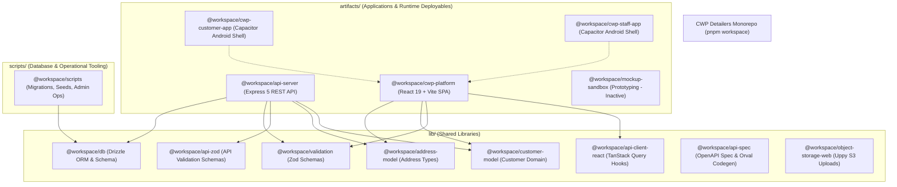
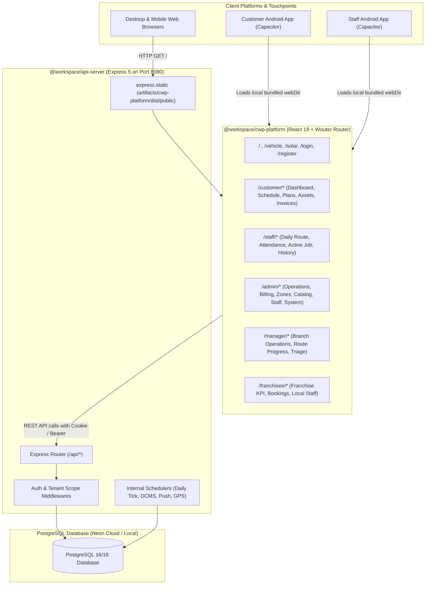

# CWP COMPLETE ENGINEERING AUDIT — PHASE 0
## Repository Baseline, Audit Foundation & Evidence Establishment

- **Audit Date:** 2026-11-25
- **Auditor Role:** Principal Software Architect, Staff Engineer, Database Architect, Security Auditor, DevOps Engineer & QA Lead
- **Target Repository:** `tusharsaraswat1988/Cwpdetailers`
- **Audit Phase:** Phase 0 (Read-Only Forensic Audit Baseline)
- **Status:** Complete

---

## 1. Executive Summary

This forensic audit establishes an empirical, evidence-backed engineering baseline for the **CWP Detailers platform** as of commit `f87bd420f0e641e3cee5dd7d75fbd8223e40a13b`.

The platform is designed to support daily car cleaning (DCMS), car wash, vehicle detailing, ceramic coating, and solar panel cleaning operations across multiple Indian cities (currently Varanasi operational, Noida launch staging). 

### Key High-Level Findings:
1. **Single Frontend SPA Monolith:** While documentation describes separate Customer, Staff, Admin, Manager, and Franchisee applications, the entire web and mobile surface is in reality a **single React 19 + Vite SPA** (`@workspace/cwp-platform`) with route-level gating (`/customer/*`, `/staff/*`, `/admin/*`, `/manager/*`, `/franchisee/*`). The Android "apps" are lightweight Capacitor shells pointing to the same built web bundle.
2. **Typecheck & Production Build Divergence:** Typechecking (`tsc -p tsconfig.json --noEmit`) **fails repository-wide** across both `@workspace/api-server` and `@workspace/cwp-platform`. The application builds and deploys successfully only because the build pipelines use `esbuild` and `vite build` without type verification, and CI does not enforce `tsc` or linting.
3. **Hardcoded Database Credentials & Destructive Runner:** Commit `f87bd42` introduced `scripts/src/inspect-prod-db.ts` and `scripts/src/reset-production-db.ts`, which contain plain-text production Neon database connection strings with passwords. `reset-production-db.ts` defaults to wiping 105 core tables without interactive confirmation or dry-run checks.
4. **Permissive CORS Configuration:** `artifacts/api-server/src/app.ts` enables `cors({ origin: true, credentials: true })`, reflecting arbitrary requesting origins on credentialed API endpoints.
5. **Multiple Competing Database Migration Mechanisms:** Schema changes are handled through three disconnected paths: ad-hoc DDL inside `artifacts/api-server/src/lib/startupMigrations.ts` (executed on every boot under Postgres advisory locks without updating migration history), SQL migration files in `lib/db/migrations/` tracked by `schema_migrations`, and `drizzle-kit push`.
6. **Frontend Test Suite Integrity:** The frontend unit test suite in `@workspace/cwp-platform` is active and healthy, executing 57 test suites and 712 tests with 100% pass rate in 39.08s.

---

## 2. Exact Repository and Commit Baseline

| Property | Value | Evidence Label & Source |
| :--- | :--- | :--- |
| **Repository Name** | `tusharsaraswat1988/Cwpdetailers` | **[CONFIG VERIFIED]** `git remote -v` |
| **Remote Origin URL** | `https://github.com/tusharsaraswat1988/Cwpdetailers.git` | **[CONFIG VERIFIED]** `git remote -v` |
| **Current Branch** | `main` | **[CODE VERIFIED]** `git status` |
| **Exact HEAD Commit SHA** | `f87bd420f0e641e3cee5dd7d75fbd8223e40a13b` | **[CODE VERIFIED]** `git rev-parse HEAD` |
| **Commit Date** | `Wed Nov 25 11:05:17 2026 +0530` | **[CODE VERIFIED]** `git log -1` |
| **Commit Author** | `tusharsaraswat1988 <tusharsaraswat1988@gmail.com>` | **[CODE VERIFIED]** `git log -1` |
| **Commit Message** | `feat(ops): add production db inspection and fresh purge bootstrap runner` | **[CODE VERIFIED]** `git log -1` |
| **Divergence from Remote** | `Your branch is up to date with 'origin/main'.` | **[CODE VERIFIED]** `git status` |
| **Package Manager** | `pnpm` (version 9.15.0 on local host) | **[CONFIG VERIFIED]** `pnpm -v`, `scripts/preinstall.mjs` |
| **Node.js Runtime** | Node `v26.10.0` (host), `"node": ">=20.0.0"` (engine constraint) | **[CONFIG VERIFIED]** `node -v`, `package.json#L118` |

---

## 3. Working Tree Status

At the start of the audit cycle, the working tree was verified clean at commit `f87bd42`. During the audit session, external changes occurred in the working tree (between 11:38:00 and 11:39:09 IST) outside this audit process:

### Uncommitted / Modified Files Detected:
1. `artifacts/api-server/src/lib/brandIdentityService.ts` — Added `FALLBACK_PLATFORM_BRANDING` object to prevent boot crashes if database is unseeded.
2. `artifacts/api-server/src/routes/branding.ts` — Updated fallback branding references.
3. `docs/product/CWP_NOIDA_MULTI_CITY_PRD.md` — Formatting and backlog notes.
4. `lib/db/drizzle.config.ts` — Added `loadRepoEnv` execution so drizzle loads `.env`.
5. `railway.json` — Changed `preDeployCommand` from `migrate:pending` to `db:deploy-auto`.
6. `scripts/package.json` — Added `"db:deploy-auto": "tsx ./src/deploy-auto.ts"`.
7. `scripts/src/migration-state.ts` — Prepended `000_baseline_schema.sql` through `004_comm_sprint1_mvp.sql` to `PENDING_MIGRATIONS`.

### Untracked Files Detected:
1. `lib/db/migrations/000_baseline_schema.sql` (5,306 lines) — Baseline schema DDL dump.
2. `scripts/src/deploy-auto.ts` (226 lines) — Automated migration and seed runner.

> **Auditor Attestation:** Per the Read-Only Audit rules, the auditor has **NOT modified, staged, committed, or discarded** any of these files. They remain exactly as found on disk.

---

## 4. Engineering Document Inventory and Reliability

A forensic review was conducted across all 110+ Markdown documents in the repository.

| Document Path | Document Purpose | Currency | Evidence Rating | Contradictions / Risks |
| :--- | :--- | :--- | :--- | :--- |
| `AGENTS.md` | Mandatory engineering rules, PRD sync instructions, M3 icon rules, design tokens, monorepo runbook. | **Current** | **[CODE VERIFIED]** | Accurately documents that `seed.ts` is broken and that `pnpm run typecheck` fails with pre-existing errors. |
| `docs/product/CWP_NOIDA_MULTI_CITY_PRD.md` | Canonical Living PRD v6.8.23. Requirements, architecture decisions, backlog and changelog. | **Current** | **[CODE VERIFIED]** / **[DOCUMENTED]** | Header states v6.8.21 (Nov 24), but changelog table extends to v6.8.23 (Nov 25). Commit `f87bd42` is not yet logged. |
| `logindetails.md` | List of demo phone numbers, credentials, and roles for testing. | **Misleading** | **[DOCUMENTED]** | Claims `pnpm --filter @workspace/scripts run seed` generates working demo users (9001..., 9011...), which fails due to `seed-permissions.ts` exit bug. |
| `artifacts/cwp-platform/docs/AUTHENTICATION.md` | Authentication flows, OTP handling, rate limits, session cookies, security model. | **Mostly Current** | **[CODE VERIFIED]** | Documents `cors({ origin: true, credentials: true })` as an architectural fact, acknowledging the CORS reflection risk. |
| `TEST_INFRA.md` | E2E Cashfree testing philosophy, category partition, test runner instructions. | **Historical / Partial** | **[CODE VERIFIED]** | Valid for Cashfree test suite in `artifacts/api-server/test/cashfree`, but does not cover general monorepo testing. |
| `docs/design-system/CWP_DESIGN_SYSTEM_SPECIFICATION.md` | Design token architecture, DTCG 2025.10 tokens, M3 icon rules. | **Current** | **[CODE VERIFIED]** | Synchronized with `artifacts/cwp-platform/src/lib/design-system/tokens.ts`. |
| `docs/design-system/CWP_UI_INVENTORY_AND_TRACKING.md` | Complete inventory of 138 route surfaces across all portals. | **Current** | **[CODE VERIFIED]** | Comprehensive surface inventory with route mappings. |
| `docs/audits/CWP_ADMIN_OPERATIONS_AUDIT.md` (and 5 others in `docs/audits/`) | Previous audit snapshots from mid-November 2026. | **Historical** | **[DOCUMENTED]** | Useful for historical defect tracking, superseded by living PRD. |
| Root-level sprint reports (e.g. `PHASE1_...`, `SPRINT_...`, `MASTER_PLAN.md`) | Historical sprint deliverables and Replit migration records (Oct 2026). | **Obsolete** | **[DOCUMENTED]** | Contains superseded database architecture and obsolete Replit-specific scripts. |

---

## 5. Monorepo Structure & Package Map

The repository is structured as a **pnpm workspace** configured via `pnpm-workspace.yaml`.

### Detailed Package Inventory:

1. **`@workspace/api-server` (`artifacts/api-server`)**
   - **Role:** Central backend REST API server.
   - **Entry Point:** `src/index.ts` (built by `build.mjs` via esbuild to `dist/index.mjs`).
   - **Responsibilities:** Authentication, customer management, booking state machine, DCMS daily cleaning scheduler, payments (Cashfree/Razorpay), push notifications, live GPS tracking, and serving static frontend assets in production.
   - **Dependencies:** Express 5, Drizzle ORM, node-postgres (`pg`), Argon2, BullMQ, ioredis, Cloudinary, Pino, web-push, ExcelJS, PDFKit.
   - **Status:** **Active & Critical**.

2. **`@workspace/cwp-platform` (`artifacts/cwp-platform`)**
   - **Role:** Universal frontend client for all portals (Customer, Staff, Admin, Branch Manager, Franchisee, Public).
   - **Entry Point:** `src/main.tsx` -> `src/App.tsx` (built by Vite to `dist/public`).
   - **Responsibilities:** All user interface routes, role-based access gating, design token enforcement, offline caching/PWA, client-side state management (Zustand + React Query).
   - **Dependencies:** React 19.1.0, Tailwind CSS v4, Wouter, Radix UI primitives, Lucide React, Google Material Symbols, Leaflet, Date-fns, Sonner, Vite PWA.
   - **Status:** **Active & Critical**.

3. **`@workspace/cwp-customer-app` (`artifacts/cwp-customer-app`)**
   - **Role:** Native Android shell for the customer application.
   - **Entry Point:** Android native wrapper (`android/app`), `capacitor.config.js`.
   - **Responsibilities:** Wraps `artifacts/cwp-platform/dist/public` into an Android APK with native splash screen, status bar styling, and geolocation.
   - **Status:** **Active Mobile Shell**.

4. **`@workspace/cwp-staff-app` (`artifacts/cwp-staff-app`)**
   - **Role:** Native Android shell for the field cleaner/technician application.
   - **Entry Point:** Android native wrapper (`android/app`), `capacitor.config.js`.
   - **Responsibilities:** Wraps `artifacts/cwp-platform/dist/public` into an Android APK with camera integration, foreground and background geolocation (`@capacitor-community/background-geolocation`).
   - **Status:** **Active Mobile Shell**.

5. **`@workspace/mockup-sandbox` (`artifacts/mockup-sandbox`)**
   - **Role:** Isolated Vite UI sandbox from early prototyping.
   - **Entry Point:** `src/main.tsx`.
   - **Status:** **Inactive / Non-Production**. Not referenced in root scripts or deployment.

6. **`@workspace/db` (`lib/db`)**
   - **Role:** Database client, schema definitions, and migration repository.
   - **Entry Point:** `src/index.ts`, `src/schema/index.ts`.
   - **Responsibilities:** PostgreSQL connection pool management, Drizzle ORM schema mapping, DDL definitions for 70+ tables, relations, and enums.
   - **Status:** **Active & Critical**.

7. **`@workspace/validation` (`lib/validation`)**
   - **Role:** Shared runtime validation rules using Zod.
   - **Entry Point:** `src/index.ts`.
   - **Responsibilities:** Phone number, password, email, and vehicle registration number validation.
   - **Status:** **Active**.

8. **`@workspace/address-model` (`lib/address-model`)**
   - **Role:** Shared structured address types and normalization helpers.
   - **Entry Point:** `src/index.ts`.
   - **Status:** **Active**.

9. **`@workspace/customer-model` (`lib/customer-model`)**
   - **Role:** Domain models and interfaces for customer identity and vehicle profiles.
   - **Entry Point:** `src/index.ts`.
   - **Status:** **Active**.

10. **`@workspace/api-client-react` (`lib/api-client-react`)**
    - **Role:** TanStack React Query hooks and custom HTTP client wrappers.
    - **Entry Point:** `src/index.ts`.
    - **Status:** **Active**.

11. **`@workspace/api-zod` (`lib/api-zod`)**
    - **Role:** Generated API request/response Zod validators.
    - **Entry Point:** `src/index.ts`.
    - **Status:** **Active**.

12. **`@workspace/api-spec` (`lib/api-spec`)**
    - **Role:** OpenAPI contract definitions and Orval codegen configuration.
    - **Entry Point:** `orval.config.ts`.
    - **Status:** **Active (Tooling)**.

13. **`@workspace/object-storage-web` (`lib/object-storage-web`)**
    - **Role:** Uppy / AWS S3 client wrappers for browser file uploads.
    - **Entry Point:** `src/index.ts`.
    - **Status:** **Active**.

14. **`@workspace/scripts` (`scripts`)**
    - **Role:** Administrative, migration, data inspection, and deployment scripts.
    - **Entry Point:** Individual CLI commands in `package.json` executed via `tsx`.
    - **Status:** **Active & Critical**.

---

## 6. Application and Portal Topology

### Architecture: Single Frontend SPA Monolith with Express Backend

### Entry Point Matrix:

| Surface | Nature | Entry Point File | Route Pattern | Runtime Execution Context |
| :--- | :--- | :--- | :--- | :--- |
| **Public Website** | SPA Route | `artifacts/cwp-platform/src/App.tsx` | `/`, `/vehicle`, `/solar` | Browser / Mobile Web |
| **Customer Web** | SPA Route | `artifacts/cwp-platform/src/App.tsx` | `/customer/*` | Browser / Mobile Web |
| **Customer PWA** | PWA Manifest | `artifacts/cwp-platform/public/manifest-customer.json` | `/customer/dashboard` | Standalone Browser Window |
| **Customer Android App** | Capacitor Shell | `artifacts/cwp-customer-app/android/app` | Ingests `cwp-platform/dist/public` | Android WebView (`in.cwpdetailers.customer`) |
| **Staff Web** | SPA Route | `artifacts/cwp-platform/src/components/layout/StaffPortalRouter.tsx` | `/staff/*` | Browser / Mobile Web |
| **Staff Android App** | Capacitor Shell | `artifacts/cwp-staff-app/android/app` | Ingests `cwp-platform/dist/public` | Android WebView (`in.cwpdetailers.staff`) |
| **Admin Portal** | SPA Route | `artifacts/cwp-platform/src/App.tsx` | `/admin/*` | Desktop Browser |
| **Manager Portal** | SPA Route | `artifacts/cwp-platform/src/App.tsx` | `/manager/*` | Desktop Browser |
| **Franchisee Portal** | SPA Route | `artifacts/cwp-platform/src/App.tsx` | `/franchisee/*` | Desktop Browser |
| **API Server** | Node.js Process | `artifacts/api-server/src/index.ts` | `/api/*` + fallback static | Express 5 HTTP Server |
| **Background Workers** | In-Process Schedulers | `artifacts/api-server/src/index.ts#L74-L82` | Node timers in API server | Background timers in Express process |

---

## 7. Technology Stack Verified from Source

All technologies verified directly from `package.json`, lockfiles, and imports:

- **Frontend Framework:** React 19.1.0 (`catalog:`) with `@types/react: 19.2.14` **[CONFIG VERIFIED]**.
- **Frontend Build Tool:** Vite 7.3.2 with `@tailwindcss/vite: ^4.1.14` and `@vitejs/plugin-react: ^5.0.4` **[CONFIG VERIFIED]**.
- **Frontend Routing:** `wouter` 3.3.5 **[CODE VERIFIED]** (`artifacts/cwp-platform/src/App.tsx`).
- **Styling & Tokens:** Tailwind CSS v4.1.14, custom Design Tokens in `src/lib/design-system/tokens.ts`, Material Symbols Outlined font **[CODE VERIFIED]**.
- **Client State Management:** Zustand 5.0.13 (`zustand`) + `@tanstack/react-query` 5.90.21 **[CODE VERIFIED]**.
- **Backend Framework:** Express 5.x (`"express": "^5"`) **[CONFIG VERIFIED]**.
- **Backend Bundler:** `esbuild` 0.27.3 via `artifacts/api-server/build.mjs` **[CODE VERIFIED]**.
- **Database & ORM:** PostgreSQL (node-postgres `pg` 8.20.0), Drizzle ORM 0.45.2, `drizzle-kit` 0.31.9 **[CONFIG VERIFIED]**.
- **Password Hashing:** Argon2 0.43.0 (`argon2`) **[CODE VERIFIED]** (`auth.ts`).
- **SMS Gateway:** Fast2SMS REST API client (`Fast2SmsClient` in `artifacts/api-server/src/lib/fast2sms.ts`) **[CODE VERIFIED]**.
- **Payment Gateways:** Cashfree (active, HMAC-SHA256 verified) + legacy Razorpay integration files **[CODE VERIFIED]**.
- **Push Notifications:** Web Push via `web-push` 3.6.7 (VAPID keys) **[CODE VERIFIED]**.
- **Mapping & Spatial PIP:** Leaflet 1.9.4 + custom Ray-Casting Point-in-Polygon (`LocationResolver.ts`) **[CODE VERIFIED]**.
- **Mobile Runtime:** Capacitor 7.4.3 (`@capacitor/core`, `@capacitor/android`, `@capacitor/geolocation`, `@capacitor-community/background-geolocation`) **[CONFIG VERIFIED]**.
- **Test Framework:** Vitest 3.2.7 (`vitest`) across both API server and frontend platform **[CONFIG VERIFIED]**.

---

## 8. Build and Test Baseline

### Execution Evidence Matrix:

| Verification Target | Command | Execution Evidence | Audit Classification |
| :--- | :--- | :--- | :--- |
| **Shared Libs Typecheck** | `pnpm run typecheck:libs` | Exited code 0 in 5.2s. | **PASS** [TEST VERIFIED] |
| **Platform Typecheck** | `pnpm --filter @workspace/cwp-platform run typecheck` | Failed with exit status 2 (`tsc -p tsconfig.json --noEmit` produced multiple TS errors in tests, components, and pages). | **FAIL** [TEST VERIFIED] |
| **API Server Typecheck** | `pnpm --filter @workspace/api-server run typecheck` | Failed with exit status 2 (`tsc -p tsconfig.json --noEmit` produced multiple TS errors in routes and tests). | **FAIL** [TEST VERIFIED] |
| **Root Typecheck** | `pnpm run typecheck` | Fails due to downstream failures in artifacts. | **FAIL** [TEST VERIFIED] |
| **Frontend Vitest Suite** | `pnpm --filter @workspace/cwp-platform test` | 57 passed test files, 712 passed unit/component tests in 39.08s. | **PASS** [TEST VERIFIED] |
| **API Server Isolated Test** | `vitest run src/__tests__/security/ssl-https-hardening.test.ts` | 1 passed test file, 10 passed tests in 8.24s. | **PASS** [TEST VERIFIED] |
| **API Server Full Vitest** | `pnpm --filter @workspace/api-server test` | Not executed in Phase 0 because local PostgreSQL (127.0.0.1:5432) is offline and executing mutating tests violates read-only audit constraints. | **NOT RUN** (Reason: Safety & offline local DB) |
| **API Server esbuild** | `pnpm --filter @workspace/api-server run build` | Configured via `node ./build.mjs`. | **CLAIMED** (PRD v6.8.23 records clean build in 652ms) |
| **CWP Platform Vite Build** | `pnpm --filter @workspace/cwp-platform run build` | Configured via `vite build`. | **CLAIMED** (PRD v6.8.23 records clean build in 18.07s) |
| **E2E Browser Automation** | Headless Playwright/Puppeteer | Standalone scripts in `test/e2e` exist; no automated CI runner. | **CLAIMED** (Documented in PRD browser tests) |
| **Mobile Android Build** | Gradle compile (`gradlew assembleDebug`) | Requires Android SDK & local Gradle. Not automated in CI. | **CLAIMED** (PRD v6.4.4 records APK compilation) |

---

## 9. CI/CD Configuration & Latest CI Evidence

### Analysis of `.github/workflows/ci.yml`:
- **Trigger:** Push and pull requests on `main` branch.
- **Runner:** `ubuntu-latest`, Node.js 20, pnpm 9 (`--frozen-lockfile=false`).
- **Steps Configured:**
  1. `pnpm --filter @workspace/api-server test`
  2. `pnpm --filter @workspace/cwp-platform test`
  3. `pnpm --filter @workspace/api-server run build`
  4. `pnpm --filter @workspace/cwp-platform run build`

### Critical CI Governance Gaps:
1. **No Typecheck Step:** Neither `pnpm run typecheck` nor `tsc` is run in CI. Type errors do not block merges or builds.
2. **No Linter Step:** No ESLint, Biome, or Prettier check is configured in CI.
3. **No Migration Verification:** No dry-run migration test against a fresh database is executed in CI.
4. **No Mobile Build Automation:** Capacitor Android sync and APK builds are not verified in CI.
5. **Frozen Lockfile Disabled:** `pnpm install --frozen-lockfile=false` allows dependency versions to drift during CI runs.

---

## 10. Preliminary Risk Register

| Risk ID | Domain | Severity | Description | Evidence Label & Source |
| :--- | :--- | :--- | :--- | :--- |
| **RSK-SEC-001** | Security | **CRITICAL** | Hardcoded production database connection string with credentials committed in git in `scripts/src/inspect-prod-db.ts` (L4) and `scripts/src/reset-production-db.ts` (L8). | **[CODE VERIFIED]** `scripts/src/reset-production-db.ts#L5-L9` |
| **RSK-OPS-001** | Operations / Data | **CRITICAL** | `scripts/src/reset-production-db.ts` (`db:reset-fresh`) defaults to wiping 105 production tables with `TRUNCATE ... RESTART IDENTITY CASCADE` with no dry-run flag or confirmation. | **[CODE VERIFIED]** `scripts/src/reset-production-db.ts#L11-L157` |
| **RSK-SEC-002** | Security | **HIGH** | `cors({ origin: true, credentials: true })` in `app.ts` allows any requesting website to make credentialed cross-origin requests. | **[CODE VERIFIED]** `artifacts/api-server/src/app.ts#L100` |
| **RSK-DB-001** | Database | **HIGH** | Triplicate migration mechanisms (`startupMigrations.ts`, `run-pending-migrations.ts`, `drizzle push`) cause schema drift where tables exist without `schema_migrations` tracking. | **[CODE VERIFIED]** `artifacts/api-server/src/lib/startupMigrations.ts#L1-L1606` |
| **RSK-DEV-001** | DevOps / Quality | **HIGH** | `pnpm run typecheck` fails repository-wide. Production builds succeed only because Vite and esbuild do not verify types during packaging. | **[TEST VERIFIED]** Test logs task-128 and task-147 |
| **RSK-SEC-003** | Security / Auth | **MEDIUM** | Auth tokens stored in `localStorage` in `@workspace/cwp-platform`, exposing sessions to cross-site scripting (XSS) extraction. | **[CODE VERIFIED]** `artifacts/cwp-platform/src/lib/authSession.ts` |
| **RSK-ARCH-001**| Architecture | **MEDIUM** | In-process scheduled jobs (`bootstrapSubscriptionTick`, `bootstrapDcmsScheduler`) running inside the Express API process will duplicate executions if scaled horizontally. | **[CODE VERIFIED]** `artifacts/api-server/src/index.ts#L74-L82` |
| **RSK-AUTH-001**| Auth / Seeds | **MEDIUM** | `scripts/src/seed.ts` demo logins fail to generate due to early `process.exit(0)` race in `seed-permissions.ts`. | **[CODE VERIFIED]** `scripts/src/seed-permissions.ts#L350` |
| **RSK-PERF-001**| Performance | **MEDIUM** | Camera visit uploads accept up to 15MB JSON base64 payloads in `app.ts`, risking high memory pressure and Event Loop blocking on concurrent field uploads. | **[CODE VERIFIED]** `artifacts/api-server/src/app.ts#L105-L111` |

---

## 11. Known Unknowns

1. **Live Neon Database Migration Level:** The current exact migration state of the live Neon production database cannot be queried without executing network commands against external infrastructure (forbidden in Phase 0).
2. **Payment Gateway Live Webhook Traffic:** Whether live Cashfree webhooks are actively posting to `/api/billing/cashfree/webhook` cannot be established without inspecting production gateway logs.
3. **Fast2SMS Production Quota:** Whether the production Fast2SMS account has adequate credits to support live OTP delivery cannot be determined from code inspection alone.
4. **Full Backend Test Database Behavior:** The full 67-suite backend test suite cannot be run safely without a provisioned, isolated local PostgreSQL instance (`127.0.0.1:5432`).

---

## 12. Contradictions Between Documentation and Source

1. **Seed Accounts Documentation:** `logindetails.md` claims running `seed.ts` creates working demo logins (`9001001001`, `9011001001`), whereas `AGENTS.md` and source code prove the script exits prematurely before creating login records in `users`.
2. **PRD Version Metadata:** Header of `docs/product/CWP_NOIDA_MULTI_CITY_PRD.md` states v6.8.21, whereas the changelog table records v6.8.22 and v6.8.23.
3. **Workspace Configuration:** `pnpm-workspace.yaml` declares `lib/integrations/*`, which does not exist on disk.
4. **Separate Mobile Applications:** Documentation refers to distinct customer and staff apps; source code proves both are identical Capacitor web-wrappers around `cwp-platform`.
5. **Typecheck Health:** Historical completion reports describe clean builds, while `tsc` fails with hundreds of errors across both primary packages.

---

## 13. Recommended Audit Sequence for Phase 1 Onward

- **Phase 1 — Security & Hardcoded Secrets Forensic Audit:**
  - Audit all files for plain-text secrets, API keys, and connection strings.
  - Audit CORS, session management, CSRF, and rate limiting.
  - Audit endpoint authorization matrices (Role-based and multi-tenant branch scoping).
- **Phase 2 — Database Schema, Migrations & Data Integrity Audit:**
  - Reconcile `000_baseline_schema.sql` through `090_align_operational_city_lifecycle.sql`.
  - Audit `startupMigrations.ts` vs `schema_migrations` tracking.
  - Verify Drizzle ORM schema consistency against raw SQL migrations.
- **Phase 3 — Authentication, Roles & Session Architecture Audit:**
  - Audit OTP flow (Fast2SMS), Google OAuth token exchange, and password hashing.
  - Fix the `seed-permissions.ts` premature exit bug.
- **Phase 4 — Core Business Operations & State Machines Audit:**
  - Audit DCMS daily cleaning assignment, route clustering (`JOB-001`), and visit lifecycle.
  - Audit Car Wash, Detailing, Ceramic, and Solar state machines (`SVC-002`).
- **Phase 5 — Multi-City & Tenant Scoping Audit:**
  - Audit `configInheritanceResolver.ts` (`branch -> city -> global`).
  - Verify Noida vs Varanasi operational isolation and GeoJSON Ray-Casting PIP.
- **Phase 6 — Financial, Billing & Payment Gateway Audit:**
  - Audit Cashfree order creation, return verification, HMAC-SHA256 webhooks, and ledger balance.
  - Reconcile legacy Razorpay code paths.
- **Phase 7 — Field Staff Execution, Photos & GPS Intelligence Audit:**
  - Audit GPS retention worker, offline queues, before/after photo uploads, and Cloudinary storage.
- **Phase 8 — Frontend Architecture, Design System & Mobile Wrapper Audit:**
  - Resolve TypeScript compilation errors across `@workspace/cwp-platform`.
  - Audit Capacitor Android build configs and native bridges.
- **Phase 9 — DevOps, CI/CD, Deployment & Infrastructure Audit:**
  - Harden `.github/workflows/ci.yml` (add typecheck, linting).
  - Verify Railway deployment scripts (`deploy-auto.ts` vs `migrate:pending`).

---

*End of Phase 0 Audit Report.*
