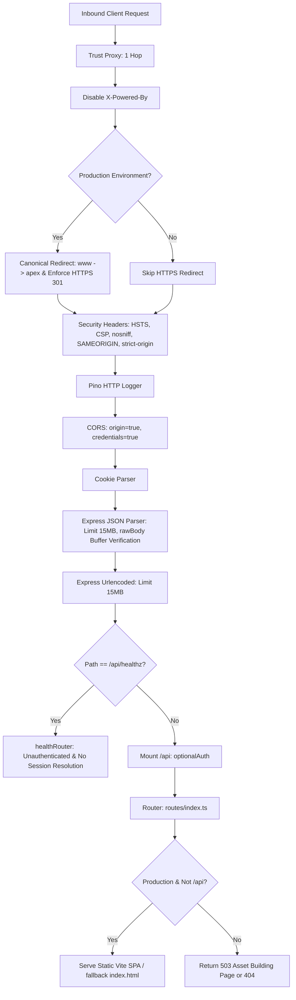

# CWP DETAILERS — COMPLETE ENGINEERING AUDIT
## PHASE 4: BACKEND API, BUSINESS LOGIC & CONTRACT FORENSICS

**Audit Mode:** STRICT READ-ONLY  
**Repository:** `tusharsaraswat1988/Cwpdetailers`  
**Baseline Commit:** `6377bbe16568aac15495bbbad205bb55db66878c` (Verified `origin/main` HEAD)  
**Audit Execution Timestamp:** November 25, 2026  
**Auditor:** Antigravity Autonomous Engineering & Forensic Intelligence  
**Status:** COMPLETED — STOPPED AT GATE (ZERO SOURCE MUTATIONS, ZERO COMMITS, ZERO PRODUCTION TRAFFIC)  

---

## 1. Executive Summary

Phase 4 of the CWP Detailers Complete Engineering Audit delivers an exhaustive, code-backed forensic investigation into the entire backend API surface, middleware execution chains, role-based access control (RBAC), multi-tenant isolation, request validation, business logic engines, database transaction atomicity, external third-party integrations, background scheduled workers, and frontend-backend contract parity.

Operating under **STRICT READ-ONLY** governance, this investigation examined all Express application setup files, route registry aggregators, 67 modular route controllers, supporting service and repository layers, database schemas, and static test suites without executing a single write operation, DDL/DML mutation, Git commit, or live third-party network call.

### Key Baseline Reconciliations

Previous audit phases (Phase 0 through Phase 3) established an estimated baseline of 67 API route modules, approximately 778 HTTP handlers, 191 database tables, 10 system roles, and 24 RBAC resources. This forensic audit confirms and rigorously reconciles those figures down to exact code references:

- **API Route Modules:** Exactly **67 route controller files** in `artifacts/api-server/src/routes/*.ts` (plus the aggregator `index.ts`, totaling 68 TypeScript files in the directory).
- **Total HTTP Route Handlers:** Exactly **778 HTTP handlers** registered across the application:
  - **752 handlers** registered via conventional `router.(get|post|put|patch|delete)` calls across 65 controller modules.
  - **14 handlers** registered via `automationRouter.(get|post|put|delete)` in `artifacts/api-server/src/routes/automation.ts`.
  - **12 handlers** registered via `loyaltyRouter.(get|post|put)` in `artifacts/api-server/src/routes/loyalty.ts`.
  - *Reconciliation Check:* `752 + 14 + 12 = 778`. The previous Phase 2 report's figure of 778 is verified to the single integer.
- **HTTP Method Distribution:**
  - `GET`: **360 endpoints** (46.28%)
  - `POST`: **297 endpoints** (38.17%)
  - `PATCH`: **62 endpoints** (7.97%)
  - `DELETE`: **40 endpoints** (5.14%)
  - `PUT`: **19 endpoints** (2.44%)
- **Database Schemas:** Exactly **191 PostgreSQL tables** defined via `pgTable()` across 74 schema modules in `lib/db/src/schema/` (100% verified, zero undocumented tables).
- **System Roles:** Exactly **10 system roles** supported in auth middleware and RBAC seeds: `customer`, `staff`, `supervisor`, `branch_manager`, `manager`, `city_admin`, `franchisee`, `admin`, `central_admin`, `superadmin`.
- **RBAC Resource Domains:** Exactly **24 resource domains** defined in `scripts/src/seed-permissions.ts`.
- **OpenAPI Contract Drift:** `lib/api-spec/openapi.yaml` specifies only **60 unique paths and 80 operations**, documenting a mere **10.28%** of the active backend API surface (698 endpoints are completely absent from OpenAPI definitions).
- **Frontend API Integration:** Analysis of `artifacts/cwp-platform/src` identified **420 active `/api/` calls** across **284 unique endpoints**, of which **254 match live backend routes** and **30 calls hit non-existent, broken, or mismatched paths**.

### Executive Highlights of Critical Forensic Findings

| Finding ID | Severity | Domain | Title | Core Forensic Impact |
|---|---|---|---|---|
| **P0-API-01** | **P0 — Critical** | Authorization & Security | `guardResource` Path Prefix Mismatch on 14 Route Modules | 14 route modules (~102 endpoints) bypass RBAC guards because route paths do not match the resource name prefix. Unauthenticated callers can read, create, update, and delete all customer address records. |
| **P0-API-02** | **P0 — Critical** | Access Control & Ops | Public Unguarded Operational Calendar & Closure APIs | `operationalCalendarRouter` is mounted without guards; `PUT /admin/calendar/hours` and `POST /admin/calendar/closures` have zero auth, allowing any anonymous user to shut down company operations. |
| **P0-API-03** | **P0 — Critical** | Concurrency & Data Integrity | Concurrency Race Condition & Zero Idempotency in `POST /bookings` | Booking creation has no database transaction, no row locking, and no unique constraints on slot time windows, allowing simultaneous double-bookings and duplicate loyalty debits. |
| **P1-API-04** | **P1 — High** | Financial & Security | Hardcoded Test-Fixture Injection in Production Cashfree Service | `cashfreeService.ts:627` intercepts orders containing `rec_idem` and executes test-fixture customer updates against live database tables in production. |
| **P1-API-05** | **P1 — High** | Business Logic & Staff | Complete Absence of Staff Attendance Punch-Out API | `POST /staff/:id/attendance` returns existing check-in row idempotently without updating; no `PATCH`/`PUT` endpoint exists, making shift check-out impossible via API. |
| **P1-API-06** | **P1 — High** | RBAC Inconsistency | Hardcoded Role Exclusion in Commercial Billing Engine | `commercialValidation.ts:27` hardcodes allowed roles to `admin`, `superadmin`, `manager`, `franchisee`, permanently locking out authorized `city_admin` and `branch_manager` users. |
| **P1-API-07** | **P1 — High** | API Routing & Defects | Double `/api/api/` Prefix Registration in Loyalty Router | `loyalty.ts:385` registers route as `/api/loyalty/admin/ledger/adjust`, which resolves to `/api/api/loyalty/admin/ledger/adjust`, breaking all frontend ledger adjustments with 404. |
| **P1-API-08** | **P1 — High** | Concurrency & Entitlements | In-Memory Non-Atomic Entitlement Decrements in DCMS Visits | Visit completion fetches subscriptions into memory, executes a 1–3s Cloudinary upload outside transactions, and writes absolute values back, overwriting concurrent visits and adjustments. |
| **P2-API-09** | **P2 — Medium** | Reliability & DoS | Unbounded In-Memory Rate Limiter in Multi-Instance Deployments | `dcmsRateLimit.ts` uses an in-memory `Map` without TTL eviction or Redis backing, causing memory growth and cluster rate limit bypass. |
| **P2-API-10** | **P2 — Medium** | Distributed Systems | Background Schedulers Lack Distributed Locking | `runDailyTick` checks `status = 'success'` without locking or checking `status = 'running'`, causing duplicate executions and duplicate renewal reminders on multi-instance boots. |
| **P2-API-11** | **P2 — Medium** | Architecture & Contracts | 89.7% OpenAPI Specification Drift & Stale Type Generation | `openapi.yaml` covers only 80 of 778 endpoints; frontend components bypass generated clients with direct `fetch()` calls. |

---

## 2. Repository State Verification

Before beginning forensic analysis, the repository working tree was inspected to verify baseline commit integrity, branch alignment, and the absolute preservation of pending Hotfix A+B remediation files:

```bash
$ git status
On branch main
Your branch is up to date with 'origin/main'.

Changes not staged for commit:
  modified:   artifacts/api-server/src/routes/location-pricing.ts
  modified:   artifacts/api-server/src/routes/payment-gateway.ts
  modified:   artifacts/api-server/src/routes/societies.ts
  modified:   artifacts/api-server/src/routes/zones.ts
  modified:   docs/product/CWP_NOIDA_MULTI_CITY_PRD.md
  modified:   scripts/src/inspect-prod-db.ts
  modified:   scripts/src/reset-production-db.ts

Untracked files:
  artifacts/api-server/src/__tests__/security/hotfix-a-b-remediation.test.ts
  artifacts/api-server/src/__tests__/security/purge-script-safety.test.ts
  docs/audits/CWP_COMPLETE_ENGINEERING_AUDIT_HOTFIX_A_B_FINAL_CLOSURE.md
  docs/audits/CWP_COMPLETE_ENGINEERING_AUDIT_HOTFIX_A_B_IMPLEMENTATION.md
  docs/audits/CWP_COMPLETE_ENGINEERING_AUDIT_HOTFIX_A_B_INDEPENDENT_VERIFICATION.md
  docs/audits/CWP_COMPLETE_ENGINEERING_AUDIT_PHASE_0.md
  docs/audits/CWP_COMPLETE_ENGINEERING_AUDIT_PHASE_1_1_CONTAINMENT_READINESS.md
  docs/audits/CWP_COMPLETE_ENGINEERING_AUDIT_PHASE_1_SECURITY.md
  docs/audits/CWP_COMPLETE_ENGINEERING_AUDIT_PHASE_2_APPLICATION_INVENTORY.md
  docs/audits/CWP_COMPLETE_ENGINEERING_AUDIT_PHASE_3_DATABASE_FORENSICS.md

HEAD commit: 6377bbe16568aac15495bbbad205bb55db66878c
```

**Forensic Verification Confirmation:**
1. The repository HEAD SHA exactly matches the required baseline commit `6377bbe16568aac15495bbbad205bb55db66878c`.
2. All 7 modified files and 10 untracked audit/test artifacts from Hotfix A+B and Phases 0–3 remain 100% intact and uncommitted.
3. Strict read-only execution was maintained throughout the investigation: no source files were altered, no database seeds or migrations were run, and no external requests were dispatched.

---

## 3. API Architecture & Entrypoint Forensics

The CWP Detailers backend is structured as an Express 4 application implemented in TypeScript within `artifacts/api-server`. The runtime execution architecture proceeds through two primary entrypoints:

1. **Process Bootstrap (`artifacts/api-server/src/index.ts`):**
   - Listens on `0.0.0.0:${PORT}` (default 8080).
   - Catches transient PostgreSQL disconnects (`Connection terminated`, `ECONNRESET`) in `uncaughtException` and `unhandledRejection` without crashing.
   - Executes startup checks: `validateStartupEnvironment()`, `ensureStartupMigrations()`, `bootstrapMasterDataIfEmpty()`, `bootstrapAdminFromEnv()`.
   - Spawns background asynchronous services and in-process cron timers:
     - `bootstrapSubscriptionTick()` (Subscription daily maintenance tick at 18:30 UTC / midnight IST)
     - `bootstrapDcmsScheduler()` (End-of-day missed visit scheduler and pause auto-resume at 18:29 UTC / 23:59 IST)
     - `bootstrapMorningRouteNotify()` (Staff daily route notification at 00:30 UTC / 6:00 AM IST)
     - `bootstrapPushEventProcessor()` (Web push notification worker)
     - `bootstrapJobOrchestration()` (Commercial job workflow runner)
     - `startGpsRetentionScheduler()` (GPS purge and retention worker)
     - `bootstrapSchedulerWorker()` (General background scheduler worker)

2. **Express Server Lifecycle & Global Middleware Pipeline (`artifacts/api-server/src/app.ts`):**



### Pipeline Forensic Analysis

- **Reverse Proxy & Trust Headers:** `app.set('trust proxy', 1)` allows edge proxies (Railway, Render, Cloudflare, ALB) to pass client IPs and protocol termination info. `x-forwarded-proto` is accurately evaluated.
- **Buffer Preservation for Webhook HMAC:** `express.json({ limit: '15mb', verify: (req, _res, buf) => { (req as any).rawBody = buf; } })` captures the untouched raw buffer, essential for cryptographic HMAC-SHA256 signature verification in Razorpay and Cashfree webhooks.
- **Payload Size Limit:** Configured to `15mb` to allow staff mobile camera base64 uploads without premature HTTP 413 rejection; payload-too-large errors return explicit JSON `{ error: 'Photo upload too large...', code: 'PAYLOAD_TOO_LARGE' }`.
- **Route Mounting Boundary:** Notice lines 130–131 of `app.ts`:
  ```typescript
  app.use('/api', healthRouter);
  app.use('/api', optionalAuth, router);
  ```
  Liveness checks bypass session resolution entirely, while ALL subsequent routes under `/api` execute `optionalAuth` before hitting router controllers.

---

## 4. Master API Route Registry

The application organizes all API endpoints across **67 controller modules** aggregated in `artifacts/api-server/src/routes/index.ts`. Below is the complete forensic registry of all 67 route modules:

| Module Name | Source File | Router Symbol | Handlers | Mounting Statement in `routes/index.ts` | Guard Applied at Mount |
|---|---|---|---|---|---|
| `addresses.ts` | `artifacts/api-server/src/routes/addresses.ts` | `router` | 15 | `router.use(..., addressesRouter)` | `guardResource(customers)` |
| `admin-approvals.ts` | `artifacts/api-server/src/routes/admin-approvals.ts` | `router` | 5 | `router.use(..., admin-approvalsRouter)` | `None` |
| `admin-ledger.ts` | `artifacts/api-server/src/routes/admin-ledger.ts` | `router` | 11 | `router.use(..., admin-ledgerRouter)` | `guardResource(invoices)` |
| `analytics.ts` | `artifacts/api-server/src/routes/analytics.ts` | `router` | 6 | `router.use(..., analyticsRouter)` | `guardResource(invoices)` |
| `assets.ts` | `artifacts/api-server/src/routes/assets.ts` | `router` | 8 | `router.use(..., assetsRouter)` | `guardResource(customers)` |
| `assignments.ts` | `artifacts/api-server/src/routes/assignments.ts` | `router` | 8 | `router.use(..., assignmentsRouter)` | `None` |
| `auth.ts` | `artifacts/api-server/src/routes/auth.ts` | `router` | 15 | `router.use(..., authRouter)` | `None` |
| `automation.ts` | `artifacts/api-server/src/routes/automation.ts` | `automationRouter` | 14 | `router.use(..., automationRouter)` | `None` |
| `billing.ts` | `artifacts/api-server/src/routes/billing.ts` | `router` | 2 | `router.use(..., billingRouter)` | `guardResource(invoices)` |
| `booking-platform.ts` | `artifacts/api-server/src/routes/booking-platform.ts` | `router` | 7 | `router.use(..., booking-platformRouter)` | `guardResource(bookings)` |
| `bookings.ts` | `artifacts/api-server/src/routes/bookings.ts` | `router` | 17 | `router.use(..., bookingsRouter)` | `None` |
| `branches.ts` | `artifacts/api-server/src/routes/branches.ts` | `router` | 16 | `router.use(..., branchesRouter)` | `guardResource(invoices)` |
| `branding.ts` | `artifacts/api-server/src/routes/branding.ts` | `router` | 10 | `router.use(..., brandingRouter)` | `None` |
| `cashfree.ts` | `artifacts/api-server/src/routes/cashfree.ts` | `router` | 4 | `router.use(..., cashfreeRouter)` | `None` |
| `churned.ts` | `artifacts/api-server/src/routes/churned.ts` | `router` | 3 | `router.use(..., churnedRouter)` | `guardResource(churned)` |
| `cities.ts` | `artifacts/api-server/src/routes/cities.ts` | `router` | 10 | `router.use(..., citiesRouter)` | `None` |
| `commercial-billing.ts` | `artifacts/api-server/src/routes/commercial-billing.ts` | `router` | 11 | `router.use(..., commercial-billingRouter)` | `None` |
| `communications-phase2.ts` | `artifacts/api-server/src/routes/communications-phase2.ts` | `router` | 22 | `router.use(..., communications-phase2Router)` | `None` |
| `communications-phase3.ts` | `artifacts/api-server/src/routes/communications-phase3.ts` | `router` | 24 | `router.use(..., communications-phase3Router)` | `None` |
| `communications-webhooks.ts` | `artifacts/api-server/src/routes/communications-webhooks.ts` | `router` | 5 | `router.use(..., communications-webhooksRouter)` | `None` |
| `communications.ts` | `artifacts/api-server/src/routes/communications.ts` | `router` | 46 | `router.use(..., communicationsRouter)` | `None` |
| `complaints.ts` | `artifacts/api-server/src/routes/complaints.ts` | `router` | 3 | `router.use(..., complaintsRouter)` | `guardResource(complaints)` |
| `config.ts` | `artifacts/api-server/src/routes/config.ts` | `router` | 4 | `router.use(..., configRouter)` | `None` |
| `contact.ts` | `artifacts/api-server/src/routes/contact.ts` | `router` | 1 | `router.use(..., contactRouter)` | `None` |
| `coverage.ts` | `artifacts/api-server/src/routes/coverage.ts` | `router` | 2 | `router.use(..., coverageRouter)` | `None` |
| `customers.ts` | `artifacts/api-server/src/routes/customers.ts` | `router` | 18 | `router.use(..., customersRouter)` | `guardResource(customers)` |
| `dcms.ts` | `artifacts/api-server/src/routes/dcms.ts` | `router` | 66 | `router.use(..., dcmsRouter)` | `None` |
| `expenses.ts` | `artifacts/api-server/src/routes/expenses.ts` | `router` | 4 | `router.use(..., expensesRouter)` | `guardResource(invoices)` |
| `extra-service.ts` | `artifacts/api-server/src/routes/extra-service.ts` | `router` | 7 | `router.use(..., extra-serviceRouter)` | `None` |
| `franchisees.ts` | `artifacts/api-server/src/routes/franchisees.ts` | `router` | 8 | `router.use(..., franchiseesRouter)` | `guardResource(franchisees)` |
| `health.ts` | `artifacts/api-server/src/routes/health.ts` | `router` | 1 | `router.use(..., healthRouter)` | `None` |
| `jobs.ts` | `artifacts/api-server/src/routes/jobs.ts` | `router` | 11 | `router.use(..., jobsRouter)` | `None` |
| `leads.ts` | `artifacts/api-server/src/routes/leads.ts` | `router` | 9 | `router.use(..., leadsRouter)` | `None` |
| `legal-entities.ts` | `artifacts/api-server/src/routes/legal-entities.ts` | `router` | 6 | `router.use(..., legal-entitiesRouter)` | `None` |
| `legal.ts` | `artifacts/api-server/src/routes/legal.ts` | `router` | 21 | `router.use(..., legalRouter)` | `None` |
| `location-pricing.ts` | `artifacts/api-server/src/routes/location-pricing.ts` | `router` | 6 | `router.use(..., location-pricingRouter)` | `None` |
| `location-resolution.ts` | `artifacts/api-server/src/routes/location-resolution.ts` | `router` | 5 | `router.use(..., location-resolutionRouter)` | `None` |
| `loyalty.ts` | `artifacts/api-server/src/routes/loyalty.ts` | `loyaltyRouter` | 12 | `router.use(..., loyaltyRouter)` | `None` |
| `marketing.ts` | `artifacts/api-server/src/routes/marketing.ts` | `router` | 23 | `router.use(..., marketingRouter)` | `None` |
| `master-data.ts` | `artifacts/api-server/src/routes/master-data.ts` | `router` | 58 | `router.use(..., master-dataRouter)` | `guardMasterDataRoutes` |
| `migration.ts` | `artifacts/api-server/src/routes/migration.ts` | `router` | 3 | `router.use(..., migrationRouter)` | `guardResource(customers)` |
| `notifications.ts` | `artifacts/api-server/src/routes/notifications.ts` | `router` | 6 | `router.use(..., notificationsRouter)` | `guardResource(notifications)` |
| `operational-calendar.ts` | `artifacts/api-server/src/routes/operational-calendar.ts` | `router` | 7 | `router.use(..., operational-calendarRouter)` | `None` |
| `operations.ts` | `artifacts/api-server/src/routes/operations.ts` | `router` | 7 | `router.use(..., operationsRouter)` | `guardResource(invoices)` |
| `payment-gateway.ts` | `artifacts/api-server/src/routes/payment-gateway.ts` | `router` | 9 | `router.use(..., payment-gatewayRouter)` | `None` |
| `payments.ts` | `artifacts/api-server/src/routes/payments.ts` | `router` | 12 | `router.use(..., paymentsRouter)` | `guardResource(invoices)` |
| `promotions.ts` | `artifacts/api-server/src/routes/promotions.ts` | `router` | 6 | `router.use(..., promotionsRouter)` | `None` |
| `push.ts` | `artifacts/api-server/src/routes/push.ts` | `router` | 6 | `router.use(..., pushRouter)` | `None` |
| `quality.ts` | `artifacts/api-server/src/routes/quality.ts` | `router` | 9 | `router.use(..., qualityRouter)` | `None` |
| `quotations.ts` | `artifacts/api-server/src/routes/quotations.ts` | `router` | 5 | `router.use(..., quotationsRouter)` | `guardResource(invoices)` |
| `service-catalog.ts` | `artifacts/api-server/src/routes/service-catalog.ts` | `router` | 44 | `router.use(..., service-catalogRouter)` | `guardCatalogRoutes` |
| `service-contracts.ts` | `artifacts/api-server/src/routes/service-contracts.ts` | `router` | 7 | `router.use(..., service-contractsRouter)` | `None` |
| `service-executions.ts` | `artifacts/api-server/src/routes/service-executions.ts` | `router` | 17 | `router.use(..., service-executionsRouter)` | `None` |
| `service-locations.ts` | `artifacts/api-server/src/routes/service-locations.ts` | `router` | 7 | `router.use(..., service-locationsRouter)` | `guardResource(customers)` |
| `services.ts` | `artifacts/api-server/src/routes/services.ts` | `router` | 8 | `router.use(..., servicesRouter)` | `guardResource(customers)` |
| `societies.ts` | `artifacts/api-server/src/routes/societies.ts` | `router` | 6 | `router.use(..., societiesRouter)` | `None` |
| `solar-sites.ts` | `artifacts/api-server/src/routes/solar-sites.ts` | `router` | 4 | `router.use(..., solar-sitesRouter)` | `guardResource(customers)` |
| `staff-ecosystem.ts` | `artifacts/api-server/src/routes/staff-ecosystem.ts` | `router` | 21 | `router.use(..., staff-ecosystemRouter)` | `None` |
| `staff-walk-in.ts` | `artifacts/api-server/src/routes/staff-walk-in.ts` | `router` | 5 | `router.use(..., staff-walk-inRouter)` | `guardWalkInRoutes` |
| `staff.ts` | `artifacts/api-server/src/routes/staff.ts` | `router` | 21 | `router.use(..., staffRouter)` | `None` |
| `storage.ts` | `artifacts/api-server/src/routes/storage.ts` | `router` | 3 | `router.use(..., storageRouter)` | `None` |
| `subscriptions.ts` | `artifacts/api-server/src/routes/subscriptions.ts` | `router` | 10 | `router.use(..., subscriptionsRouter)` | `None` |
| `support.ts` | `artifacts/api-server/src/routes/support.ts` | `router` | 6 | `router.use(..., supportRouter)` | `None` |
| `ux-experiments.ts` | `artifacts/api-server/src/routes/ux-experiments.ts` | `router` | 7 | `router.use(..., ux-experimentsRouter)` | `None` |
| `vehicles.ts` | `artifacts/api-server/src/routes/vehicles.ts` | `router` | 6 | `router.use(..., vehiclesRouter)` | `guardResource(customers)` |
| `wallet.ts` | `artifacts/api-server/src/routes/wallet.ts` | `router` | 4 | `router.use(..., walletRouter)` | `None` |
| `zones.ts` | `artifacts/api-server/src/routes/zones.ts` | `router` | 8 | `router.use(..., zonesRouter)` | `None` |

---

## 5. Master Endpoint Inventory by Domain

To ensure structured forensics, the 778 endpoints are partitioned into **10 logical operational domains** rather than a single monolithic table. Each domain details endpoint paths, HTTP methods, source lines, authentication requirements, permissions, tenant restrictions, and database interactions.

### 5.1 Domain 1: Authentication, Session & Contact Verification

| Endpoint ID | Method | Path | Source Reference | Auth Guard | Permission | Tenant Scope | Request Validation | Status |
|---|---|---|---|---|---|---|---|---|
| `EP-001` | `GET` | `/auth/google/config` | `auth.ts:134` | `None` | `None` | Global / None | Manual / Route | Active |
| `EP-002` | `POST` | `/auth/google` | `auth.ts:142` | `None` | `None` | Global / None | Manual / Route | Active |
| `EP-003` | `POST` | `/auth/google/complete` | `auth.ts:325` | `None` | `None` | Global / None | Manual / Route | Active |
| `EP-004` | `POST` | `/auth/forgot-password` | `auth.ts:469` | `None` | `None` | Global / None | Manual / Route | Active |
| `EP-005` | `POST` | `/auth/reset-password` | `auth.ts:529` | `None` | `None` | Global / None | Manual / Route | Active |
| `EP-006` | `POST` | `/auth/set-password` | `auth.ts:580` | `None` | `None` | Global / None | Manual / Route | Active |
| `EP-007` | `POST` | `/auth/login` | `auth.ts:633` | `None` | `None` | Global / None | Manual / Route | Active |
| `EP-008` | `GET` | `/auth/otp/config` | `auth.ts:717` | `None` | `None` | Global / None | Manual / Route | Active |
| `EP-009` | `POST` | `/auth/otp/send` | `auth.ts:724` | `None` | `None` | Global / None | Manual / Route | Active |
| `EP-010` | `POST` | `/auth/otp/verify` | `auth.ts:777` | `None` | `None` | Global / None | Manual / Route | Active |
| `EP-011` | `POST` | `/auth/register` | `auth.ts:914` | `None` | `None` | Global / None | Manual / Route | Active |
| `EP-012` | `GET` | `/auth/me` | `auth.ts:995` | `None` | `None` | Global / None | Manual / Route | Active |
| `EP-013` | `GET` | `/auth/permissions` | `auth.ts:1026` | `None` | `None` | Customer/Staff Scoped | Manual / Route | Active |
| `EP-014` | `POST` | `/auth/logout` | `auth.ts:1039` | `None` | `None` | Global / None | Manual / Route | Active |
| `EP-015` | `GET` | `/auth/metrics` | `auth.ts:1086` | `None` | `None` | Global / None | Manual / Route | Active |
| `EP-016` | `GET` | `/contact/verify` | `contact.ts:7` | `None` | `None` | Global / None | Manual / Route | Active |

### 5.2 Domain 2: Customers, Addresses, Assets, Vehicles & Solar Sites

| Endpoint ID | Method | Path | Source Reference | Auth Guard | Permission | Tenant Scope | Request Validation | Status |
|---|---|---|---|---|---|---|---|---|
| `EP-017` | `POST` | `/addresses` | `addresses.ts:74` | `guardResource(customers)` | `Inherited` | Global / None | Manual / Route | Active |
| `EP-018` | `GET` | `/addresses` | `addresses.ts:95` | `guardResource(customers)` | `Inherited` | Global / None | Manual / Route | Active |
| `EP-019` | `GET` | `/addresses/:id` | `addresses.ts:113` | `guardResource(customers)` | `Inherited` | Global / None | Manual / Route | Active |
| `EP-020` | `PATCH` | `/addresses/:id` | `addresses.ts:126` | `guardResource(customers)` | `Inherited` | Global / None | Manual / Route | Active |
| `EP-021` | `DELETE` | `/addresses/:id` | `addresses.ts:148` | `guardResource(customers)` | `Inherited` | Global / None | Manual / Route | Active |
| `EP-022` | `POST` | `/addresses/:id/restore` | `addresses.ts:162` | `guardResource(customers)` | `Inherited` | Global / None | Manual / Route | Active |
| `EP-023` | `POST` | `/addresses/:id/default` | `addresses.ts:176` | `guardResource(customers)` | `Inherited` | Global / None | Manual / Route | Active |
| `EP-024` | `POST` | `/addresses/validate` | `addresses.ts:190` | `guardResource(customers)` | `Inherited` | Global / None | Manual / Route | Active |
| `EP-025` | `POST` | `/addresses/normalize` | `addresses.ts:202` | `guardResource(customers)` | `Inherited` | Global / None | Manual / Route | Active |
| `EP-026` | `POST` | `/addresses/preview-parse` | `addresses.ts:214` | `guardResource(customers)` | `Inherited` | Global / None | Manual / Route | Active |
| `EP-027` | `POST` | `/addresses/check-duplicates` | `addresses.ts:226` | `guardResource(customers)` | `Inherited` | Global / None | Manual / Route | Active |
| `EP-028` | `POST` | `/addresses/merge-duplicates` | `addresses.ts:239` | `guardResource(customers)` | `Inherited` | Global / None | Manual / Route | Active |
| `EP-029` | `GET` | `/addresses/:id/history` | `addresses.ts:258` | `guardResource(customers)` | `Inherited` | Global / None | Manual / Route | Active |
| `EP-030` | `POST` | `/addresses/:id/snapshot` | `addresses.ts:272` | `guardResource(customers)` | `Inherited` | Global / None | Manual / Route | Active |
| `EP-031` | `POST` | `/addresses/migrate-legacy` | `addresses.ts:286` | `guardResource(customers)` | `Inherited` | Customer/Staff Scoped | Manual / Route | Active |
| `EP-032` | `GET` | `/assets` | `assets.ts:30` | `guardResource(customers)` | `Inherited` | Global / None | Manual / Route | Active |
| `EP-033` | `GET` | `/assets/:id` | `assets.ts:58` | `guardResource(customers)` | `Inherited` | Global / None | Manual / Route | Active |
| `EP-034` | `POST` | `/assets` | `assets.ts:78` | `guardResource(customers)` | `Inherited` | Global / None | Manual / Route | Active |
| `EP-035` | `PATCH` | `/assets/:id` | `assets.ts:179` | `guardResource(customers)` | `Inherited` | Global / None | Manual / Route | Active |
| `EP-036` | `GET` | `/assets/:id/location-links` | `assets.ts:276` | `guardResource(customers)` | `Inherited` | Global / None | Manual / Route | Active |
| `EP-037` | `POST` | `/assets/:id/location-links` | `assets.ts:290` | `guardResource(customers)` | `Inherited` | Global / None | Manual / Route | Active |
| `EP-038` | `GET` | `/assets/:id/customer-links` | `assets.ts:318` | `guardResource(customers)` | `Inherited` | Global / None | Manual / Route | Active |
| `EP-039` | `POST` | `/assets/:id/customer-links` | `assets.ts:332` | `guardResource(customers)` | `Inherited` | Global / None | Manual / Route | Active |
| `EP-040` | `GET` | `/customers` | `customers.ts:158` | `guardResource(customers)` | `Inherited` | Global / None | Manual / Route | Active |
| `EP-041` | `GET` | `/customers/legacy-contacts` | `customers.ts:197` | `guardResource(customers)` | `Inherited` | Global / None | Manual / Route | Active |
| `EP-042` | `GET` | `/customers/reactivated` | `customers.ts:235` | `guardResource(customers)` | `Inherited` | Global / None | Manual / Route | Active |
| `EP-043` | `POST` | `/customers` | `customers.ts:273` | `guardResource(customers)` | `Inherited` | Global / None | Manual / Route | Active |
| `EP-044` | `GET` | `/customers/me` | `customers.ts:415` | `guardResource(customers)` | `Inherited` | Global / None | Manual / Route | Active |
| `EP-045` | `PATCH` | `/customers/me` | `customers.ts:441` | `guardResource(customers)` | `Inherited` | Global / None | Manual / Route | Active |
| `EP-046` | `GET` | `/customers/me/supervisor-contact` | `customers.ts:506` | `guardResource(customers)` | `Inherited` | Global / None | Manual / Route | Active |
| `EP-047` | `GET` | `/customers/:id` | `customers.ts:519` | `guardResource(customers)` | `Inherited` | Global / None | Manual / Route | Active |
| `EP-048` | `PATCH` | `/customers/:id` | `customers.ts:543` | `guardResource(customers)` | `Inherited` | Global / None | Manual / Route | Active |
| `EP-049` | `POST` | `/customers/:id/reactivate` | `customers.ts:652` | `guardResource(customers)` | `Inherited` | Global / None | Manual / Route | Active |
| `EP-050` | `GET` | `/customers/:id/network` | `customers.ts:679` | `guardResource(customers)` | `Inherited` | Global / None | Manual / Route | Active |
| `EP-051` | `GET` | `/customers/:id/services` | `customers.ts:726` | `guardResource(customers)` | `Inherited` | Global / None | Manual / Route | Active |
| `EP-052` | `GET` | `/customers/:id/billing-summary` | `customers.ts:742` | `guardResource(customers)` | `Inherited` | Global / None | Manual / Route | Active |
| `EP-053` | `GET` | `/customers/:id/contracts` | `customers.ts:758` | `guardResource(customers)` | `Inherited` | Global / None | Manual / Route | Active |
| `EP-054` | `GET` | `/customers/:id/summary` | `customers.ts:775` | `guardResource(customers)` | `Inherited` | Global / None | Manual / Route | Active |
| `EP-055` | `GET` | `/customers/:id/360` | `customers.ts:889` | `guardResource(customers)` | `Inherited` | Global / None | Manual / Route | Active |
| `EP-056` | `GET` | `/customers/:id/bookings` | `customers.ts:1069` | `guardResource(customers)` | `Inherited` | Global / None | Manual / Route | Active |
| `EP-057` | `GET` | `/customers/:id/payments` | `customers.ts:1119` | `guardResource(customers)` | `Inherited` | Global / None | Manual / Route | Active |
| `EP-058` | `GET` | `/service-locations` | `service-locations.ts:42` | `guardResource(customers)` | `Inherited` | Global / None | Manual / Route | Active |
| `EP-059` | `GET` | `/service-locations/:id` | `service-locations.ts:195` | `guardResource(customers)` | `Inherited` | Global / None | Manual / Route | Active |
| `EP-060` | `POST` | `/service-locations` | `service-locations.ts:273` | `guardResource(customers)` | `Inherited` | Global / None | Manual / Route | Active |
| `EP-061` | `PATCH` | `/service-locations/:id` | `service-locations.ts:376` | `guardResource(customers)` | `Inherited` | Global / None | Manual / Route | Active |
| `EP-062` | `GET` | `/service-locations/:id/customer-links` | `service-locations.ts:431` | `guardResource(customers)` | `Inherited` | Global / None | Manual / Route | Active |
| `EP-063` | `POST` | `/service-locations/:id/customer-links` | `service-locations.ts:504` | `guardResource(customers)` | `Inherited` | Global / None | Manual / Route | Active |
| `EP-064` | `DELETE` | `/service-locations/:id/customer-links` | `service-locations.ts:592` | `guardResource(customers)` | `Inherited` | Global / None | Manual / Route | Active |
| `EP-065` | `GET` | `/solar-sites` | `solar-sites.ts:32` | `guardResource(customers)` | `Inherited` | Yes (tenantFilters/Stamp) | Manual / Route | Active |
| `EP-066` | `POST` | `/solar-sites` | `solar-sites.ts:51` | `guardResource(customers)` | `Inherited` | Global / None | Manual / Route | Active |
| `EP-067` | `PATCH` | `/solar-sites/:id` | `solar-sites.ts:116` | `guardResource(customers)` | `Inherited` | Global / None | Manual / Route | Active |
| `EP-068` | `DELETE` | `/solar-sites/:id` | `solar-sites.ts:141` | `guardResource(customers)` | `Inherited` | Global / None | Manual / Route | Active |
| `EP-069` | `GET` | `/vehicles` | `vehicles.ts:36` | `guardResource(customers)` | `Inherited` | Yes (tenantFilters/Stamp) | Manual / Route | Active |
| `EP-070` | `POST` | `/vehicles` | `vehicles.ts:54` | `guardResource(customers)` | `Inherited` | Global / None | Manual / Route | Active |
| `EP-071` | `PATCH` | `/vehicles/:id` | `vehicles.ts:146` | `guardResource(customers)` | `Inherited` | Global / None | Manual / Route | Active |
| `EP-072` | `DELETE` | `/vehicles/:id` | `vehicles.ts:256` | `guardResource(customers)` | `Inherited` | Global / None | Manual / Route | Active |
| `EP-073` | `GET` | `/vehicles/:id/reference-photos` | `vehicles.ts:271` | `guardResource(customers)` | `Inherited` | Global / None | Manual / Route | Active |
| `EP-074` | `PATCH` | `/vehicles/:id/reference-photos` | `vehicles.ts:287` | `guardResource(customers)` | `Inherited` | Global / None | Manual / Route | Active |

### 5.3 Domain 3: Booking Platform, Scheduling & Job Orchestration

| Endpoint ID | Method | Path | Source Reference | Auth Guard | Permission | Tenant Scope | Request Validation | Status |
|---|---|---|---|---|---|---|---|---|
| `EP-075` | `GET` | `/admin/makeup-approvals` | `admin-approvals.ts:21` | `None` | `None` | Global / None | Manual / Route | Active |
| `EP-076` | `POST` | `/admin/makeup-approvals/:id/approve` | `admin-approvals.ts:43` | `None` | `None` | Global / None | Manual / Route | Active |
| `EP-077` | `POST` | `/admin/makeup-approvals/:id/reject` | `admin-approvals.ts:62` | `None` | `None` | Global / None | Manual / Route | Active |
| `EP-078` | `GET` | `/admin/tracking/retention-status` | `admin-approvals.ts:87` | `None` | `None` | Global / None | Manual / Route | Active |
| `EP-079` | `POST` | `/admin/tracking/run-purge` | `admin-approvals.ts:98` | `None` | `None` | Global / None | Manual / Route | Active |
| `EP-080` | `GET` | `/assignments/pending` | `assignments.ts:38` | `None` | `None` | Global / None | Manual / Route | Active |
| `EP-081` | `GET` | `/assignments/assigned` | `assignments.ts:53` | `None` | `None` | Global / None | Manual / Route | Active |
| `EP-082` | `GET` | `/assignments/:id/timeline` | `assignments.ts:68` | `None` | `None` | Global / None | Manual / Route | Active |
| `EP-083` | `GET` | `/assignments/:id` | `assignments.ts:95` | `None` | `None` | Global / None | Manual / Route | Active |
| `EP-084` | `POST` | `/assignments/:pendingId/assign` | `assignments.ts:110` | `None` | `None` | Global / None | Manual / Route | Active |
| `EP-085` | `POST` | `/assignments/:id/reassign` | `assignments.ts:156` | `None` | `None` | Global / None | Manual / Route | Active |
| `EP-086` | `POST` | `/assignments/:id/remove` | `assignments.ts:177` | `None` | `None` | Global / None | Manual / Route | Active |
| `EP-087` | `POST` | `/assignments/substitute` | `assignments.ts:194` | `None` | `None` | Global / None | Manual / Route | Active |
| `EP-088` | `GET` | `/booking-platform/address-selection/:customerId` | `booking-platform.ts:18` | `guardResource(bookings)` | `Inherited` | Global / None | Manual / Route | Active |
| `EP-089` | `POST` | `/booking-platform/address-selection/validate` | `booking-platform.ts:33` | `guardResource(bookings)` | `Inherited` | Global / None | Manual / Route | Active |
| `EP-090` | `POST` | `/booking-platform/services/discover` | `booking-platform.ts:59` | `guardResource(bookings)` | `Inherited` | Global / None | Manual / Route | Active |
| `EP-091` | `GET` | `/booking-platform/bookings/:id/context` | `booking-platform.ts:76` | `guardResource(bookings)` | `Inherited` | Global / None | Manual / Route | Active |
| `EP-092` | `GET` | `/booking-platform/bookings/:id/timeline` | `booking-platform.ts:94` | `guardResource(bookings)` | `Inherited` | Global / None | Manual / Route | Active |
| `EP-093` | `GET` | `/booking-platform/bookings/:id/snapshots` | `booking-platform.ts:106` | `guardResource(bookings)` | `Inherited` | Global / None | Manual / Route | Active |
| `EP-094` | `POST` | `/booking-platform/bookings/search` | `booking-platform.ts:118` | `guardResource(bookings)` | `Inherited` | Global / None | Manual / Route | Active |
| `EP-095` | `GET` | `/bookings/calendar-days` | `bookings.ts:213` | `None` | `None` | Global / None | Manual / Route | Active |
| `EP-096` | `GET` | `/bookings/slots` | `bookings.ts:273` | `None` | `None` | Global / None | Manual / Route | Active |
| `EP-097` | `GET` | `/bookings/today` | `bookings.ts:296` | `None` | `None` | Global / None | Manual / Route | Active |
| `EP-098` | `GET` | `/bookings` | `bookings.ts:324` | `None` | `None` | Global / None | Manual / Route | Active |
| `EP-099` | `POST` | `/bookings` | `bookings.ts:394` | `None` | `None` | Global / None | Manual / Route | Active |
| `EP-100` | `GET` | `/bookings/:id/timeline` | `bookings.ts:691` | `None` | `None` | Global / None | Manual / Route | Active |
| `EP-101` | `GET` | `/bookings/:id/events` | `bookings.ts:704` | `None` | `None` | Global / None | Manual / Route | Active |
| `EP-102` | `GET` | `/bookings/:id` | `bookings.ts:719` | `None` | `None` | Global / None | Manual / Route | Active |
| `EP-103` | `PATCH` | `/bookings/:id` | `bookings.ts:732` | `None` | `None` | Global / None | Manual / Route | Active |
| `EP-104` | `POST` | `/bookings/:id/confirm` | `bookings.ts:790` | `None` | `None` | Global / None | Manual / Route | Active |
| `EP-105` | `POST` | `/bookings/:id/transition` | `bookings.ts:843` | `None` | `None` | Global / None | Manual / Route | Active |
| `EP-106` | `POST` | `/bookings/:id/reschedule` | `bookings.ts:919` | `None` | `None` | Global / None | Manual / Route | Active |
| `EP-107` | `POST` | `/bookings/:id/cancel` | `bookings.ts:985` | `None` | `None` | Global / None | Manual / Route | Active |
| `EP-108` | `GET` | `/bookings/:id/makeup-eligibility` | `bookings.ts:1066` | `None` | `None` | Global / None | Manual / Route | Active |
| `EP-109` | `POST` | `/bookings/:id/reschedule-missed` | `bookings.ts:1079` | `None` | `None` | Global / None | Manual / Route | Active |
| `EP-110` | `POST` | `/bookings/:id/en-route` | `bookings.ts:1103` | `None` | `None` | Global / None | Manual / Route | Active |
| `EP-111` | `GET` | `/bookings/:id/tracking` | `bookings.ts:1121` | `None` | `None` | Global / None | Manual / Route | Active |
| `EP-112` | `GET` | `/jobs` | `jobs.ts:34` | `None` | `None` | Global / None | Manual / Route | Active |
| `EP-113` | `GET` | `/jobs/:id/timeline` | `jobs.ts:61` | `None` | `None` | Global / None | Manual / Route | Active |
| `EP-114` | `GET` | `/jobs/:id` | `jobs.ts:74` | `None` | `None` | Global / None | Manual / Route | Active |
| `EP-115` | `POST` | `/jobs/:id/reopen` | `jobs.ts:87` | `None` | `None` | Global / None | Manual / Route | Active |
| `EP-116` | `POST` | `/jobs/:id/escalate` | `jobs.ts:101` | `None` | `None` | Global / None | Manual / Route | Active |
| `EP-117` | `POST` | `/jobs/:id/priority` | `jobs.ts:115` | `None` | `None` | Global / None | Manual / Route | Active |
| `EP-118` | `POST` | `/jobs/:id/approve` | `jobs.ts:129` | `None` | `None` | Global / None | Manual / Route | Active |
| `EP-119` | `POST` | `/jobs/:id/ready-for-billing` | `jobs.ts:143` | `None` | `None` | Global / None | Manual / Route | Active |
| `EP-120` | `POST` | `/jobs/:id/cancel` | `jobs.ts:156` | `None` | `None` | Global / None | Manual / Route | Active |
| `EP-121` | `POST` | `/jobs/:id/ownership` | `jobs.ts:170` | `None` | `None` | Global / None | Manual / Route | Active |
| `EP-122` | `POST` | `/jobs/:id/dependency` | `jobs.ts:190` | `None` | `None` | Global / None | Manual / Route | Active |
| `EP-123` | `GET` | `/admin/calendar/hours` | `operational-calendar.ts:10` | `None` | `None` | Global / None | Manual / Route | Active |
| `EP-124` | `PUT` | `/admin/calendar/hours` | `operational-calendar.ts:37` | `None` | `None` | Global / None | Zod Schema | Active |
| `EP-125` | `GET` | `/admin/calendar/closures` | `operational-calendar.ts:54` | `None` | `None` | Global / None | Manual / Route | Active |
| `EP-126` | `POST` | `/admin/calendar/closures` | `operational-calendar.ts:70` | `None` | `None` | Global / None | Zod Schema | Active |
| `EP-127` | `PATCH` | `/admin/calendar/closures/:id` | `operational-calendar.ts:88` | `None` | `None` | Global / None | Manual / Route | Active |
| `EP-128` | `DELETE` | `/admin/calendar/closures/:id` | `operational-calendar.ts:103` | `None` | `None` | Global / None | Manual / Route | Active |
| `EP-129` | `GET` | `/admin/calendar/preview` | `operational-calendar.ts:120` | `None` | `None` | Global / None | Manual / Route | Active |
| `EP-130` | `POST` | `/service-contracts` | `service-contracts.ts:28` | `None` | `None` | Global / None | Manual / Route | Active |
| `EP-131` | `GET` | `/service-contracts/:id` | `service-contracts.ts:57` | `None` | `None` | Global / None | Manual / Route | Active |
| `EP-132` | `GET` | `/service-contracts/:id/billing-preview` | `service-contracts.ts:70` | `None` | `None` | Global / None | Manual / Route | Active |
| `EP-133` | `POST` | `/service-contracts/:id/quotation` | `service-contracts.ts:88` | `None` | `None` | Global / None | Manual / Route | Active |
| `EP-134` | `POST` | `/service-contracts/:id/invoice` | `service-contracts.ts:107` | `None` | `None` | Global / None | Manual / Route | Active |
| `EP-135` | `PATCH` | `/service-contracts/:id/status` | `service-contracts.ts:126` | `None` | `None` | Global / None | Manual / Route | Active |
| `EP-136` | `GET` | `/customers/:customerId/service-contracts` | `service-contracts.ts:144` | `None` | `requirePermission("bookings", "view")` | Global / None | Manual / Route | Active |
| `EP-137` | `GET` | `/service-executions/today` | `service-executions.ts:34` | `None` | `None` | Global / None | Manual / Route | Active |
| `EP-138` | `GET` | `/service-executions` | `service-executions.ts:45` | `None` | `None` | Global / None | Manual / Route | Active |
| `EP-139` | `GET` | `/service-executions/:id/timeline` | `service-executions.ts:57` | `None` | `None` | Global / None | Manual / Route | Active |
| `EP-140` | `GET` | `/service-executions/:id` | `service-executions.ts:79` | `None` | `None` | Global / None | Manual / Route | Active |
| `EP-141` | `POST` | `/service-executions/:id/start` | `service-executions.ts:92` | `None` | `None` | Global / None | Manual / Route | Active |
| `EP-142` | `POST` | `/service-executions/:id/pause` | `service-executions.ts:106` | `None` | `None` | Global / None | Manual / Route | Active |
| `EP-143` | `POST` | `/service-executions/:id/resume` | `service-executions.ts:119` | `None` | `None` | Global / None | Manual / Route | Active |
| `EP-144` | `POST` | `/service-executions/:id/photos` | `service-executions.ts:132` | `None` | `None` | Global / None | Manual / Route | Active |
| `EP-145` | `POST` | `/service-executions/:id/notes` | `service-executions.ts:149` | `None` | `None` | Global / None | Manual / Route | Active |
| `EP-146` | `POST` | `/service-executions/:id/checklist` | `service-executions.ts:168` | `None` | `None` | Global / None | Manual / Route | Active |
| `EP-147` | `POST` | `/service-executions/:id/signature` | `service-executions.ts:185` | `None` | `None` | Global / None | Manual / Route | Active |
| `EP-148` | `POST` | `/service-executions/:id/complete` | `service-executions.ts:200` | `None` | `None` | Global / None | Manual / Route | Active |
| `EP-149` | `POST` | `/service-executions/:id/miss` | `service-executions.ts:220` | `None` | `None` | Global / None | Manual / Route | Active |
| `EP-150` | `POST` | `/service-executions/:id/cancel` | `service-executions.ts:233` | `None` | `None` | Global / None | Manual / Route | Active |
| `EP-151` | `POST` | `/service-executions/:id/reschedule` | `service-executions.ts:246` | `None` | `None` | Global / None | Manual / Route | Active |
| `EP-152` | `POST` | `/service-executions/:id/en-route` | `service-executions.ts:261` | `None` | `None` | Global / None | Manual / Route | Active |
| `EP-153` | `POST` | `/service-executions/:id/location-ping` | `service-executions.ts:281` | `None` | `None` | Global / None | Manual / Route | Active |

### 5.4 Domain 4: DCMS (Daily Car Cleaning) & Subscriptions

| Endpoint ID | Method | Path | Source Reference | Auth Guard | Permission | Tenant Scope | Request Validation | Status |
|---|---|---|---|---|---|---|---|---|
| `EP-154` | `GET` | `/daily-cleaning/admin/dashboard` | `dcms.ts:75` | `None` | `requirePermission("daily_cleaning", "view_reports")` | Global / None | Manual / Route | Active |
| `EP-155` | `GET` | `/daily-cleaning/plans` | `dcms.ts:92` | `None` | `requirePermission("daily_cleaning", "view")` | Global / None | Manual / Route | Active |
| `EP-156` | `GET` | `/daily-cleaning/plans/:id` | `dcms.ts:126` | `None` | `requirePermission("daily_cleaning", "view")` | Global / None | Manual / Route | Active |
| `EP-157` | `POST` | `/daily-cleaning/plans` | `dcms.ts:141` | `None` | `requirePermission("daily_cleaning", "manage_plans")` | Global / None | Manual / Route | Active |
| `EP-158` | `PATCH` | `/daily-cleaning/plans/:id` | `dcms.ts:186` | `None` | `requirePermission("daily_cleaning", "manage_plans")` | Global / None | Manual / Route | Active |
| `EP-159` | `DELETE` | `/daily-cleaning/plans/:id` | `dcms.ts:230` | `None` | `requirePermission("daily_cleaning", "manage_plans")` | Customer/Staff Scoped | Manual / Route | Active |
| `EP-160` | `GET` | `/daily-cleaning/subscriptions` | `dcms.ts:247` | `None` | `requirePermission("daily_cleaning", "view")` | Global / None | Manual / Route | Active |
| `EP-161` | `GET` | `/daily-cleaning/subscriptions/:id` | `dcms.ts:264` | `None` | `requirePermission("daily_cleaning", "view")` | Global / None | Manual / Route | Active |
| `EP-162` | `POST` | `/daily-cleaning/subscriptions` | `dcms.ts:279` | `None` | `requirePermission("daily_cleaning", "manage_subscriptions")` | Global / None | Manual / Route | Active |
| `EP-163` | `POST` | `/daily-cleaning/subscriptions/:id/renew` | `dcms.ts:320` | `None` | `requirePermission("daily_cleaning", "manage_subscriptions")` | Customer/Staff Scoped | Manual / Route | Active |
| `EP-164` | `PATCH` | `/daily-cleaning/subscriptions/:id/location` | `dcms.ts:334` | `None` | `requirePermission("daily_cleaning", "manage_subscriptions")` | Global / None | Manual / Route | Active |
| `EP-165` | `GET` | `/daily-cleaning/assignments/monthly` | `dcms.ts:360` | `None` | `requirePermission("daily_cleaning", "view")` | Global / None | Manual / Route | Active |
| `EP-166` | `POST` | `/daily-cleaning/assignments/monthly/assign` | `dcms.ts:388` | `None` | `requirePermission("daily_cleaning", "manage_subscriptions")` | Global / None | Manual / Route | Active |
| `EP-167` | `POST` | `/daily-cleaning/assignments/auto-assign` | `dcms.ts:415` | `None` | `requirePermission("daily_cleaning", "manage_subscriptions")` | Global / None | Manual / Route | Active |
| `EP-168` | `GET` | `/daily-cleaning/assignments/auto-assign/preview` | `dcms.ts:449` | `None` | `requirePermission("daily_cleaning", "view")` | Global / None | Manual / Route | Active |
| `EP-169` | `GET` | `/daily-cleaning/assignments/washes` | `dcms.ts:482` | `None` | `requirePermission("daily_cleaning", "view")` | Global / None | Manual / Route | Active |
| `EP-170` | `POST` | `/daily-cleaning/assignments/washes/assign` | `dcms.ts:512` | `None` | `requirePermission("daily_cleaning", "manage_subscriptions")` | Global / None | Manual / Route | Active |
| `EP-171` | `GET` | `/daily-cleaning/assignments/staff-options` | `dcms.ts:539` | `None` | `requirePermission("daily_cleaning", "view")` | Global / None | Manual / Route | Active |
| `EP-172` | `GET` | `/daily-cleaning/visits` | `dcms.ts:594` | `None` | `requirePermission("daily_cleaning", "view")` | Global / None | Manual / Route | Active |
| `EP-173` | `POST` | `/daily-cleaning/visits/complete` | `dcms.ts:618` | `None` | `requirePermission("daily_cleaning", "complete_visits")` | Global / None | Manual / Route | Active |
| `EP-174` | `POST` | `/daily-cleaning/visits/car-not-available` | `dcms.ts:678` | `None` | `requirePermission("daily_cleaning", "complete_visits")` | Global / None | Manual / Route | Active |
| `EP-175` | `GET` | `/daily-cleaning/vehicles/search` | `dcms.ts:719` | `None` | `requirePermission("daily_cleaning", "complete_visits")` | Global / None | Manual / Route | Active |
| `EP-176` | `POST` | `/daily-cleaning/plates/recognize` | `dcms.ts:742` | `None` | `requirePermission("daily_cleaning", "complete_visits")` | Global / None | Manual / Route | Active |
| `EP-177` | `GET` | `/daily-cleaning/search/customers` | `dcms.ts:770` | `None` | `requirePermission("daily_cleaning", "view")` | Global / None | Manual / Route | Active |
| `EP-178` | `GET` | `/daily-cleaning/search/vehicles` | `dcms.ts:777` | `None` | `requirePermission("daily_cleaning", "view")` | Global / None | Manual / Route | Active |
| `EP-179` | `GET` | `/daily-cleaning/search/staff` | `dcms.ts:789` | `None` | `requirePermission("daily_cleaning", "view")` | Global / None | Manual / Route | Active |
| `EP-180` | `GET` | `/daily-cleaning/search/subscriptions` | `dcms.ts:798` | `None` | `requirePermission("daily_cleaning", "view")` | Global / None | Manual / Route | Active |
| `EP-181` | `GET` | `/daily-cleaning/staff/daily-route` | `dcms.ts:806` | `None` | `requirePermission("daily_cleaning", "complete_visits")` | Customer/Staff Scoped | Manual / Route | Active |
| `EP-182` | `GET` | `/daily-cleaning/service-history` | `dcms.ts:821` | `None` | `requirePermission("daily_cleaning", "view")` | Global / None | Manual / Route | Active |
| `EP-183` | `GET` | `/daily-cleaning/washes` | `dcms.ts:850` | `None` | `requirePermission("daily_cleaning", "view")` | Global / None | Manual / Route | Active |
| `EP-184` | `GET` | `/daily-cleaning/customer/washes` | `dcms.ts:861` | `None` | `None` | Customer/Staff Scoped | Manual / Route | Active |
| `EP-185` | `GET` | `/daily-cleaning/subscriptions/outstanding` | `dcms.ts:878` | `None` | `requirePermission("daily_cleaning", "view_reports")` | Global / None | Manual / Route | Active |
| `EP-186` | `POST` | `/daily-cleaning/admin/sync-missed` | `dcms.ts:884` | `None` | `requirePermission("daily_cleaning", "manage_subscriptions")` | Global / None | Manual / Route | Active |
| `EP-187` | `POST` | `/daily-cleaning/cron/end-of-day` | `dcms.ts:901` | `None` | `None` | Global / None | Manual / Route | Active |
| `EP-188` | `POST` | `/daily-cleaning/subscriptions/:id/pause` | `dcms.ts:925` | `None` | `requirePermission("daily_cleaning", "manage_subscriptions")` | Global / None | Manual / Route | Active |
| `EP-189` | `POST` | `/daily-cleaning/subscriptions/:id/resume` | `dcms.ts:942` | `None` | `requirePermission("daily_cleaning", "manage_subscriptions")` | Customer/Staff Scoped | Manual / Route | Active |
| `EP-190` | `GET` | `/daily-cleaning/subscriptions/:id/pause-history` | `dcms.ts:948` | `None` | `requirePermission("daily_cleaning", "view")` | Global / None | Manual / Route | Active |
| `EP-191` | `GET` | `/daily-cleaning/pause-requests` | `dcms.ts:954` | `None` | `requirePermission("daily_cleaning", "manage_subscriptions")` | Global / None | Manual / Route | Active |
| `EP-192` | `POST` | `/daily-cleaning/pause-requests/:id/approve` | `dcms.ts:960` | `None` | `requirePermission("daily_cleaning", "manage_subscriptions")` | Customer/Staff Scoped | Manual / Route | Active |
| `EP-193` | `POST` | `/daily-cleaning/pause-requests/:id/reject` | `dcms.ts:966` | `None` | `requirePermission("daily_cleaning", "manage_subscriptions")` | Customer/Staff Scoped | Manual / Route | Active |
| `EP-194` | `POST` | `/daily-cleaning/customer/pause-request` | `dcms.ts:972` | `None` | `None` | Customer/Staff Scoped | Manual / Route | Active |
| `EP-195` | `POST` | `/daily-cleaning/customer/feedback` | `dcms.ts:989` | `None` | `None` | Customer/Staff Scoped | Manual / Route | Active |
| `EP-196` | `GET` | `/daily-cleaning/customer/pending-feedback` | `dcms.ts:1003` | `None` | `None` | Customer/Staff Scoped | Manual / Route | Active |
| `EP-197` | `GET` | `/daily-cleaning/admin/feedback-stats` | `dcms.ts:1011` | `None` | `requirePermission("daily_cleaning", "view_reports")` | Global / None | Manual / Route | Active |
| `EP-198` | `GET` | `/daily-cleaning/admin/staff-performance` | `dcms.ts:1019` | `None` | `requirePermission("daily_cleaning", "view_reports")` | Global / None | Manual / Route | Active |
| `EP-199` | `GET` | `/daily-cleaning/admin/renewal-ops` | `dcms.ts:1028` | `None` | `requirePermission("daily_cleaning", "view_reports")` | Global / None | Manual / Route | Active |
| `EP-200` | `GET` | `/daily-cleaning/admin/notification-events` | `dcms.ts:1036` | `None` | `requirePermission("daily_cleaning", "view_reports")` | Global / None | Manual / Route | Active |
| `EP-201` | `GET` | `/daily-cleaning/customer/dashboard` | `dcms.ts:1047` | `None` | `None` | Customer/Staff Scoped | Manual / Route | Active |
| `EP-202` | `GET` | `/daily-cleaning/customer/visits` | `dcms.ts:1066` | `None` | `None` | Customer/Staff Scoped | Manual / Route | Active |
| `EP-203` | `GET` | `/daily-cleaning/customer/gallery` | `dcms.ts:1091` | `None` | `None` | Customer/Staff Scoped | Manual / Route | Active |
| `EP-204` | `GET` | `/daily-cleaning/customer/available-plans` | `dcms.ts:1122` | `None` | `None` | Customer/Staff Scoped | Manual / Route | Active |
| `EP-205` | `POST` | `/daily-cleaning/customer/subscribe-order` | `dcms.ts:1153` | `None` | `None` | Customer/Staff Scoped | Manual / Route | Active |
| `EP-206` | `POST` | `/daily-cleaning/customer/subscriptions/:id/retry-payment` | `dcms.ts:1292` | `None` | `None` | Customer/Staff Scoped | Manual / Route | Active |
| `EP-207` | `POST` | `/daily-cleaning/customer/subscriptions/:id/pause` | `dcms.ts:1348` | `None` | `None` | Customer/Staff Scoped | Manual / Route | Active |
| `EP-208` | `POST` | `/daily-cleaning/customer/subscriptions/:id/resume` | `dcms.ts:1383` | `None` | `None` | Customer/Staff Scoped | Manual / Route | Active |
| `EP-209` | `POST` | `/daily-cleaning/customer/subscriptions/:id/cancel` | `dcms.ts:1412` | `None` | `None` | Customer/Staff Scoped | Manual / Route | Active |
| `EP-210` | `GET` | `/daily-cleaning/activity-logs` | `dcms.ts:1439` | `None` | `requirePermission("daily_cleaning", "view_reports")` | Global / None | Manual / Route | Active |
| `EP-211` | `GET` | `/daily-cleaning/exceptions` | `dcms.ts:1461` | `None` | `requirePermission("daily_cleaning", "view")` | Global / None | Manual / Route | Active |
| `EP-212` | `POST` | `/daily-cleaning/exceptions` | `dcms.ts:1493` | `None` | `requirePermission("daily_cleaning", "manage_subscriptions")` | Global / None | Manual / Route | Active |
| `EP-213` | `POST` | `/daily-cleaning/exceptions/:id/resolve` | `dcms.ts:1528` | `None` | `requirePermission("daily_cleaning", "manage_subscriptions")` | Global / None | Manual / Route | Active |
| `EP-214` | `GET` | `/daily-cleaning/societies/daily-operations` | `dcms.ts:1556` | `None` | `requirePermission("daily_cleaning", "view_reports")` | Global / None | Manual / Route | Active |
| `EP-215` | `POST` | `/daily-cleaning/subscriptions/:id/cancel` | `dcms.ts:1574` | `None` | `requirePermission("daily_cleaning", "manage_subscriptions")` | Global / None | Manual / Route | Active |
| `EP-216` | `GET` | `/daily-cleaning/subscriptions/expiring` | `dcms.ts:1590` | `None` | `requirePermission("daily_cleaning", "view")` | Global / None | Manual / Route | Active |
| `EP-217` | `GET` | `/daily-cleaning/media/retention/policy` | `dcms.ts:1620` | `None` | `None` | Global / None | Manual / Route | Active |
| `EP-218` | `POST` | `/daily-cleaning/media/retention/run-purge` | `dcms.ts:1632` | `None` | `requirePermission("daily_cleaning", "manage_subscriptions")` | Customer/Staff Scoped | Manual / Route | Active |
| `EP-219` | `POST` | `/daily-cleaning/media/retention/visits/:id/hold` | `dcms.ts:1651` | `None` | `requirePermission("daily_cleaning", "manage_subscriptions")` | Global / None | Manual / Route | Active |
| `EP-220` | `GET` | `/subscriptions` | `subscriptions.ts:53` | `None` | `None` | Global / None | Manual / Route | Active |
| `EP-221` | `POST` | `/subscriptions` | `subscriptions.ts:93` | `None` | `None` | Global / None | Manual / Route | Active |
| `EP-222` | `GET` | `/subscriptions/expiring-soon` | `subscriptions.ts:143` | `None` | `None` | Global / None | Manual / Route | Active |
| `EP-223` | `GET` | `/subscriptions/health` | `subscriptions.ts:169` | `None` | `None` | Global / None | Manual / Route | Active |
| `EP-224` | `GET` | `/subscriptions/due-washes` | `subscriptions.ts:227` | `None` | `None` | Global / None | Manual / Route | Active |
| `EP-225` | `GET` | `/subscriptions/:id` | `subscriptions.ts:238` | `None` | `None` | Global / None | Manual / Route | Active |
| `EP-226` | `PATCH` | `/subscriptions/:id` | `subscriptions.ts:257` | `None` | `None` | Global / None | Manual / Route | Active |
| `EP-227` | `POST` | `/subscriptions/:id/pause` | `subscriptions.ts:289` | `None` | `None` | Global / None | Manual / Route | Active |
| `EP-228` | `POST` | `/subscriptions/:id/resume` | `subscriptions.ts:305` | `None` | `None` | Global / None | Manual / Route | Active |
| `EP-229` | `POST` | `/subscriptions/:id/cancel` | `subscriptions.ts:321` | `None` | `None` | Global / None | Manual / Route | Active |

### 5.5 Domain 5: Service Catalog, Pricing Engine & Master Data

| Endpoint ID | Method | Path | Source Reference | Auth Guard | Permission | Tenant Scope | Request Validation | Status |
|---|---|---|---|---|---|---|---|---|
| `EP-230` | `GET` | `/location-pricing` | `location-pricing.ts:32` | `None` | `None` | Customer/Staff Scoped | Manual / Route | Active |
| `EP-231` | `POST` | `/location-pricing` | `location-pricing.ts:123` | `None` | `requirePermission("services", "edit")` | Global / None | Manual / Route | Active |
| `EP-232` | `PATCH` | `/location-pricing/:id` | `location-pricing.ts:227` | `None` | `requirePermission("services", "edit")` | Global / None | Manual / Route | Active |
| `EP-233` | `DELETE` | `/location-pricing/:id` | `location-pricing.ts:295` | `None` | `requirePermission("services", "edit")` | Global / None | Manual / Route | Active |
| `EP-234` | `POST` | `/location-pricing/resolve` | `location-pricing.ts:343` | `None` | `None` | Global / None | Manual / Route | Active |
| `EP-235` | `GET` | `/location-pricing/:id/audit` | `location-pricing.ts:394` | `None` | `requirePermission("pricing", "view")` | Global / None | Manual / Route | Active |
| `EP-236` | `GET` | `/masters/vehicle-categories` | `master-data.ts:98` | `guardMasterDataRoutes` | `None` | Global / None | Manual / Route | Active |
| `EP-237` | `POST` | `/masters/vehicle-categories` | `master-data.ts:100` | `guardMasterDataRoutes` | `None` | Global / None | Manual / Route | Active |
| `EP-238` | `PATCH` | `/masters/vehicle-categories/:id` | `master-data.ts:102` | `guardMasterDataRoutes` | `None` | Global / None | Manual / Route | Active |
| `EP-239` | `DELETE` | `/masters/vehicle-categories/:id` | `master-data.ts:103` | `guardMasterDataRoutes` | `None` | Global / None | Manual / Route | Active |
| `EP-240` | `GET` | `/masters/seat-categories` | `master-data.ts:105` | `guardMasterDataRoutes` | `None` | Global / None | Manual / Route | Active |
| `EP-241` | `POST` | `/masters/seat-categories` | `master-data.ts:107` | `guardMasterDataRoutes` | `None` | Global / None | Manual / Route | Active |
| `EP-242` | `PATCH` | `/masters/seat-categories/:id` | `master-data.ts:109` | `guardMasterDataRoutes` | `None` | Global / None | Manual / Route | Active |
| `EP-243` | `DELETE` | `/masters/seat-categories/:id` | `master-data.ts:110` | `guardMasterDataRoutes` | `None` | Global / None | Manual / Route | Active |
| `EP-244` | `GET` | `/masters/fuel-types` | `master-data.ts:112` | `guardMasterDataRoutes` | `None` | Global / None | Manual / Route | Active |
| `EP-245` | `POST` | `/masters/fuel-types` | `master-data.ts:114` | `guardMasterDataRoutes` | `None` | Global / None | Manual / Route | Active |
| `EP-246` | `PATCH` | `/masters/fuel-types/:id` | `master-data.ts:116` | `guardMasterDataRoutes` | `None` | Global / None | Manual / Route | Active |
| `EP-247` | `DELETE` | `/masters/fuel-types/:id` | `master-data.ts:117` | `guardMasterDataRoutes` | `None` | Global / None | Manual / Route | Active |
| `EP-248` | `GET` | `/masters/vehicle-brands` | `master-data.ts:119` | `guardMasterDataRoutes` | `None` | Global / None | Manual / Route | Active |
| `EP-249` | `POST` | `/masters/vehicle-brands` | `master-data.ts:135` | `guardMasterDataRoutes` | `None` | Global / None | Manual / Route | Active |
| `EP-250` | `PATCH` | `/masters/vehicle-brands/:id` | `master-data.ts:137` | `guardMasterDataRoutes` | `None` | Global / None | Manual / Route | Active |
| `EP-251` | `DELETE` | `/masters/vehicle-brands/:id` | `master-data.ts:138` | `guardMasterDataRoutes` | `None` | Global / None | Manual / Route | Active |
| `EP-252` | `GET` | `/masters/vehicle-models` | `master-data.ts:140` | `guardMasterDataRoutes` | `None` | Global / None | Manual / Route | Active |
| `EP-253` | `POST` | `/masters/vehicle-models` | `master-data.ts:183` | `guardMasterDataRoutes` | `None` | Global / None | Manual / Route | Active |
| `EP-254` | `PATCH` | `/masters/vehicle-models/:id` | `master-data.ts:185` | `guardMasterDataRoutes` | `None` | Global / None | Manual / Route | Active |
| `EP-255` | `DELETE` | `/masters/vehicle-models/:id` | `master-data.ts:186` | `guardMasterDataRoutes` | `None` | Global / None | Manual / Route | Active |
| `EP-256` | `GET` | `/masters/vehicle-models/:id/details` | `master-data.ts:188` | `guardMasterDataRoutes` | `None` | Global / None | Manual / Route | Active |
| `EP-257` | `GET` | `/masters/states` | `master-data.ts:201` | `guardMasterDataRoutes` | `None` | Global / None | Manual / Route | Active |
| `EP-258` | `POST` | `/masters/states` | `master-data.ts:203` | `guardMasterDataRoutes` | `None` | Global / None | Manual / Route | Active |
| `EP-259` | `PATCH` | `/masters/states/:id` | `master-data.ts:204` | `guardMasterDataRoutes` | `None` | Global / None | Manual / Route | Active |
| `EP-260` | `DELETE` | `/masters/states/:id` | `master-data.ts:205` | `guardMasterDataRoutes` | `None` | Global / None | Manual / Route | Active |
| `EP-261` | `GET` | `/masters/cities` | `master-data.ts:207` | `guardMasterDataRoutes` | `None` | Global / None | Manual / Route | Active |
| `EP-262` | `POST` | `/masters/cities` | `master-data.ts:235` | `guardMasterDataRoutes` | `None` | Global / None | Manual / Route | Active |
| `EP-263` | `PATCH` | `/masters/cities/:id` | `master-data.ts:237` | `guardMasterDataRoutes` | `None` | Global / None | Manual / Route | Active |
| `EP-264` | `DELETE` | `/masters/cities/:id` | `master-data.ts:239` | `guardMasterDataRoutes` | `None` | Global / None | Manual / Route | Active |
| `EP-265` | `GET` | `/masters/service-areas` | `master-data.ts:242` | `guardMasterDataRoutes` | `None` | Global / None | Manual / Route | Active |
| `EP-266` | `POST` | `/masters/service-areas` | `master-data.ts:268` | `guardMasterDataRoutes` | `None` | Global / None | Manual / Route | Active |
| `EP-267` | `PATCH` | `/masters/service-areas/:id` | `master-data.ts:270` | `guardMasterDataRoutes` | `None` | Global / None | Manual / Route | Active |
| `EP-268` | `DELETE` | `/masters/service-areas/:id` | `master-data.ts:272` | `guardMasterDataRoutes` | `None` | Global / None | Manual / Route | Active |
| `EP-269` | `GET` | `/masters/pincodes` | `master-data.ts:275` | `guardMasterDataRoutes` | `None` | Global / None | Manual / Route | Active |
| `EP-270` | `POST` | `/masters/pincodes` | `master-data.ts:305` | `guardMasterDataRoutes` | `None` | Global / None | Manual / Route | Active |
| `EP-271` | `PATCH` | `/masters/pincodes/:id` | `master-data.ts:309` | `guardMasterDataRoutes` | `None` | Global / None | Manual / Route | Active |
| `EP-272` | `DELETE` | `/masters/pincodes/:id` | `master-data.ts:311` | `guardMasterDataRoutes` | `None` | Global / None | Manual / Route | Active |
| `EP-273` | `GET` | `/masters/pincodes/lookup/:pincode` | `master-data.ts:314` | `guardMasterDataRoutes` | `None` | Global / None | Manual / Route | Active |
| `EP-274` | `GET` | `/masters/service-categories` | `master-data.ts:342` | `guardMasterDataRoutes` | `None` | Global / None | Manual / Route | Active |
| `EP-275` | `POST` | `/masters/service-categories` | `master-data.ts:344` | `guardMasterDataRoutes` | `None` | Global / None | Manual / Route | Active |
| `EP-276` | `PATCH` | `/masters/service-categories/:id` | `master-data.ts:346` | `guardMasterDataRoutes` | `None` | Global / None | Manual / Route | Active |
| `EP-277` | `DELETE` | `/masters/service-categories/:id` | `master-data.ts:347` | `guardMasterDataRoutes` | `None` | Global / None | Manual / Route | Active |
| `EP-278` | `GET` | `/masters/service-plans` | `master-data.ts:349` | `guardMasterDataRoutes` | `None` | Global / None | Manual / Route | Active |
| `EP-279` | `POST` | `/masters/service-plans` | `master-data.ts:364` | `guardMasterDataRoutes` | `None` | Global / None | Manual / Route | Active |
| `EP-280` | `PATCH` | `/masters/service-plans/:id` | `master-data.ts:366` | `guardMasterDataRoutes` | `None` | Global / None | Manual / Route | Active |
| `EP-281` | `DELETE` | `/masters/service-plans/:id` | `master-data.ts:367` | `guardMasterDataRoutes` | `None` | Global / None | Manual / Route | Active |
| `EP-282` | `GET` | `/masters/service-pricing` | `master-data.ts:369` | `guardMasterDataRoutes` | `None` | Global / None | Manual / Route | Active |
| `EP-283` | `POST` | `/masters/service-pricing` | `master-data.ts:397` | `guardMasterDataRoutes` | `None` | Global / None | Manual / Route | Active |
| `EP-284` | `PATCH` | `/masters/service-pricing/:id` | `master-data.ts:399` | `guardMasterDataRoutes` | `None` | Global / None | Manual / Route | Active |
| `EP-285` | `DELETE` | `/masters/service-pricing/:id` | `master-data.ts:400` | `guardMasterDataRoutes` | `None` | Global / None | Manual / Route | Active |
| `EP-286` | `GET` | `/pricing/quote` | `master-data.ts:402` | `guardMasterDataRoutes` | `None` | Global / None | Manual / Route | Active |
| `EP-287` | `GET` | `/saved-locations` | `master-data.ts:430` | `guardMasterDataRoutes` | `None` | Global / None | Manual / Route | Active |
| `EP-288` | `POST` | `/saved-locations` | `master-data.ts:443` | `guardMasterDataRoutes` | `None` | Global / None | Manual / Route | Active |
| `EP-289` | `PATCH` | `/saved-locations/:id` | `master-data.ts:479` | `guardMasterDataRoutes` | `None` | Global / None | Manual / Route | Active |
| `EP-290` | `POST` | `/saved-locations/:id/default` | `master-data.ts:516` | `guardMasterDataRoutes` | `None` | Global / None | Manual / Route | Active |
| `EP-291` | `DELETE` | `/saved-locations/:id` | `master-data.ts:530` | `guardMasterDataRoutes` | `None` | Global / None | Manual / Route | Active |
| `EP-292` | `GET` | `/catalog/services` | `master-data.ts:547` | `guardMasterDataRoutes` | `None` | Global / None | Manual / Route | Active |
| `EP-293` | `GET` | `/catalog/plans` | `master-data.ts:576` | `guardMasterDataRoutes` | `None` | Global / None | Manual / Route | Active |
| `EP-294` | `GET` | `/catalog/settings` | `service-catalog.ts:72` | `guardCatalogRoutes` | `None` | Customer/Staff Scoped | Manual / Route | Active |
| `EP-295` | `PUT` | `/catalog/settings` | `service-catalog.ts:79` | `guardCatalogRoutes` | `None` | Global / None | Manual / Route | Active |
| `EP-296` | `GET` | `/catalog/city-availability` | `service-catalog.ts:90` | `guardCatalogRoutes` | `None` | Global / None | Manual / Route | Active |
| `EP-297` | `POST` | `/catalog/city-availability` | `service-catalog.ts:100` | `guardCatalogRoutes` | `None` | Global / None | Manual / Route | Active |
| `EP-298` | `PATCH` | `/catalog/city-availability/:id` | `service-catalog.ts:113` | `guardCatalogRoutes` | `None` | Global / None | Manual / Route | Active |
| `EP-299` | `GET` | `/catalog/matrix` | `service-catalog.ts:135` | `guardCatalogRoutes` | `None` | Global / None | Manual / Route | Active |
| `EP-300` | `POST` | `/catalog/matrix` | `service-catalog.ts:155` | `guardCatalogRoutes` | `None` | Customer/Staff Scoped | Manual / Route | Active |
| `EP-301` | `GET` | `/catalog/preview` | `service-catalog.ts:197` | `guardCatalogRoutes` | `None` | Global / None | Manual / Route | Active |
| `EP-302` | `GET` | `/catalog/pricing-rules` | `service-catalog.ts:216` | `guardCatalogRoutes` | `None` | Global / None | Manual / Route | Active |
| `EP-303` | `POST` | `/catalog/pricing-rules` | `service-catalog.ts:262` | `guardCatalogRoutes` | `None` | Customer/Staff Scoped | Manual / Route | Active |
| `EP-304` | `PATCH` | `/catalog/pricing-rules/:id` | `service-catalog.ts:298` | `guardCatalogRoutes` | `None` | Customer/Staff Scoped | Manual / Route | Active |
| `EP-305` | `DELETE` | `/catalog/pricing-rules/:id` | `service-catalog.ts:317` | `guardCatalogRoutes` | `None` | Customer/Staff Scoped | Manual / Route | Active |
| `EP-306` | `GET` | `/catalog/solar-slabs` | `service-catalog.ts:331` | `guardCatalogRoutes` | `None` | Global / None | Manual / Route | Active |
| `EP-307` | `GET` | `/catalog/solar-rate-card` | `service-catalog.ts:345` | `guardCatalogRoutes` | `None` | Global / None | Manual / Route | Active |
| `EP-308` | `POST` | `/catalog/solar-slabs` | `service-catalog.ts:355` | `guardCatalogRoutes` | `None` | Global / None | Manual / Route | Active |
| `EP-309` | `PATCH` | `/catalog/solar-slabs/:id` | `service-catalog.ts:366` | `guardCatalogRoutes` | `None` | Global / None | Manual / Route | Active |
| `EP-310` | `DELETE` | `/catalog/solar-slabs/:id` | `service-catalog.ts:368` | `guardCatalogRoutes` | `None` | Global / None | Manual / Route | Active |
| `EP-311` | `GET` | `/catalog/addons` | `service-catalog.ts:377` | `guardCatalogRoutes` | `None` | Global / None | Manual / Route | Active |
| `EP-312` | `GET` | `/catalog/addons/:id` | `service-catalog.ts:431` | `guardCatalogRoutes` | `None` | Global / None | Manual / Route | Active |
| `EP-313` | `POST` | `/catalog/addons` | `service-catalog.ts:461` | `guardCatalogRoutes` | `None` | Global / None | Manual / Route | Active |
| `EP-314` | `PATCH` | `/catalog/addons/:id` | `service-catalog.ts:495` | `guardCatalogRoutes` | `None` | Global / None | Manual / Route | Active |
| `EP-315` | `POST` | `/catalog/addon-links` | `service-catalog.ts:497` | `guardCatalogRoutes` | `None` | Global / None | Manual / Route | Active |
| `EP-316` | `DELETE` | `/catalog/addon-links/:id` | `service-catalog.ts:537` | `guardCatalogRoutes` | `None` | Global / None | Manual / Route | Active |
| `EP-317` | `GET` | `/catalog/packages` | `service-catalog.ts:557` | `guardCatalogRoutes` | `None` | Global / None | Manual / Route | Active |
| `EP-318` | `GET` | `/catalog/packages/:id` | `service-catalog.ts:583` | `guardCatalogRoutes` | `None` | Global / None | Manual / Route | Active |
| `EP-319` | `POST` | `/catalog/packages` | `service-catalog.ts:593` | `guardCatalogRoutes` | `None` | Global / None | Manual / Route | Active |
| `EP-320` | `PATCH` | `/catalog/packages/:id` | `service-catalog.ts:698` | `guardCatalogRoutes` | `None` | Global / None | Manual / Route | Active |
| `EP-321` | `POST` | `/catalog/packages/:id/entitlements` | `service-catalog.ts:813` | `guardCatalogRoutes` | `None` | Global / None | Manual / Route | Active |
| `EP-322` | `DELETE` | `/catalog/package-entitlements/:id` | `service-catalog.ts:819` | `guardCatalogRoutes` | `None` | Global / None | Manual / Route | Active |
| `EP-323` | `GET` | `/catalog/entitlements` | `service-catalog.ts:827` | `guardCatalogRoutes` | `None` | Global / None | Manual / Route | Active |
| `EP-324` | `POST` | `/catalog/entitlements/grant-package` | `service-catalog.ts:839` | `guardCatalogRoutes` | `None` | Global / None | Manual / Route | Active |
| `EP-325` | `GET` | `/catalog/self-booking/check` | `service-catalog.ts:865` | `guardCatalogRoutes` | `None` | Customer/Staff Scoped | Manual / Route | Active |
| `EP-326` | `GET` | `/catalog/city-content` | `service-catalog.ts:884` | `guardCatalogRoutes` | `None` | Global / None | Manual / Route | Active |
| `EP-327` | `POST` | `/catalog/city-content` | `service-catalog.ts:904` | `guardCatalogRoutes` | `None` | Global / None | Manual / Route | Active |
| `EP-328` | `PATCH` | `/catalog/city-content/:id` | `service-catalog.ts:913` | `guardCatalogRoutes` | `None` | Global / None | Manual / Route | Active |
| `EP-329` | `GET` | `/catalog/homepage` | `service-catalog.ts:917` | `guardCatalogRoutes` | `None` | Global / None | Manual / Route | Active |
| `EP-330` | `GET` | `/catalog/homepage-plans` | `service-catalog.ts:924` | `guardCatalogRoutes` | `None` | Global / None | Manual / Route | Active |
| `EP-331` | `PUT` | `/catalog/homepage/:sectionKey` | `service-catalog.ts:930` | `guardCatalogRoutes` | `None` | Global / None | Manual / Route | Active |
| `EP-332` | `GET` | `/catalog/reminder-hooks` | `service-catalog.ts:944` | `guardCatalogRoutes` | `None` | Global / None | Manual / Route | Active |
| `EP-333` | `GET` | `/catalog/reminder-hooks/:hookKey/candidates` | `service-catalog.ts:949` | `guardCatalogRoutes` | `None` | Global / None | Manual / Route | Active |
| `EP-334` | `POST` | `/catalog/reminder-hooks/refresh` | `service-catalog.ts:954` | `guardCatalogRoutes` | `None` | Global / None | Manual / Route | Active |
| `EP-335` | `GET` | `/catalog/pricing/quote` | `service-catalog.ts:961` | `guardCatalogRoutes` | `None` | Global / None | Manual / Route | Active |
| `EP-336` | `GET` | `/catalog/services/:citySlug` | `service-catalog.ts:1013` | `guardCatalogRoutes` | `None` | Global / None | Manual / Route | Active |
| `EP-337` | `GET` | `/catalog/:citySlug/:serviceSlug` | `service-catalog.ts:1048` | `guardCatalogRoutes` | `None` | Global / None | Manual / Route | Active |
| `EP-338` | `GET` | `/services` | `services.ts:55` | `guardResource(customers)` | `Inherited` | Global / None | Manual / Route | Active |
| `EP-339` | `GET` | `/services/:id` | `services.ts:166` | `guardResource(customers)` | `Inherited` | Global / None | Manual / Route | Active |
| `EP-340` | `POST` | `/services` | `services.ts:216` | `guardResource(customers)` | `Inherited` | Global / None | Manual / Route | Active |
| `EP-341` | `PATCH` | `/services/:id` | `services.ts:234` | `guardResource(customers)` | `Inherited` | Global / None | Manual / Route | Active |
| `EP-342` | `GET` | `/services/workflows` | `services.ts:249` | `guardResource(customers)` | `Inherited` | Global / None | Manual / Route | Active |
| `EP-343` | `GET` | `/services/workflows/:serviceType` | `services.ts:258` | `guardResource(customers)` | `Inherited` | Global / None | Manual / Route | Active |
| `EP-344` | `GET` | `/services/:id/workflow` | `services.ts:267` | `guardResource(customers)` | `Inherited` | Global / None | Manual / Route | Active |
| `EP-345` | `DELETE` | `/services/:id` | `services.ts:286` | `guardResource(customers)` | `Inherited` | Global / None | Manual / Route | Active |

### 5.6 Domain 6: Staff Ecosystem, Attendance & Walk-In Workflows

| Endpoint ID | Method | Path | Source Reference | Auth Guard | Permission | Tenant Scope | Request Validation | Status |
|---|---|---|---|---|---|---|---|---|
| `EP-346` | `GET` | `/staff/extra-service/context` | `extra-service.ts:41` | `None` | `None` | Global / None | Manual / Route | Active |
| `EP-347` | `GET` | `/staff/extra-service/requests` | `extra-service.ts:56` | `None` | `None` | Global / None | Manual / Route | Active |
| `EP-348` | `POST` | `/staff/extra-service/requests` | `extra-service.ts:69` | `None` | `None` | Global / None | Manual / Route | Active |
| `EP-349` | `POST` | `/staff/extra-service/requests/:id/verify-otp` | `extra-service.ts:99` | `None` | `None` | Global / None | Manual / Route | Active |
| `EP-350` | `GET` | `/customer/extra-service/pending` | `extra-service.ts:114` | `None` | `None` | Global / None | Manual / Route | Active |
| `EP-351` | `POST` | `/customer/extra-service/requests/:id/approve` | `extra-service.ts:126` | `None` | `None` | Global / None | Manual / Route | Active |
| `EP-352` | `POST` | `/customer/extra-service/requests/:id/reject` | `extra-service.ts:140` | `None` | `None` | Global / None | Manual / Route | Active |
| `EP-353` | `GET` | `/staff/dashboard-stats` | `staff-ecosystem.ts:69` | `None` | `None` | Global / None | Manual / Route | Active |
| `EP-354` | `GET` | `/staff-role-master` | `staff-ecosystem.ts:79` | `None` | `None` | Global / None | Manual / Route | Active |
| `EP-355` | `GET` | `/staff/me/operational-roles` | `staff-ecosystem.ts:90` | `None` | `None` | Customer/Staff Scoped | Manual / Route | Active |
| `EP-356` | `GET` | `/staff/me/context` | `staff-ecosystem.ts:104` | `None` | `None` | Customer/Staff Scoped | Manual / Route | Active |
| `EP-357` | `GET` | `/staff/me/team-complaints` | `staff-ecosystem.ts:210` | `None` | `None` | Customer/Staff Scoped | Manual / Route | Active |
| `EP-358` | `GET` | `/staff/me/ecosystem` | `staff-ecosystem.ts:327` | `None` | `None` | Customer/Staff Scoped | Manual / Route | Active |
| `EP-359` | `PATCH` | `/staff/me/ecosystem` | `staff-ecosystem.ts:344` | `None` | `None` | Customer/Staff Scoped | Manual / Route | Active |
| `EP-360` | `POST` | `/staff/me/documents` | `staff-ecosystem.ts:374` | `None` | `None` | Customer/Staff Scoped | Manual / Route | Active |
| `EP-361` | `POST` | `/staff/me/documents/:docId/replace` | `staff-ecosystem.ts:419` | `None` | `None` | Customer/Staff Scoped | Manual / Route | Active |
| `EP-362` | `PATCH` | `/staff/me/team-complaints/:id` | `staff-ecosystem.ts:461` | `None` | `None` | Customer/Staff Scoped | Manual / Route | Active |
| `EP-363` | `GET` | `/staff/:id/ecosystem` | `staff-ecosystem.ts:502` | `None` | `None` | Global / None | Manual / Route | Active |
| `EP-364` | `PATCH` | `/staff/:id/ecosystem` | `staff-ecosystem.ts:581` | `None` | `None` | Global / None | Manual / Route | Active |
| `EP-365` | `PUT` | `/staff/:id/roles` | `staff-ecosystem.ts:670` | `None` | `None` | Global / None | Manual / Route | Active |
| `EP-366` | `POST` | `/staff/:id/verification-status` | `staff-ecosystem.ts:699` | `None` | `None` | Global / None | Manual / Route | Active |
| `EP-367` | `GET` | `/staff/:id/documents` | `staff-ecosystem.ts:720` | `None` | `None` | Global / None | Manual / Route | Active |
| `EP-368` | `POST` | `/staff/:id/documents` | `staff-ecosystem.ts:738` | `None` | `None` | Global / None | Manual / Route | Active |
| `EP-369` | `POST` | `/staff/:id/documents/:docId/replace` | `staff-ecosystem.ts:779` | `None` | `None` | Global / None | Manual / Route | Active |
| `EP-370` | `DELETE` | `/staff/:id/documents/:docId` | `staff-ecosystem.ts:818` | `None` | `None` | Global / None | Manual / Route | Active |
| `EP-371` | `GET` | `/staff/:id/notes` | `staff-ecosystem.ts:835` | `None` | `None` | Global / None | Manual / Route | Active |
| `EP-372` | `POST` | `/staff/:id/notes` | `staff-ecosystem.ts:848` | `None` | `None` | Global / None | Manual / Route | Active |
| `EP-373` | `GET` | `/staff/:id/performance-profile` | `staff-ecosystem.ts:867` | `None` | `None` | Global / None | Manual / Route | Active |
| `EP-374` | `GET` | `/staff/walk-in/search` | `staff-walk-in.ts:26` | `guardWalkInRoutes` | `None` | Global / None | Manual / Route | Active |
| `EP-375` | `GET` | `/staff/walk-in/customer/:customerId` | `staff-walk-in.ts:38` | `guardWalkInRoutes` | `None` | Global / None | Manual / Route | Active |
| `EP-376` | `GET` | `/staff/walk-in/customer/:customerId/quota` | `staff-walk-in.ts:53` | `guardWalkInRoutes` | `None` | Global / None | Manual / Route | Active |
| `EP-377` | `GET` | `/staff/walk-in/dcms-stop/:subscriptionId` | `staff-walk-in.ts:71` | `guardWalkInRoutes` | `None` | Global / None | Manual / Route | Active |
| `EP-378` | `POST` | `/staff/walk-in/resolve` | `staff-walk-in.ts:86` | `guardWalkInRoutes` | `None` | Global / None | Manual / Route | Active |
| `EP-379` | `GET` | `/staff` | `staff.ts:58` | `None` | `None` | Yes (tenantFilters/Stamp) | Manual / Route | Active |
| `EP-380` | `POST` | `/staff` | `staff.ts:151` | `None` | `None` | Global / None | Manual / Route | Active |
| `EP-381` | `GET` | `/staff/:id` | `staff.ts:290` | `None` | `None` | Global / None | Manual / Route | Active |
| `EP-382` | `PATCH` | `/staff/:id` | `staff.ts:338` | `None` | `None` | Global / None | Manual / Route | Active |
| `EP-383` | `GET` | `/staff/:id/deletion-check` | `staff.ts:401` | `None` | `None` | Global / None | Manual / Route | Active |
| `EP-384` | `DELETE` | `/staff/:id` | `staff.ts:421` | `None` | `None` | Global / None | Manual / Route | Active |
| `EP-385` | `POST` | `/staff/:id/deactivate` | `staff.ts:467` | `None` | `None` | Global / None | Manual / Route | Active |
| `EP-386` | `POST` | `/staff/:id/reactivate` | `staff.ts:492` | `None` | `None` | Global / None | Manual / Route | Active |
| `EP-387` | `POST` | `/staff/:id/verify` | `staff.ts:513` | `None` | `None` | Global / None | Manual / Route | Active |
| `EP-388` | `POST` | `/staff/:id/create-account` | `staff.ts:535` | `None` | `None` | Global / None | Manual / Route | Active |
| `EP-389` | `POST` | `/staff/:id/reset-password` | `staff.ts:564` | `None` | `None` | Global / None | Manual / Route | Active |
| `EP-390` | `GET` | `/staff/:id/performance` | `staff.ts:596` | `None` | `None` | Global / None | Manual / Route | Active |
| `EP-391` | `GET` | `/staff/:id/attendance` | `staff.ts:657` | `None` | `None` | Global / None | Manual / Route | Active |
| `EP-392` | `POST` | `/staff/:id/attendance` | `staff.ts:673` | `None` | `None` | Global / None | Manual / Route | Active |
| `EP-393` | `POST` | `/staff/:id/test-job-alert` | `staff.ts:775` | `None` | `None` | Global / None | Manual / Route | Active |
| `EP-394` | `GET` | `/staff/:id/location-logs` | `staff.ts:795` | `None` | `None` | Global / None | Manual / Route | Active |
| `EP-395` | `GET` | `/staff/me/earnings` | `staff.ts:835` | `None` | `None` | Customer/Staff Scoped | Manual / Route | Active |
| `EP-396` | `GET` | `/staff/:id/payouts` | `staff.ts:864` | `None` | `None` | Global / None | Manual / Route | Active |
| `EP-397` | `POST` | `/staff/:id/payouts/calculate` | `staff.ts:883` | `None` | `None` | Global / None | Manual / Route | Active |
| `EP-398` | `POST` | `/staff/payouts/:payoutId/approve` | `staff.ts:910` | `None` | `None` | Global / None | Manual / Route | Active |
| `EP-399` | `POST` | `/staff/payouts/:payoutId/disburse` | `staff.ts:925` | `None` | `None` | Global / None | Manual / Route | Active |

### 5.7 Domain 7: Invoicing, Payments, Gateways & Ledger

| Endpoint ID | Method | Path | Source Reference | Auth Guard | Permission | Tenant Scope | Request Validation | Status |
|---|---|---|---|---|---|---|---|---|
| `EP-400` | `GET` | `/admin/payments/ledger/summary` | `admin-ledger.ts:504` | `guardResource(invoices)` | `Inherited` | Global / None | Manual / Route | Active |
| `EP-401` | `GET` | `/admin/payments/ledger` | `admin-ledger.ts:593` | `guardResource(invoices)` | `Inherited` | Customer/Staff Scoped | Manual / Route | Active |
| `EP-402` | `GET` | `/api/admin/payments/ledger/export` | `admin-ledger.ts:653` | `guardResource(invoices)` | `Inherited` | Customer/Staff Scoped | Manual / Route | Active |
| `EP-403` | `GET` | `/admin/payments/ledger/export` | `admin-ledger.ts:774` | `guardResource(invoices)` | `Inherited` | Global / None | Manual / Route | Active |
| `EP-404` | `GET` | `/admin/payments/ledger/:id` | `admin-ledger.ts:783` | `guardResource(invoices)` | `Inherited` | Customer/Staff Scoped | Manual / Route | Active |
| `EP-405` | `GET` | `/admin/payments/refundable-balance/:id` | `admin-ledger.ts:1014` | `guardResource(invoices)` | `Inherited` | Global / None | Manual / Route | Active |
| `EP-406` | `POST` | `/admin/payments/refund` | `admin-ledger.ts:1027` | `guardResource(invoices)` | `Inherited` | Global / None | Manual / Route | Active |
| `EP-407` | `GET` | `/admin/payments/refunds` | `admin-ledger.ts:1054` | `guardResource(invoices)` | `Inherited` | Global / None | Manual / Route | Active |
| `EP-408` | `GET` | `/admin/payments/reconciliation/dashboard` | `admin-ledger.ts:1083` | `guardResource(invoices)` | `Inherited` | Global / None | Manual / Route | Active |
| `EP-409` | `POST` | `/admin/payments/reconciliation/reconcile-order/:id` | `admin-ledger.ts:1103` | `guardResource(invoices)` | `Inherited` | Global / None | Manual / Route | Active |
| `EP-410` | `GET` | `/admin/payments/revenue-intelligence` | `admin-ledger.ts:1129` | `guardResource(invoices)` | `Inherited` | Global / None | Manual / Route | Active |
| `EP-411` | `GET` | `/billing/health` | `billing.ts:28` | `guardResource(invoices)` | `Inherited` | Global / None | Manual / Route | Active |
| `EP-412` | `GET` | `/billing/dues` | `billing.ts:75` | `guardResource(invoices)` | `Inherited` | Global / None | Manual / Route | Active |
| `EP-413` | `POST` | `/payments/cashfree/create-order` | `cashfree.ts:22` | `None` | `None` | Customer/Staff Scoped | Manual / Route | Active |
| `EP-414` | `GET` | `/payments/cashfree/verify/:orderId` | `cashfree.ts:142` | `None` | `None` | Customer/Staff Scoped | Manual / Route | Active |
| `EP-415` | `POST` | `/webhooks/cashfree` | `cashfree.ts:277` | `None` | `None` | Global / None | Manual / Route | Active |
| `EP-416` | `POST` | `/payments/cashfree/webhook` | `cashfree.ts:283` | `None` | `None` | Global / None | Manual / Route | Active |
| `EP-417` | `GET` | `/billing/ready-for-billing` | `commercial-billing.ts:24` | `None` | `None` | Global / None | Manual / Route | Active |
| `EP-418` | `GET` | `/billing/jobs/:jobId/preview` | `commercial-billing.ts:41` | `None` | `None` | Global / None | Manual / Route | Active |
| `EP-419` | `POST` | `/billing/jobs/:jobId/generate` | `commercial-billing.ts:54` | `None` | `None` | Global / None | Manual / Route | Active |
| `EP-420` | `GET` | `/billing/commercial` | `commercial-billing.ts:67` | `None` | `None` | Global / None | Manual / Route | Active |
| `EP-421` | `GET` | `/billing/invoices/:id` | `commercial-billing.ts:90` | `None` | `None` | Global / None | Manual / Route | Active |
| `EP-422` | `GET` | `/billing/invoices/:id/timeline` | `commercial-billing.ts:103` | `None` | `None` | Global / None | Manual / Route | Active |
| `EP-423` | `GET` | `/billing/invoices/:id/history` | `commercial-billing.ts:116` | `None` | `None` | Global / None | Manual / Route | Active |
| `EP-424` | `POST` | `/billing/invoices/:id/issue` | `commercial-billing.ts:129` | `None` | `None` | Global / None | Manual / Route | Active |
| `EP-425` | `POST` | `/billing/invoices/:id/mark-paid` | `commercial-billing.ts:142` | `None` | `None` | Global / None | Manual / Route | Active |
| `EP-426` | `POST` | `/billing/invoices/:id/void` | `commercial-billing.ts:155` | `None` | `None` | Global / None | Manual / Route | Active |
| `EP-427` | `POST` | `/billing/invoices/:id/credit-note` | `commercial-billing.ts:169` | `None` | `None` | Global / None | Manual / Route | Active |
| `EP-428` | `GET` | `/expenses` | `expenses.ts:15` | `guardResource(invoices)` | `Inherited` | Global / None | Manual / Route | Active |
| `EP-429` | `POST` | `/expenses` | `expenses.ts:40` | `guardResource(invoices)` | `Inherited` | Global / None | Manual / Route | Active |
| `EP-430` | `GET` | `/expenses/:id` | `expenses.ts:61` | `guardResource(invoices)` | `Inherited` | Global / None | Manual / Route | Active |
| `EP-431` | `PATCH` | `/expenses/:id` | `expenses.ts:73` | `guardResource(invoices)` | `Inherited` | Global / None | Manual / Route | Active |
| `EP-432` | `GET` | `/payments/gateway-info` | `payment-gateway.ts:23` | `None` | `None` | Global / None | Manual / Route | Active |
| `EP-433` | `GET` | `/payments/gateway-diagnostics` | `payment-gateway.ts:36` | `None` | `requirePermission("settings", "view")` | Global / None | Manual / Route | Active |
| `EP-434` | `POST` | `/payments/create-order` | `payment-gateway.ts:99` | `None` | `None` | Customer/Staff Scoped | Manual / Route | Active |
| `EP-435` | `POST` | `/payments/razorpay/record-failure` | `payment-gateway.ts:224` | `None` | `None` | Customer/Staff Scoped | Manual / Route | Active |
| `EP-436` | `POST` | `/payments/razorpay/verify` | `payment-gateway.ts:268` | `None` | `None` | Customer/Staff Scoped | Manual / Route | Active |
| `EP-437` | `POST` | `/payments/admin/diagnose-order-creation` | `payment-gateway.ts:328` | `None` | `None` | Customer/Staff Scoped | Manual / Route | Active |
| `EP-438` | `GET` | `/webhooks/razorpay` | `payment-gateway.ts:407` | `None` | `None` | Global / None | Manual / Route | Active |
| `EP-439` | `POST` | `/webhooks/razorpay` | `payment-gateway.ts:415` | `None` | `None` | Global / None | Manual / Route | Active |
| `EP-440` | `POST` | `/payments/razorpay/webhook` | `payment-gateway.ts:416` | `None` | `None` | Global / None | Manual / Route | Active |
| `EP-441` | `GET` | `/invoices/billing-settings` | `payments.ts:40` | `guardResource(invoices)` | `Inherited` | Global / None | Manual / Route | Active |
| `EP-442` | `PUT` | `/invoices/billing-settings` | `payments.ts:51` | `guardResource(invoices)` | `Inherited` | Global / None | Manual / Route | Active |
| `EP-443` | `POST` | `/invoices/gst-preview` | `payments.ts:65` | `guardResource(invoices)` | `Inherited` | Global / None | Manual / Route | Active |
| `EP-444` | `GET` | `/invoices` | `payments.ts:94` | `guardResource(invoices)` | `Inherited` | Global / None | Manual / Route | Active |
| `EP-445` | `POST` | `/invoices` | `payments.ts:159` | `guardResource(invoices)` | `Inherited` | Global / None | Manual / Route | Active |
| `EP-446` | `POST` | `/invoices/:id/credit-note` | `payments.ts:204` | `guardResource(invoices)` | `Inherited` | Global / None | Manual / Route | Active |
| `EP-447` | `GET` | `/invoices/:id` | `payments.ts:233` | `guardResource(invoices)` | `Inherited` | Global / None | Manual / Route | Active |
| `EP-448` | `PATCH` | `/invoices/:id` | `payments.ts:262` | `guardResource(invoices)` | `Inherited` | Global / None | Manual / Route | Active |
| `EP-449` | `GET` | `/payments` | `payments.ts:290` | `guardResource(invoices)` | `Inherited` | Global / None | Manual / Route | Active |
| `EP-450` | `POST` | `/payments` | `payments.ts:325` | `guardResource(invoices)` | `Inherited` | Global / None | Manual / Route | Active |
| `EP-451` | `GET` | `/invoices/:id/pdf` | `payments.ts:373` | `guardResource(invoices)` | `Inherited` | Global / None | Manual / Route | Active |
| `EP-452` | `POST` | `/payments/:id/reverse` | `payments.ts:457` | `guardResource(invoices)` | `Inherited` | Global / None | Manual / Route | Active |
| `EP-453` | `GET` | `/quotations` | `quotations.ts:74` | `guardResource(invoices)` | `Inherited` | Global / None | Manual / Route | Active |
| `EP-454` | `POST` | `/quotations` | `quotations.ts:103` | `guardResource(invoices)` | `Inherited` | Global / None | Manual / Route | Active |
| `EP-455` | `GET` | `/quotations/:id` | `quotations.ts:173` | `guardResource(invoices)` | `Inherited` | Global / None | Manual / Route | Active |
| `EP-456` | `PATCH` | `/quotations/:id` | `quotations.ts:187` | `guardResource(invoices)` | `Inherited` | Global / None | Manual / Route | Active |
| `EP-457` | `POST` | `/quotations/:id/convert` | `quotations.ts:217` | `guardResource(invoices)` | `Inherited` | Global / None | Manual / Route | Active |
| `EP-458` | `GET` | `/customers/:id/wallet` | `wallet.ts:21` | `None` | `None` | Global / None | Manual / Route | Active |
| `EP-459` | `GET` | `/customers/:id/wallet/transactions` | `wallet.ts:43` | `None` | `None` | Global / None | Manual / Route | Active |
| `EP-460` | `POST` | `/customers/:id/wallet/credit` | `wallet.ts:63` | `None` | `None` | Global / None | Manual / Route | Active |
| `EP-461` | `POST` | `/customers/:id/wallet/debit` | `wallet.ts:132` | `None` | `None` | Global / None | Manual / Route | Active |

### 5.8 Domain 8: Geographic Hierarchy, Multi-City, Zones & Societies

| Endpoint ID | Method | Path | Source Reference | Auth Guard | Permission | Tenant Scope | Request Validation | Status |
|---|---|---|---|---|---|---|---|---|
| `EP-462` | `GET` | `/branches` | `branches.ts:34` | `guardResource(invoices)` | `Inherited` | Global / None | Manual / Route | Active |
| `EP-463` | `POST` | `/branches` | `branches.ts:57` | `guardResource(invoices)` | `Inherited` | Global / None | Manual / Route | Active |
| `EP-464` | `PATCH` | `/branches/:id` | `branches.ts:105` | `guardResource(invoices)` | `Inherited` | Global / None | Manual / Route | Active |
| `EP-465` | `POST` | `/branches/:id/suspend` | `branches.ts:142` | `guardResource(invoices)` | `Inherited` | Global / None | Manual / Route | Active |
| `EP-466` | `GET` | `/branches/:id/readiness` | `branches.ts:156` | `guardResource(invoices)` | `Inherited` | Global / None | Manual / Route | Active |
| `EP-467` | `GET` | `/branches/:id/operations-hub` | `branches.ts:167` | `guardResource(invoices)` | `Inherited` | Global / None | Manual / Route | Active |
| `EP-468` | `POST` | `/branches/:id/activate` | `branches.ts:178` | `guardResource(invoices)` | `Inherited` | Global / None | Manual / Route | Active |
| `EP-469` | `DELETE` | `/branches/:id` | `branches.ts:190` | `guardResource(invoices)` | `Inherited` | Global / None | Manual / Route | Active |
| `EP-470` | `GET` | `/branch-assignments/candidate-users` | `branches.ts:227` | `guardResource(invoices)` | `Inherited` | Customer/Staff Scoped | Manual / Route | Active |
| `EP-471` | `GET` | `/branch-assignments/my-branches` | `branches.ts:265` | `guardResource(invoices)` | `Inherited` | Customer/Staff Scoped | Manual / Route | Active |
| `EP-472` | `GET` | `/branches/:id/assignments` | `branches.ts:320` | `guardResource(invoices)` | `Inherited` | Global / None | Manual / Route | Active |
| `EP-473` | `POST` | `/branches/:id/assignments` | `branches.ts:341` | `guardResource(invoices)` | `Inherited` | Customer/Staff Scoped | Manual / Route | Active |
| `EP-474` | `POST` | `/branches/:id/replace-manager` | `branches.ts:379` | `guardResource(invoices)` | `Inherited` | Customer/Staff Scoped | Manual / Route | Active |
| `EP-475` | `DELETE` | `/branches/:id/assignments/:assignmentId` | `branches.ts:415` | `guardResource(invoices)` | `Inherited` | Customer/Staff Scoped | Manual / Route | Active |
| `EP-476` | `GET` | `/branches/:id/services` | `branches.ts:444` | `guardResource(invoices)` | `Inherited` | Global / None | Manual / Route | Active |
| `EP-477` | `PUT` | `/branches/:id/services/:serviceId` | `branches.ts:465` | `guardResource(invoices)` | `Inherited` | Global / None | Manual / Route | Active |
| `EP-478` | `GET` | `/cities/:idOrSlug/content` | `cities.ts:30` | `None` | `None` | Global / None | Manual / Route | Active |
| `EP-479` | `GET` | `/cities` | `cities.ts:45` | `None` | `None` | Customer/Staff Scoped | Manual / Route | Active |
| `EP-480` | `GET` | `/cities/:id` | `cities.ts:128` | `None` | `None` | Global / None | Manual / Route | Active |
| `EP-481` | `POST` | `/cities` | `cities.ts:185` | `None` | `None` | Global / None | Manual / Route | Active |
| `EP-482` | `PATCH` | `/cities/:id` | `cities.ts:233` | `None` | `None` | Global / None | Manual / Route | Active |
| `EP-483` | `GET` | `/cities/:id/readiness` | `cities.ts:260` | `None` | `None` | Global / None | Manual / Route | Active |
| `EP-484` | `POST` | `/cities/:id/activate` | `cities.ts:278` | `None` | `None` | Global / None | Manual / Route | Active |
| `EP-485` | `POST` | `/cities/:id/suspend` | `cities.ts:297` | `None` | `None` | Global / None | Manual / Route | Active |
| `EP-486` | `POST` | `/cities/:id/archive` | `cities.ts:320` | `None` | `None` | Global / None | Manual / Route | Active |
| `EP-487` | `GET` | `/cities/:id/operations-dashboard` | `cities.ts:338` | `None` | `None` | Global / None | Manual / Route | Active |
| `EP-488` | `GET` | `/config/resolve` | `config.ts:18` | `None` | `None` | Global / None | Manual / Route | Active |
| `EP-489` | `GET` | `/config/branch/:branchId/settings` | `config.ts:41` | `None` | `None` | Global / None | Manual / Route | Active |
| `EP-490` | `PUT` | `/config/branch/:branchId/settings` | `config.ts:60` | `None` | `requirePermission("branches", "edit")` | Global / None | Manual / Route | Active |
| `EP-491` | `GET` | `/config/operating-hours` | `config.ts:122` | `None` | `None` | Global / None | Manual / Route | Active |
| `EP-492` | `POST` | `/coverage/check` | `coverage.ts:35` | `None` | `None` | Global / None | Manual / Route | Active |
| `EP-493` | `POST` | `/serviceability/check` | `coverage.ts:38` | `None` | `None` | Global / None | Manual / Route | Active |
| `EP-494` | `POST` | `/location/resolve` | `location-resolution.ts:18` | `None` | `None` | Global / None | Manual / Route | Active |
| `EP-495` | `GET` | `/location/localities` | `location-resolution.ts:124` | `None` | `None` | Global / None | Manual / Route | Active |
| `EP-496` | `POST` | `/location/localities` | `location-resolution.ts:171` | `None` | `None` | Global / None | Manual / Route | Active |
| `EP-497` | `GET` | `/location/aliases` | `location-resolution.ts:206` | `None` | `None` | Global / None | Manual / Route | Active |
| `EP-498` | `POST` | `/location/aliases` | `location-resolution.ts:227` | `None` | `None` | Global / None | Manual / Route | Active |
| `EP-499` | `GET` | `/societies` | `societies.ts:33` | `None` | `None` | Global / None | Manual / Route | Active |
| `EP-500` | `GET` | `/societies/:id` | `societies.ts:141` | `None` | `None` | Global / None | Manual / Route | Active |
| `EP-501` | `POST` | `/societies` | `societies.ts:195` | `None` | `requirePermission("branches", "edit")` | Global / None | Manual / Route | Active |
| `EP-502` | `PATCH` | `/societies/:id` | `societies.ts:299` | `None` | `requirePermission("branches", "edit")` | Global / None | Manual / Route | Active |
| `EP-503` | `GET` | `/societies/:id/towers` | `societies.ts:373` | `None` | `None` | Global / None | Manual / Route | Active |
| `EP-504` | `POST` | `/societies/:id/towers` | `societies.ts:394` | `None` | `requirePermission("branches", "edit")` | Global / None | Manual / Route | Active |
| `EP-505` | `GET` | `/zones` | `zones.ts:26` | `None` | `None` | Customer/Staff Scoped | Manual / Route | Active |
| `EP-506` | `POST` | `/zones` | `zones.ts:91` | `None` | `requirePermission("branches", "edit")` | Global / None | Manual / Route | Active |
| `EP-507` | `PATCH` | `/zones/:id` | `zones.ts:171` | `None` | `requirePermission("branches", "edit")` | Global / None | Manual / Route | Active |
| `EP-508` | `GET` | `/zones/:id/coverage` | `zones.ts:225` | `None` | `None` | Global / None | Manual / Route | Active |
| `EP-509` | `POST` | `/zones/:id/coverage` | `zones.ts:267` | `None` | `requirePermission("branches", "edit")` | Global / None | Manual / Route | Active |
| `EP-510` | `DELETE` | `/zones/coverage/:ruleId` | `zones.ts:325` | `None` | `requirePermission("branches", "edit")` | Global / None | Manual / Route | Active |
| `EP-511` | `GET` | `/zones/branch-mappings` | `zones.ts:362` | `None` | `None` | Global / None | Manual / Route | Active |
| `EP-512` | `POST` | `/zones/branch-mappings` | `zones.ts:395` | `None` | `requirePermission("branches", "edit")` | Global / None | Manual / Route | Active |

### 5.9 Domain 9: Marketing, Loyalty, Leads & CRM Communications

| Endpoint ID | Method | Path | Source Reference | Auth Guard | Permission | Tenant Scope | Request Validation | Status |
|---|---|---|---|---|---|---|---|---|
| `EP-513` | `GET` | `/churned` | `churned.ts:28` | `guardResource(churned)` | `Inherited` | Global / None | Manual / Route | Active |
| `EP-514` | `PATCH` | `/churned/:id/remark` | `churned.ts:102` | `guardResource(churned)` | `Inherited` | Global / None | Manual / Route | Active |
| `EP-515` | `POST` | `/churned/bulk-message` | `churned.ts:126` | `guardResource(churned)` | `Inherited` | Global / None | Manual / Route | Active |
| `EP-516` | `GET` | `/communications/brands` | `communications-phase2.ts:22` | `None` | `None` | Global / None | Manual / Route | Active |
| `EP-517` | `POST` | `/communications/brands` | `communications-phase2.ts:33` | `None` | `None` | Global / None | Manual / Route | Active |
| `EP-518` | `PATCH` | `/communications/brands/:id` | `communications-phase2.ts:49` | `None` | `None` | Global / None | Manual / Route | Active |
| `EP-519` | `GET` | `/communications/dlt/templates` | `communications-phase2.ts:64` | `None` | `None` | Global / None | Manual / Route | Active |
| `EP-520` | `POST` | `/communications/dlt/templates` | `communications-phase2.ts:79` | `None` | `None` | Global / None | Manual / Route | Active |
| `EP-521` | `POST` | `/communications/dlt/validate` | `communications-phase2.ts:99` | `None` | `None` | Customer/Staff Scoped | Manual / Route | Active |
| `EP-522` | `GET` | `/communications/email/templates` | `communications-phase2.ts:114` | `None` | `None` | Global / None | Manual / Route | Active |
| `EP-523` | `POST` | `/communications/email/templates` | `communications-phase2.ts:128` | `None` | `None` | Global / None | Manual / Route | Active |
| `EP-524` | `GET` | `/communications/whatsapp/templates` | `communications-phase2.ts:143` | `None` | `None` | Global / None | Manual / Route | Active |
| `EP-525` | `POST` | `/communications/whatsapp/templates` | `communications-phase2.ts:157` | `None` | `None` | Global / None | Manual / Route | Active |
| `EP-526` | `GET` | `/communications/workflows` | `communications-phase2.ts:175` | `None` | `None` | Global / None | Manual / Route | Active |
| `EP-527` | `GET` | `/communications/workflows/:id` | `communications-phase2.ts:185` | `None` | `None` | Global / None | Manual / Route | Active |
| `EP-528` | `POST` | `/communications/workflows` | `communications-phase2.ts:195` | `None` | `None` | Global / None | Manual / Route | Active |
| `EP-529` | `POST` | `/communications/workflows/:id/run` | `communications-phase2.ts:219` | `None` | `None` | Global / None | Manual / Route | Active |
| `EP-530` | `GET` | `/communications/workflows/:id/runs` | `communications-phase2.ts:231` | `None` | `None` | Global / None | Manual / Route | Active |
| `EP-531` | `GET` | `/communications/timeline/customer/:customerId` | `communications-phase2.ts:246` | `None` | `None` | Global / None | Manual / Route | Active |
| `EP-532` | `GET` | `/communications/timeline/analytics` | `communications-phase2.ts:259` | `None` | `None` | Global / None | Manual / Route | Active |
| `EP-533` | `GET` | `/communications/queue/stats` | `communications-phase2.ts:271` | `None` | `None` | Global / None | Manual / Route | Active |
| `EP-534` | `POST` | `/communications/queue/process` | `communications-phase2.ts:280` | `None` | `None` | Global / None | Manual / Route | Active |
| `EP-535` | `GET` | `/communications/queue/dead-letter` | `communications-phase2.ts:290` | `None` | `None` | Global / None | Manual / Route | Active |
| `EP-536` | `GET` | `/communications/consents/:customerId/history` | `communications-phase2.ts:308` | `None` | `None` | Global / None | Manual / Route | Active |
| `EP-537` | `GET` | `/communications/ai/recommendations` | `communications-phase2.ts:319` | `None` | `None` | Global / None | Manual / Route | Active |
| `EP-538` | `GET` | `/communications/inbox` | `communications-phase3.ts:25` | `None` | `None` | Customer/Staff Scoped | Manual / Route | Active |
| `EP-539` | `GET` | `/communications/inbox/counts` | `communications-phase3.ts:44` | `None` | `None` | Customer/Staff Scoped | Manual / Route | Active |
| `EP-540` | `GET` | `/communications/conversations/:id` | `communications-phase3.ts:55` | `None` | `None` | Global / None | Manual / Route | Active |
| `EP-541` | `POST` | `/communications/conversations/:id/reply` | `communications-phase3.ts:65` | `None` | `None` | Global / None | Manual / Route | Active |
| `EP-542` | `POST` | `/communications/conversations/:id/assign` | `communications-phase3.ts:81` | `None` | `None` | Customer/Staff Scoped | Manual / Route | Active |
| `EP-543` | `POST` | `/communications/conversations/:id/close` | `communications-phase3.ts:96` | `None` | `None` | Customer/Staff Scoped | Manual / Route | Active |
| `EP-544` | `POST` | `/communications/conversations/:id/notes` | `communications-phase3.ts:106` | `None` | `None` | Global / None | Manual / Route | Active |
| `EP-545` | `POST` | `/communications/conversations/:id/tags` | `communications-phase3.ts:117` | `None` | `None` | Global / None | Manual / Route | Active |
| `EP-546` | `DELETE` | `/communications/conversations/:id/tags/:tag` | `communications-phase3.ts:128` | `None` | `None` | Global / None | Manual / Route | Active |
| `EP-547` | `GET` | `/communications/conversations/:id/ai` | `communications-phase3.ts:139` | `None` | `None` | Global / None | Manual / Route | Active |
| `EP-548` | `GET` | `/communications/journey/customer/:customerId` | `communications-phase3.ts:154` | `None` | `None` | Global / None | Manual / Route | Active |
| `EP-549` | `GET` | `/communications/sla/dashboard` | `communications-phase3.ts:171` | `None` | `None` | Global / None | Manual / Route | Active |
| `EP-550` | `GET` | `/communications/teams` | `communications-phase3.ts:183` | `None` | `None` | Global / None | Manual / Route | Active |
| `EP-551` | `POST` | `/communications/links/track` | `communications-phase3.ts:194` | `None` | `None` | Global / None | Manual / Route | Active |
| `EP-552` | `GET` | `/communications/links/stats/:campaignId` | `communications-phase3.ts:208` | `None` | `None` | Global / None | Manual / Route | Active |
| `EP-553` | `GET` | `/communications/profitability` | `communications-phase3.ts:219` | `None` | `None` | Global / None | Manual / Route | Active |
| `EP-554` | `POST` | `/communications/campaigns/:id/profitability` | `communications-phase3.ts:234` | `None` | `None` | Global / None | Manual / Route | Active |
| `EP-555` | `GET` | `/communications/performance/team` | `communications-phase3.ts:245` | `None` | `None` | Global / None | Manual / Route | Active |
| `EP-556` | `POST` | `/communications/performance/compute` | `communications-phase3.ts:255` | `None` | `None` | Customer/Staff Scoped | Manual / Route | Active |
| `EP-557` | `GET` | `/communications/csat/dashboard` | `communications-phase3.ts:267` | `None` | `None` | Global / None | Manual / Route | Active |
| `EP-558` | `POST` | `/communications/csat/:conversationId` | `communications-phase3.ts:276` | `None` | `None` | Global / None | Manual / Route | Active |
| `EP-559` | `GET` | `/communications/knowledge-base` | `communications-phase3.ts:293` | `None` | `None` | Global / None | Manual / Route | Active |
| `EP-560` | `POST` | `/communications/knowledge-base` | `communications-phase3.ts:304` | `None` | `None` | Yes (tenantFilters/Stamp) | Manual / Route | Active |
| `EP-561` | `GET` | `/communications/crm/analytics` | `communications-phase3.ts:317` | `None` | `None` | Customer/Staff Scoped | Manual / Route | Active |
| `EP-562` | `GET` | `/webhooks/whatsapp` | `communications-webhooks.ts:11` | `None` | `None` | Global / None | Manual / Route | Active |
| `EP-563` | `POST` | `/webhooks/whatsapp` | `communications-webhooks.ts:20` | `None` | `None` | Global / None | Manual / Route | Active |
| `EP-564` | `POST` | `/webhooks/sms` | `communications-webhooks.ts:32` | `None` | `None` | Global / None | Manual / Route | Active |
| `EP-565` | `POST` | `/webhooks/email` | `communications-webhooks.ts:45` | `None` | `None` | Global / None | Manual / Route | Active |
| `EP-566` | `GET` | `/r/:trackingId` | `communications-webhooks.ts:61` | `None` | `None` | Global / None | Manual / Route | Active |
| `EP-567` | `GET` | `/communications/dlt` | `communications.ts:31` | `None` | `None` | Yes (tenantFilters/Stamp) | Manual / Route | Active |
| `EP-568` | `GET` | `/communications/dlt/entities` | `communications.ts:49` | `None` | `None` | Yes (tenantFilters/Stamp) | Manual / Route | Active |
| `EP-569` | `POST` | `/communications/dlt/entities` | `communications.ts:61` | `None` | `None` | Global / None | Manual / Route | Active |
| `EP-570` | `PATCH` | `/communications/dlt/entities/:id` | `communications.ts:75` | `None` | `None` | Global / None | Manual / Route | Active |
| `EP-571` | `GET` | `/communications/dlt/headers` | `communications.ts:89` | `None` | `None` | Yes (tenantFilters/Stamp) | Manual / Route | Active |
| `EP-572` | `POST` | `/communications/dlt/headers` | `communications.ts:100` | `None` | `None` | Global / None | Manual / Route | Active |
| `EP-573` | `GET` | `/communications/templates` | `communications.ts:114` | `None` | `None` | Yes (tenantFilters/Stamp) | Manual / Route | Active |
| `EP-574` | `POST` | `/communications/templates` | `communications.ts:125` | `None` | `None` | Global / None | Manual / Route | Active |
| `EP-575` | `PATCH` | `/communications/templates/:id` | `communications.ts:142` | `None` | `None` | Global / None | Manual / Route | Active |
| `EP-576` | `DELETE` | `/communications/templates/:id` | `communications.ts:156` | `None` | `None` | Global / None | Manual / Route | Active |
| `EP-577` | `GET` | `/communications/template-variables` | `communications.ts:167` | `None` | `None` | Global / None | Manual / Route | Active |
| `EP-578` | `GET` | `/communications/providers` | `communications.ts:173` | `None` | `None` | Yes (tenantFilters/Stamp) | Manual / Route | Active |
| `EP-579` | `POST` | `/communications/providers` | `communications.ts:189` | `None` | `None` | Global / None | Manual / Route | Active |
| `EP-580` | `PATCH` | `/communications/providers/:id` | `communications.ts:205` | `None` | `None` | Global / None | Manual / Route | Active |
| `EP-581` | `DELETE` | `/communications/providers/:id` | `communications.ts:217` | `None` | `None` | Global / None | Manual / Route | Active |
| `EP-582` | `GET` | `/communications/audiences` | `communications.ts:230` | `None` | `None` | Yes (tenantFilters/Stamp) | Manual / Route | Active |
| `EP-583` | `POST` | `/communications/audiences` | `communications.ts:241` | `None` | `None` | Global / None | Manual / Route | Active |
| `EP-584` | `PATCH` | `/communications/audiences/:id` | `communications.ts:258` | `None` | `None` | Global / None | Manual / Route | Active |
| `EP-585` | `DELETE` | `/communications/audiences/:id` | `communications.ts:275` | `None` | `None` | Global / None | Manual / Route | Active |
| `EP-586` | `POST` | `/communications/audiences/preview` | `communications.ts:286` | `None` | `None` | Global / None | Manual / Route | Active |
| `EP-587` | `GET` | `/communications/audience-filters` | `communications.ts:301` | `None` | `None` | Global / None | Manual / Route | Active |
| `EP-588` | `GET` | `/communications/campaigns` | `communications.ts:331` | `None` | `None` | Yes (tenantFilters/Stamp) | Manual / Route | Active |
| `EP-589` | `POST` | `/communications/campaigns` | `communications.ts:342` | `None` | `None` | Global / None | Manual / Route | Active |
| `EP-590` | `DELETE` | `/communications/campaigns/:id` | `communications.ts:360` | `None` | `None` | Global / None | Manual / Route | Active |
| `EP-591` | `POST` | `/communications/campaigns/:id/send` | `communications.ts:371` | `None` | `None` | Global / None | Manual / Route | Active |
| `EP-592` | `POST` | `/communications/campaigns/:id/schedule` | `communications.ts:382` | `None` | `None` | Global / None | Manual / Route | Active |
| `EP-593` | `POST` | `/communications/campaigns/preview` | `communications.ts:397` | `None` | `None` | Global / None | Manual / Route | Active |
| `EP-594` | `GET` | `/communications/automations` | `communications.ts:414` | `None` | `None` | Yes (tenantFilters/Stamp) | Manual / Route | Active |
| `EP-595` | `POST` | `/communications/automations` | `communications.ts:425` | `None` | `None` | Global / None | Manual / Route | Active |
| `EP-596` | `PATCH` | `/communications/automations/:id` | `communications.ts:442` | `None` | `None` | Global / None | Manual / Route | Active |
| `EP-597` | `GET` | `/communications/automation-triggers` | `communications.ts:454` | `None` | `None` | Global / None | Manual / Route | Active |
| `EP-598` | `GET` | `/communications/history` | `communications.ts:469` | `None` | `None` | Global / None | Manual / Route | Active |
| `EP-599` | `GET` | `/communications/timeline` | `communications.ts:485` | `None` | `None` | Yes (tenantFilters/Stamp) | Manual / Route | Active |
| `EP-600` | `GET` | `/communications/analytics` | `communications.ts:501` | `None` | `None` | Global / None | Manual / Route | Active |
| `EP-601` | `GET` | `/communications/audit-logs` | `communications.ts:514` | `None` | `None` | Yes (tenantFilters/Stamp) | Manual / Route | Active |
| `EP-602` | `POST` | `/communications/jobs/process` | `communications.ts:527` | `None` | `None` | Global / None | Manual / Route | Active |
| `EP-603` | `GET` | `/communications/consents/:customerId` | `communications.ts:539` | `None` | `None` | Global / None | Manual / Route | Active |
| `EP-604` | `PUT` | `/communications/consents/:customerId` | `communications.ts:552` | `None` | `None` | Global / None | Manual / Route | Active |
| `EP-605` | `GET` | `/communications/smart-segments` | `communications.ts:580` | `None` | `None` | Global / None | Manual / Route | Active |
| `EP-606` | `POST` | `/communications/smart-segments` | `communications.ts:589` | `None` | `None` | Global / None | Manual / Route | Active |
| `EP-607` | `POST` | `/communications/smart-segments/preview` | `communications.ts:613` | `None` | `None` | Global / None | Manual / Route | Active |
| `EP-608` | `GET` | `/communications/campaigns/:id` | `communications.ts:635` | `None` | `None` | Global / None | Manual / Route | Active |
| `EP-609` | `GET` | `/communications/campaigns/:id/attribution` | `communications.ts:653` | `None` | `None` | Global / None | Manual / Route | Active |
| `EP-610` | `POST` | `/communications/campaigns/:id/attribution/process` | `communications.ts:663` | `None` | `None` | Global / None | Manual / Route | Active |
| `EP-611` | `POST` | `/communications/whatsapp/test-send` | `communications.ts:675` | `None` | `None` | Global / None | Manual / Route | Active |
| `EP-612` | `GET` | `/communications/dashboard` | `communications.ts:699` | `None` | `None` | Global / None | Manual / Route | Active |
| `EP-613` | `GET` | `/leads` | `leads.ts:58` | `None` | `None` | Global / None | Manual / Route | Active |
| `EP-614` | `POST` | `/leads` | `leads.ts:139` | `None` | `None` | Global / None | Manual / Route | Active |
| `EP-615` | `GET` | `/leads/stats` | `leads.ts:203` | `None` | `None` | Yes (tenantFilters/Stamp) | Manual / Route | Active |
| `EP-616` | `GET` | `/leads/follow-ups` | `leads.ts:251` | `None` | `None` | Yes (tenantFilters/Stamp) | Manual / Route | Active |
| `EP-617` | `POST` | `/leads/ingest` | `leads.ts:289` | `None` | `None` | Global / None | Manual / Route | Active |
| `EP-618` | `GET` | `/leads/:id` | `leads.ts:340` | `None` | `None` | Global / None | Manual / Route | Active |
| `EP-619` | `PATCH` | `/leads/:id` | `leads.ts:393` | `None` | `None` | Global / None | Manual / Route | Active |
| `EP-620` | `POST` | `/leads/:id/activities` | `leads.ts:449` | `None` | `None` | Global / None | Manual / Route | Active |
| `EP-621` | `POST` | `/leads/:id/convert` | `leads.ts:481` | `None` | `None` | Global / None | Manual / Route | Active |
| `EP-622` | `GET` | `/loyalty/my-rewards` | `loyalty.ts:49` | `None` | `None` | Customer/Staff Scoped | Manual / Route | Active |
| `EP-623` | `POST` | `/loyalty/referrals/attribute` | `loyalty.ts:80` | `None` | `None` | Customer/Staff Scoped | Manual / Route | Active |
| `EP-624` | `POST` | `/loyalty/validate-redemption` | `loyalty.ts:107` | `None` | `None` | Customer/Staff Scoped | Manual / Route | Active |
| `EP-625` | `GET` | `/loyalty/admin/overview` | `loyalty.ts:142` | `None` | `None` | Global / None | Manual / Route | Active |
| `EP-626` | `GET` | `/loyalty/admin/referrals` | `loyalty.ts:194` | `None` | `None` | Global / None | Manual / Route | Active |
| `EP-627` | `GET` | `/loyalty/admin/config` | `loyalty.ts:213` | `None` | `None` | Global / None | Manual / Route | Active |
| `EP-628` | `PUT` | `/loyalty/admin/config` | `loyalty.ts:227` | `None` | `None` | Global / None | Manual / Route | Active |
| `EP-629` | `GET` | `/loyalty/admin/automations` | `loyalty.ts:269` | `None` | `None` | Global / None | Manual / Route | Active |
| `EP-630` | `POST` | `/loyalty/admin/automations` | `loyalty.ts:283` | `None` | `None` | Global / None | Manual / Route | Active |
| `EP-631` | `POST` | `/loyalty/admin/automations/run` | `loyalty.ts:338` | `None` | `None` | Global / None | Manual / Route | Active |
| `EP-632` | `GET` | `/loyalty/admin/customer-ledger/:customerId` | `loyalty.ts:357` | `None` | `None` | Global / None | Manual / Route | Active |
| `EP-633` | `POST` | `/api/loyalty/admin/ledger/adjust` | `loyalty.ts:385` | `None` | `None` | Global / None | Manual / Route | Active |
| `EP-634` | `GET` | `/marketing/homepage-sections` | `marketing.ts:80` | `None` | `None` | Global / None | Manual / Route | Active |
| `EP-635` | `GET` | `/marketing/hero-banners` | `marketing.ts:117` | `None` | `None` | Global / None | Manual / Route | Active |
| `EP-636` | `GET` | `/marketing/city-landing/:citySlug` | `marketing.ts:168` | `None` | `None` | Global / None | Manual / Route | Active |
| `EP-637` | `POST` | `/marketing/coupons/validate` | `marketing.ts:202` | `None` | `None` | Global / None | Manual / Route | Active |
| `EP-638` | `POST` | `/marketing/events` | `marketing.ts:251` | `None` | `None` | Global / None | Manual / Route | Active |
| `EP-639` | `POST` | `/marketing/funnel/event` | `marketing.ts:294` | `None` | `None` | Global / None | Manual / Route | Active |
| `EP-640` | `GET` | `/marketing/sections` | `marketing.ts:345` | `None` | `None` | Global / None | Manual / Route | Active |
| `EP-641` | `POST` | `/marketing/sections` | `marketing.ts:393` | `None` | `None` | Global / None | Manual / Route | Active |
| `EP-642` | `PATCH` | `/marketing/sections/:id` | `marketing.ts:444` | `None` | `None` | Global / None | Manual / Route | Active |
| `EP-643` | `DELETE` | `/marketing/sections/:id` | `marketing.ts:500` | `None` | `None` | Global / None | Manual / Route | Active |
| `EP-644` | `POST` | `/marketing/sections/reorder` | `marketing.ts:529` | `None` | `None` | Global / None | Manual / Route | Active |
| `EP-645` | `GET` | `/marketing/campaigns` | `marketing.ts:555` | `None` | `None` | Global / None | Manual / Route | Active |
| `EP-646` | `POST` | `/marketing/campaigns` | `marketing.ts:612` | `None` | `None` | Global / None | Manual / Route | Active |
| `EP-647` | `PATCH` | `/marketing/campaigns/:id` | `marketing.ts:687` | `None` | `None` | Global / None | Manual / Route | Active |
| `EP-648` | `DELETE` | `/marketing/campaigns/:id` | `marketing.ts:752` | `None` | `None` | Global / None | Manual / Route | Active |
| `EP-649` | `GET` | `/marketing/landing-pages` | `marketing.ts:781` | `None` | `None` | Global / None | Manual / Route | Active |
| `EP-650` | `POST` | `/marketing/landing-pages` | `marketing.ts:824` | `None` | `None` | Global / None | Manual / Route | Active |
| `EP-651` | `GET` | `/marketing/media` | `marketing.ts:909` | `None` | `None` | Global / None | Manual / Route | Active |
| `EP-652` | `POST` | `/marketing/media` | `marketing.ts:940` | `None` | `None` | Global / None | Manual / Route | Active |
| `EP-653` | `DELETE` | `/marketing/media/:id` | `marketing.ts:975` | `None` | `None` | Global / None | Manual / Route | Active |
| `EP-654` | `GET` | `/marketing/analytics` | `marketing.ts:992` | `None` | `None` | Global / None | Manual / Route | Active |
| `EP-655` | `GET` | `/marketing/funnel/analytics` | `marketing.ts:1014` | `None` | `None` | Global / None | Manual / Route | Active |
| `EP-656` | `GET` | `/marketing/preview` | `marketing.ts:1038` | `None` | `None` | Global / None | Manual / Route | Active |
| `EP-657` | `GET` | `/promotions` | `promotions.ts:18` | `None` | `None` | Global / None | Manual / Route | Active |
| `EP-658` | `POST` | `/promotions/:id/click` | `promotions.ts:135` | `None` | `None` | Global / None | Manual / Route | Active |
| `EP-659` | `GET` | `/promotions/admin` | `promotions.ts:165` | `None` | `None` | Global / None | Manual / Route | Active |
| `EP-660` | `POST` | `/promotions` | `promotions.ts:225` | `None` | `None` | Global / None | Manual / Route | Active |
| `EP-661` | `PATCH` | `/promotions/:id` | `promotions.ts:267` | `None` | `None` | Global / None | Manual / Route | Active |
| `EP-662` | `DELETE` | `/promotions/:id` | `promotions.ts:319` | `None` | `None` | Global / None | Manual / Route | Active |
| `EP-663` | `GET` | `/ux/experiments/active` | `ux-experiments.ts:23` | `None` | `None` | Global / None | Manual / Route | Active |
| `EP-664` | `POST` | `/ux/experiments/exposure` | `ux-experiments.ts:51` | `None` | `None` | Global / None | Manual / Route | Active |
| `EP-665` | `POST` | `/ux/experiments/conversion` | `ux-experiments.ts:79` | `None` | `None` | Global / None | Manual / Route | Active |
| `EP-666` | `GET` | `/admin/ux-experiments` | `ux-experiments.ts:108` | `None` | `None` | Global / None | Manual / Route | Active |
| `EP-667` | `GET` | `/admin/ux-experiments/:id` | `ux-experiments.ts:143` | `None` | `None` | Global / None | Manual / Route | Active |
| `EP-668` | `POST` | `/admin/ux-experiments` | `ux-experiments.ts:161` | `None` | `None` | Global / None | Manual / Route | Active |
| `EP-669` | `PUT` | `/admin/ux-experiments/:id` | `ux-experiments.ts:216` | `None` | `None` | Global / None | Manual / Route | Active |

### 5.10 Domain 10: Operational Command, Quality, Analytics & System Governance

| Endpoint ID | Method | Path | Source Reference | Auth Guard | Permission | Tenant Scope | Request Validation | Status |
|---|---|---|---|---|---|---|---|---|
| `EP-670` | `GET` | `/analytics/dashboard` | `analytics.ts:20` | `guardResource(invoices)` | `Inherited` | Yes (tenantFilters/Stamp) | Manual / Route | Active |
| `EP-671` | `GET` | `/analytics/revenue` | `analytics.ts:111` | `guardResource(invoices)` | `Inherited` | Global / None | Manual / Route | Active |
| `EP-672` | `GET` | `/analytics/customers` | `analytics.ts:158` | `guardResource(invoices)` | `Inherited` | Yes (tenantFilters/Stamp) | Manual / Route | Active |
| `EP-673` | `GET` | `/analytics/staff-leaderboard` | `analytics.ts:200` | `guardResource(invoices)` | `Inherited` | Global / None | Manual / Route | Active |
| `EP-674` | `GET` | `/analytics/outstanding-dues` | `analytics.ts:258` | `guardResource(invoices)` | `Inherited` | Global / None | Manual / Route | Active |
| `EP-675` | `GET` | `/analytics/multi-city` | `analytics.ts:293` | `guardResource(invoices)` | `Inherited` | Global / None | Manual / Route | Active |
| `EP-676` | `GET` | `/automation/dashboard` | `automation.ts:49` | `None` | `None` | Global / None | Manual / Route | Active |
| `EP-677` | `GET` | `/automation/jobs` | `automation.ts:63` | `None` | `None` | Global / None | Manual / Route | Active |
| `EP-678` | `GET` | `/automation/job-types` | `automation.ts:106` | `None` | `None` | Global / None | Manual / Route | Active |
| `EP-679` | `GET` | `/automation/jobs/:id` | `automation.ts:137` | `None` | `None` | Global / None | Manual / Route | Active |
| `EP-680` | `POST` | `/automation/jobs` | `automation.ts:172` | `None` | `None` | Global / None | Manual / Route | Active |
| `EP-681` | `PUT` | `/automation/jobs/:id` | `automation.ts:216` | `None` | `None` | Global / None | Manual / Route | Active |
| `EP-682` | `POST` | `/automation/jobs/:id/run-now` | `automation.ts:263` | `None` | `None` | Global / None | Manual / Route | Active |
| `EP-683` | `POST` | `/automation/jobs/:id/dry-run` | `automation.ts:294` | `None` | `None` | Global / None | Manual / Route | Active |
| `EP-684` | `POST` | `/automation/jobs/:id/pause` | `automation.ts:325` | `None` | `None` | Global / None | Manual / Route | Active |
| `EP-685` | `POST` | `/automation/jobs/:id/resume` | `automation.ts:349` | `None` | `None` | Global / None | Manual / Route | Active |
| `EP-686` | `POST` | `/automation/jobs/:id/retry` | `automation.ts:373` | `None` | `None` | Global / None | Manual / Route | Active |
| `EP-687` | `DELETE` | `/automation/jobs/:id` | `automation.ts:419` | `None` | `None` | Global / None | Manual / Route | Active |
| `EP-688` | `GET` | `/automation/executions` | `automation.ts:438` | `None` | `None` | Global / None | Manual / Route | Active |
| `EP-689` | `GET` | `/automation/workers` | `automation.ts:480` | `None` | `None` | Global / None | Manual / Route | Active |
| `EP-690` | `GET` | `/branding` | `branding.ts:22` | `None` | `None` | Global / None | Manual / Route | Active |
| `EP-691` | `GET` | `/branding/public` | `branding.ts:35` | `None` | `None` | Global / None | Manual / Route | Active |
| `EP-692` | `GET` | `/branding/public/manifest/:portal` | `branding.ts:48` | `None` | `None` | Global / None | Manual / Route | Active |
| `EP-693` | `GET` | `/branding/admin` | `branding.ts:67` | `None` | `requirePermission("settings", "view")` | Global / None | Manual / Route | Active |
| `EP-694` | `GET` | `/admin/branding` | `branding.ts:78` | `None` | `requirePermission("settings", "view")` | Global / None | Manual / Route | Active |
| `EP-695` | `PUT` | `/branding/admin` | `branding.ts:89` | `None` | `requirePermission("settings", "edit")` | Global / None | Manual / Route | Active |
| `EP-696` | `PUT` | `/admin/branding` | `branding.ts:119` | `None` | `requirePermission("settings", "edit")` | Global / None | Manual / Route | Active |
| `EP-697` | `PUT` | `/branding` | `branding.ts:149` | `None` | `requirePermission("settings", "edit")` | Global / None | Manual / Route | Active |
| `EP-698` | `POST` | `/branding/upload` | `branding.ts:188` | `None` | `requirePermission("settings", "edit")` | Global / None | Manual / Route | Active |
| `EP-699` | `POST` | `/branding/process` | `branding.ts:222` | `None` | `requirePermission("settings", "edit")` | Global / None | Manual / Route | Active |
| `EP-700` | `GET` | `/franchisees` | `franchisees.ts:29` | `guardResource(franchisees)` | `Inherited` | Global / None | Manual / Route | Active |
| `EP-701` | `POST` | `/franchisees` | `franchisees.ts:44` | `guardResource(franchisees)` | `Inherited` | Global / None | Manual / Route | Active |
| `EP-702` | `GET` | `/franchisees/:id` | `franchisees.ts:105` | `guardResource(franchisees)` | `Inherited` | Global / None | Manual / Route | Active |
| `EP-703` | `PATCH` | `/franchisees/:id` | `franchisees.ts:143` | `guardResource(franchisees)` | `Inherited` | Global / None | Manual / Route | Active |
| `EP-704` | `POST` | `/franchisees/:id/create-account` | `franchisees.ts:176` | `guardResource(franchisees)` | `Inherited` | Global / None | Manual / Route | Active |
| `EP-705` | `POST` | `/franchisees/:id/reset-password` | `franchisees.ts:206` | `guardResource(franchisees)` | `Inherited` | Global / None | Manual / Route | Active |
| `EP-706` | `POST` | `/franchisees/:id/suspend` | `franchisees.ts:234` | `guardResource(franchisees)` | `Inherited` | Global / None | Manual / Route | Active |
| `EP-707` | `POST` | `/franchisees/:id/activate` | `franchisees.ts:248` | `guardResource(franchisees)` | `Inherited` | Global / None | Manual / Route | Active |
| `EP-708` | `GET` | `/healthz` | `health.ts:6` | `None` | `None` | Global / None | Zod Schema | Active |
| `EP-709` | `GET` | `/legal-entities` | `legal-entities.ts:18` | `None` | `None` | Global / None | Manual / Route | Active |
| `EP-710` | `GET` | `/legal-entities/:id` | `legal-entities.ts:81` | `None` | `None` | Global / None | Manual / Route | Active |
| `EP-711` | `POST` | `/legal-entities` | `legal-entities.ts:121` | `None` | `None` | Global / None | Zod Schema | Active |
| `EP-712` | `PATCH` | `/legal-entities/:id` | `legal-entities.ts:167` | `None` | `None` | Global / None | Manual / Route | Active |
| `EP-713` | `POST` | `/legal-entities/:id/set-default` | `legal-entities.ts:212` | `None` | `None` | Global / None | Manual / Route | Active |
| `EP-714` | `POST` | `/legal-entities/:id/assign-branches` | `legal-entities.ts:233` | `None` | `None` | Global / None | Manual / Route | Active |
| `EP-715` | `GET` | `/legal/pages` | `legal.ts:28` | `None` | `None` | Global / None | Manual / Route | Active |
| `EP-716` | `GET` | `/legal/pages/:slug` | `legal.ts:53` | `None` | `None` | Global / None | Manual / Route | Active |
| `EP-717` | `GET` | `/admin/legal/pages` | `legal.ts:84` | `None` | `requirePermission("settings", "view")` | Global / None | Manual / Route | Active |
| `EP-718` | `GET` | `/admin/legal/pages/:slug` | `legal.ts:104` | `None` | `requirePermission("settings", "view")` | Global / None | Manual / Route | Active |
| `EP-719` | `PUT` | `/admin/legal/pages/:slug` | `legal.ts:132` | `None` | `requirePermission("settings", "edit")` | Global / None | Manual / Route | Active |
| `EP-720` | `POST` | `/admin/legal/pages/:slug/publish` | `legal.ts:218` | `None` | `requirePermission("settings", "edit")` | Global / None | Manual / Route | Active |
| `EP-721` | `POST` | `/admin/legal/pages/:slug/unpublish` | `legal.ts:245` | `None` | `requirePermission("settings", "edit")` | Global / None | Manual / Route | Active |
| `EP-722` | `GET` | `/admin/legal/pages/:slug/versions` | `legal.ts:272` | `None` | `requirePermission("settings", "view")` | Global / None | Manual / Route | Active |
| `EP-723` | `POST` | `/admin/legal/pages/:slug/restore/:versionId` | `legal.ts:306` | `None` | `requirePermission("settings", "edit")` | Global / None | Manual / Route | Active |
| `EP-724` | `GET` | `/business-info` | `legal.ts:380` | `None` | `None` | Global / None | Manual / Route | Active |
| `EP-725` | `PUT` | `/admin/business-info` | `legal.ts:392` | `None` | `requirePermission("settings", "edit")` | Global / None | Manual / Route | Active |
| `EP-726` | `GET` | `/refund-settings` | `legal.ts:448` | `None` | `None` | Global / None | Manual / Route | Active |
| `EP-727` | `PUT` | `/admin/refund-settings` | `legal.ts:460` | `None` | `requirePermission("settings", "edit")` | Global / None | Manual / Route | Active |
| `EP-728` | `GET` | `/oauth-compliance` | `legal.ts:502` | `None` | `None` | Global / None | Manual / Route | Active |
| `EP-729` | `PUT` | `/admin/oauth-compliance` | `legal.ts:514` | `None` | `requirePermission("settings", "edit")` | Global / None | Manual / Route | Active |
| `EP-730` | `GET` | `/seo-settings` | `legal.ts:559` | `None` | `None` | Global / None | Manual / Route | Active |
| `EP-731` | `PUT` | `/admin/seo-settings` | `legal.ts:571` | `None` | `requirePermission("settings", "edit")` | Global / None | Manual / Route | Active |
| `EP-732` | `GET` | `/sitemap.xml` | `legal.ts:616` | `None` | `None` | Global / None | Manual / Route | Active |
| `EP-733` | `GET` | `/robots.txt` | `legal.ts:664` | `None` | `None` | Global / None | Manual / Route | Active |
| `EP-734` | `GET` | `/schema/local-business` | `legal.ts:701` | `None` | `None` | Global / None | Manual / Route | Active |
| `EP-735` | `GET` | `/schema/organization` | `legal.ts:770` | `None` | `None` | Global / None | Manual / Route | Active |
| `EP-736` | `GET` | `/migration/customers/sample` | `migration.ts:50` | `guardResource(customers)` | `Inherited` | Global / None | Manual / Route | Active |
| `EP-737` | `POST` | `/migration/customers/preview` | `migration.ts:64` | `guardResource(customers)` | `Inherited` | Global / None | Manual / Route | Active |
| `EP-738` | `POST` | `/migration/customers/import` | `migration.ts:77` | `guardResource(customers)` | `Inherited` | Global / None | Manual / Route | Active |
| `EP-739` | `GET` | `/notifications` | `notifications.ts:70` | `guardResource(notifications)` | `Inherited` | Global / None | Manual / Route | Active |
| `EP-740` | `POST` | `/notifications` | `notifications.ts:92` | `guardResource(notifications)` | `Inherited` | Global / None | Manual / Route | Active |
| `EP-741` | `POST` | `/notifications/test-sms` | `notifications.ts:136` | `guardResource(notifications)` | `Inherited` | Customer/Staff Scoped | Manual / Route | Active |
| `EP-742` | `GET` | `/notifications/unread-count` | `notifications.ts:160` | `guardResource(notifications)` | `Inherited` | Global / None | Manual / Route | Active |
| `EP-743` | `POST` | `/notifications/mark-all-read` | `notifications.ts:181` | `guardResource(notifications)` | `Inherited` | Customer/Staff Scoped | Manual / Route | Active |
| `EP-744` | `PATCH` | `/notifications/:id/read` | `notifications.ts:206` | `guardResource(notifications)` | `Inherited` | Global / None | Manual / Route | Active |
| `EP-745` | `GET` | `/operations/timeline` | `operations.ts:21` | `guardResource(invoices)` | `Inherited` | Global / None | Manual / Route | Active |
| `EP-746` | `GET` | `/operations/command-center` | `operations.ts:38` | `guardResource(invoices)` | `Inherited` | Global / None | Manual / Route | Active |
| `EP-747` | `GET` | `/operations/exceptions` | `operations.ts:77` | `guardResource(invoices)` | `Inherited` | Global / None | Manual / Route | Active |
| `EP-748` | `POST` | `/operations/exceptions/scan` | `operations.ts:113` | `guardResource(invoices)` | `Inherited` | Customer/Staff Scoped | Manual / Route | Active |
| `EP-749` | `POST` | `/operations/exceptions` | `operations.ts:136` | `guardResource(invoices)` | `Inherited` | Global / None | Manual / Route | Active |
| `EP-750` | `POST` | `/operations/exceptions/:id/acknowledge` | `operations.ts:182` | `guardResource(invoices)` | `Inherited` | Global / None | Manual / Route | Active |
| `EP-751` | `POST` | `/operations/exceptions/:id/resolve` | `operations.ts:203` | `guardResource(invoices)` | `Inherited` | Global / None | Manual / Route | Active |
| `EP-752` | `GET` | `/push/vapid-public-key` | `push.ts:14` | `None` | `None` | Global / None | Manual / Route | Active |
| `EP-753` | `GET` | `/push/status` | `push.ts:22` | `None` | `None` | Customer/Staff Scoped | Manual / Route | Active |
| `EP-754` | `POST` | `/push/register` | `push.ts:34` | `None` | `None` | Global / None | Manual / Route | Active |
| `EP-755` | `POST` | `/push/unregister` | `push.ts:65` | `None` | `None` | Global / None | Manual / Route | Active |
| `EP-756` | `POST` | `/push/test` | `push.ts:77` | `None` | `None` | Global / None | Manual / Route | Active |
| `EP-757` | `GET` | `/push/admin/logs` | `push.ts:99` | `None` | `requirePermission("notifications", "view")` | Global / None | Manual / Route | Active |
| `EP-758` | `POST` | `/visits/:id/feedback` | `quality.ts:34` | `None` | `None` | Global / None | Manual / Route | Active |
| `EP-759` | `GET` | `/customer/pending-feedback` | `quality.ts:66` | `None` | `None` | Customer/Staff Scoped | Manual / Route | Active |
| `EP-760` | `GET` | `/quality/analytics` | `quality.ts:82` | `None` | `None` | Customer/Staff Scoped | Manual / Route | Active |
| `EP-761` | `GET` | `/quality/supervisor-hub` | `quality.ts:111` | `None` | `None` | Customer/Staff Scoped | Manual / Route | Active |
| `EP-762` | `GET` | `/quality/sla-policies` | `quality.ts:201` | `None` | `None` | Global / None | Manual / Route | Active |
| `EP-763` | `POST` | `/quality/sla-policies` | `quality.ts:214` | `None` | `None` | Customer/Staff Scoped | Manual / Route | Active |
| `EP-764` | `POST` | `/customer/subscriptions/:id/cancel-with-reason` | `quality.ts:264` | `None` | `None` | Global / None | Manual / Route | Active |
| `EP-765` | `GET` | `/retention/winback-candidates` | `quality.ts:307` | `None` | `None` | Customer/Staff Scoped | Manual / Route | Active |
| `EP-766` | `POST` | `/retention/trigger-reminders` | `quality.ts:334` | `None` | `None` | Customer/Staff Scoped | Manual / Route | Active |
| `EP-767` | `POST` | `/storage/uploads/request-url` | `storage.ts:15` | `None` | `None` | Global / None | Zod Schema | Active |
| `EP-768` | `GET` | `/storage/public-objects/*filePath` | `storage.ts:53` | `None` | `None` | Global / None | Manual / Route | Active |
| `EP-769` | `GET` | `/storage/objects/*path` | `storage.ts:59` | `None` | `None` | Global / None | Manual / Route | Active |
| `EP-770` | `GET` | `/support/tickets` | `support.ts:18` | `None` | `None` | Customer/Staff Scoped | Manual / Route | Active |
| `EP-771` | `POST` | `/support/tickets` | `support.ts:49` | `None` | `None` | Customer/Staff Scoped | Manual / Route | Active |
| `EP-772` | `GET` | `/support/tickets/:id` | `support.ts:103` | `None` | `None` | Global / None | Manual / Route | Active |
| `EP-773` | `POST` | `/support/tickets/:id/messages` | `support.ts:131` | `None` | `None` | Global / None | Manual / Route | Active |
| `EP-774` | `PATCH` | `/support/tickets/:id/status` | `support.ts:181` | `None` | `None` | Customer/Staff Scoped | Manual / Route | Active |
| `EP-775` | `POST` | `/support/tickets/:id/resolve` | `support.ts:229` | `None` | `None` | Customer/Staff Scoped | Manual / Route | Active |

---

## 6. Authentication & Middleware Chain Forensics

The backend authentication and authorization architecture is implemented primarily within `artifacts/api-server/src/middlewares/auth.ts`, `permissions.ts`, and `tenantScope.ts`. Every inbound request undergoes a sequential multi-stage evaluation:

```
Inbound Request
  │
  ▼
[Stage 1: Session Resolution] optionalAuth
  ├── Extracts tokens from Cookie (cwp_session, session_token) or Authorization Bearer header
  ├── SHA-256 hashes token and queries sessionsTable innerJoin usersTable
  ├── Checks sessionsTable.revokedAt IS NULL and expiresAt > NOW()
  ├── Verifies user.isActive == true
  ├── Suspended/inactive staff check (staffTable.verificationStatus != 'suspended'/'rejected')
  ├── Branch/Franchise/City suspension check (branchesTable, citiesTable, franchiseesTable)
  └── Populates req.user and computes req.scope (if session present)
  │
  ▼
[Stage 2: Router Guard] guardResource / guardMasterDataRoutes / guardCatalogRoutes / guardWalkInRoutes
  ├── Evaluates route path against configured pathPrefix (defaults to /${resource})
  ├── Maps HTTP method to action (GET/HEAD=view, POST=create, PUT/PATCH=edit, DELETE=delete)
  ├── Evaluates regex path overrides (e.g. /cancel -> edit)
  └── Invokes requirePermission(resource, action)
  │
  ▼
[Stage 3: RBAC Permission Evaluation] requirePermission(resource, action)
  ├── Allow public reads for explicit allowlist (services, branches with view action)
  ├── Requires req.user (returns 401 if null)
  ├── SUPERADMIN BYPASS: if role is superadmin, central_admin, or admin without branchId -> bypasses all seed rows!
  ├── Staff Self-Service bypass: /staff/me/*, /staff/extra-service/*, own attendance/performance -> bypasses RBAC
  ├── Customer Self-Service bypass: /customers/me/*, own booking cancel/reschedule -> bypasses RBAC
  ├── Checks permissionOverridesTable (user or role specific override)
  └── Queries permissionsTable (role, resource, action, allow=true) -> returns 403 if no matching allow row
  │
  ▼
[Stage 4: Tenant Scoping] tenantFilters / tenantStamp / assertBranchAccess / rowInScope
  ├── Injects SQL WHERE clauses (companyId, branchId IN [...], cityId, customerId, staffId)
  └── Enforces branch boundary via assertBranchAccess (returns 403 on branch mismatch)
  │
  ▼
[Stage 5: Route Handler & Database Execution]
```

### Critical Forensic Flaw: The `guardResource` Path Prefix Mismatch (Finding P0-API-01)

In `artifacts/api-server/src/middlewares/permissions.ts`, `guardResource` is defined as:
```typescript
export function guardResource(
  resource: string,
  overrides: PermissionOverride[] = [],
  excludePaths: RegExp[] = [],
  pathPrefix?: string,
) {
  return (req: Request, res: Response, next: NextFunction) => {
    const path = req.path;
    if (excludePaths.some(p => p.test(path))) return next();
    const prefix = pathPrefix ?? `/${resource}`;
    if (!path.startsWith(prefix) && path !== `/${resource.replace(/-/g, '_')}`) {
      return next(); // <--- CRITICAL BYPASS: Bypasses guard if path does not start with prefix!
    }
    // ... evaluates overrides and calls requirePermission
  };
}
```

In `artifacts/api-server/src/routes/index.ts`, routers with paths different from their resource name were mounted **without passing `pathPrefix`**:

1. Line 91: `router.use(guardResource('customers'), assetsRouter);` — Route paths are `/assets/*`. Prefix defaults to `/customers`. Result: **Bypasses guard entirely!**
2. Line 92: `router.use(guardResource('customers'), addressesRouter);` — Route paths are `/addresses/*`. Prefix defaults to `/customers`. Result: **Bypasses guard entirely!**
3. Line 93: `router.use(guardResource('customers'), serviceLocationsRouter);` — Route paths are `/service-locations/*`. Prefix defaults to `/customers`. Result: **Bypasses guard entirely!**
4. Line 109: `router.use(guardResource('customers'), vehiclesRouter);` — Route paths are `/vehicles/*`. Prefix defaults to `/customers`. Result: **Bypasses guard entirely!**
5. Line 110: `router.use(guardResource('customers'), solarSitesRouter);` — Route paths are `/solar-sites/*`. Prefix defaults to `/customers`. Result: **Bypasses guard entirely!**
6. Line 102: `router.use(guardResource('customers', [...]), migrationRouter);` — Route paths are `/migration/*`. Result: **Bypasses guard entirely!**
7. Line 181: `router.use(guardResource('bookings', [...]), bookingPlatformRouter);` — Route paths are `/booking-platform/*`. Result: **Bypasses guard entirely!**
8. Line 188: `router.use(guardResource('bookings', [...]), adminApprovalsRouter);` — Route paths are `/admin/makeup-approvals/*`. Result: **Bypasses guard entirely!**
9. Line 231: `router.use(guardResource('invoices', [...]), paymentsRouter);` — Route paths are `/payments/*`. Result: **Bypasses guard entirely!**
10. Line 249: `router.use(guardResource('invoices'), quotationsRouter);` — Route paths are `/quotations/*`. Result: **Bypasses guard entirely!**
11. Line 250: `router.use(guardResource('invoices'), expensesRouter);` — Route paths are `/expenses/*`. Result: **Bypasses guard entirely!**
12. Line 251: `router.use(guardResource('invoices'), billingRouter);` — Route paths are `/billing/*`. Result: **Bypasses guard entirely!**
13. Line 252: `router.use(guardResource('invoices', [...]), commercialBillingRouter);` — Route paths are `/billing/*`. Result: **Bypasses guard entirely!**
14. Line 239: `router.use(guardResource('branches'), branchesRouter);` — `/branch-assignments/*` paths do not start with `/branches`. Result: **Bypasses guard!**

**Immediate Consequence:** In `artifacts/api-server/src/routes/addresses.ts`, helper `assertCustomerAccess` checks:
```typescript
function assertCustomerAccess(req: import('express').Request, customerId: number) {
  if (req.user?.role === 'customer' && req.scope?.customerId && req.scope.customerId !== customerId) {
    return false;
  }
  return true; // Returns TRUE for anonymous callers!
}
```
Because `guardResource` bypassed permission checks and `assertCustomerAccess` returns true when `req.user` is undefined, **any unauthenticated caller can invoke `GET /api/addresses?customerId=X`, `POST /api/addresses`, `PATCH /api/addresses/:id`, and `DELETE /api/addresses/:id` with zero credentials!**

---

## 7. RBAC Forensics & Authorization Governance

The platform RBAC system defines **10 system roles** interacting with **24 permission resource domains**:

### The 10 System Roles
1. `superadmin` — Global system owner across all cities and branches.
2. `central_admin` — Headquarters enterprise administrator.
3. `admin` — Branch/Company admin (superadmin if `branchId` is null/0).
4. `city_admin` — Regional administrative authority scoped to a single `cityId`.
5. `branch_manager` — Operational manager scoped to assigned branches.
6. `manager` — Legacy operational manager role.
7. `supervisor` — Field supervisor managing staff attendance and quality audits.
8. `franchisee` — External partner owning franchisee-scoped branches.
9. `staff` — Field service technician performing washes and visits.
10. `customer` — End-user vehicle/solar asset owner.

### The 24 RBAC Resources (`scripts/src/seed-permissions.ts`)
`customers`, `leads`, `staff`, `bookings`, `subscriptions`, `invoices`, `complaints`, `branches`, `services`, `masters`, `catalog`, `pricing`, `packages`, `addons`, `analytics`, `notifications`, `franchisees`, `churned`, `inventory`, `billing`, `settings`, `permissions`, `communications`, `daily_cleaning`.

### Central SuperAdmin Bypass Analysis
In `artifacts/api-server/src/middlewares/auth.ts` lines 50–52 & 415:
```typescript
function isSuperAdminRole(role: string, branchId?: number | null) {
  return role === 'superadmin' || role === 'central_admin' || (role === 'admin' && (branchId == null || branchId === 0));
}
```
When `isSuperAdminRole` returns true, `requirePermission` executes `return next()` without consulting `permissionsTable` or `permissionOverridesTable`. While this prevents startup lockouts, it makes granular permission revocation impossible for central admins.

### Permission Mismatches & Service Exclusions
- **Commercial Billing Hardcoded Lockout (Finding P1-API-06):** In `artifacts/api-server/src/lib/billing/commercialValidation.ts:27`, `assertAdminBillingActor` validates `const allowed = new Set(['admin', 'superadmin', 'manager', 'franchisee']);`. `city_admin` and `branch_manager` (who hold `invoices: ['view', 'create', 'edit']` in the RBAC matrix) are hard-rejected with HTTP 401/403.
- **Wallet Debit Permission Anomaly:** In `routes/index.ts`, `{ match: /\/wallet\/credit$/, method: 'POST', action: 'edit' }` maps wallet credit to `customers:edit`. However, `POST /customers/:id/wallet/debit` has no override, defaulting `POST` to `customers:create`. Debiting a wallet therefore requires customer creation privileges.

---

## 8. Tenant Scope & Multi-Tenant Data Isolation Forensics

Multi-tenant scoping logic is centralized in `artifacts/api-server/src/middlewares/tenantScope.ts`. Scopes are computed during session resolution in `computeScope(user)`:

| Role | Company Filter | Branch Filter | City Filter | Customer Filter | Staff Filter | Notes |
|---|---|---|---|---|---|---|
| `superadmin` / `central_admin` | Optional (`companyId`) | None (`branchIds: null`) | None | None | None | Unrestricted multi-city view |
| `city_admin` | `companyId` | All active branches in `cityId` | `cityId` | None | None | City-wide operational scope |
| `branch_manager` / `manager` | `companyId` | Assigned branch IDs via `getUserActiveBranchIds` | `cityId` | None | None | Multi-branch operational scope |
| `supervisor` | `companyId` | Single assigned branch | `cityId` | None | `staffId` | Branch & assigned staff scope |
| `franchisee` | `companyId` | Franchisee branch | `cityId` | None | None | Scoped by `franchiseeId` |
| `staff` | `companyId` | Assigned branch | `cityId` | None | `staffId` | Scoped by `staffId` |
| `customer` | `companyId` | None (`branchIds: null`) | `cityId` | `customerId` | None | Scoped strictly by `customerId` |

### Tenant Scope Helpers
1. `tenantFilters(req, opts)`: Injects Drizzle SQL WHERE conditions for provided column references. When `req.scope` is null (anonymous), returns `[sql\`false\`]` to fail closed.
2. `tenantStamp(req, data)`: Enforces caller's `companyId`, `branchId`, `cityId`, `franchiseeId` on insert payloads, preventing clients from spoofing foreign tenant IDs.
3. `assertBranchAccess(req, branchId)`: Throws `BranchAccessDeniedError` (HTTP 403) if caller attempts to access a branch outside `req.scope.branchIds`.
4. `rowInScope(req, row)`: Validates loaded record against caller scope (converts cross-tenant access to 404).

### Multi-Tenant Leak Risks
- **Omission of `customerCol`:** If a route handler queries customer-sensitive data (e.g. vehicles or bookings) and invokes `tenantFilters(req, { branchCol })` without passing `customerCol`, a logged-in customer's `customerId` is NOT filtered, potentially exposing other customers' data within the same branch.
- **Nullable `branchId` Handling:** In `tenantFilters`, rows with `NULL branch_id` are excluded when `s.branchIds !== null`. However, in legacy tables without branch foreign keys, data is invisible to branch managers unless explicitly handled.

---

## 9. Request Validation & Input Contract Forensics

Request input validation across the backend exhibits significant fragmentation between modern Zod schema enforcement and legacy manual parameter parsing:

### Validation Patterns Across Route Modules
- **Shared Zod Validation:** 26 route files import and execute Zod schemas (`.parse()` or `.safeParse()`) from `@workspace/api-zod` or `@workspace/db` (e.g. `operational-calendar.ts`, `societies.ts`, `zones.ts`, `location-pricing.ts`, `health.ts`).
- **Manual Route Parsing:** 41 route files rely on manual parsing (`parseInt(req.params.id, 10)`, `typeof req.body.name === 'string'`, regex checks) (e.g. `customers.ts`, `vehicles.ts`, `subscriptions.ts`, `complaints.ts`).
- **Unsafe Mass-Assignment:** Several update handlers execute unfiltered object spreads (`...req.body`) into Drizzle `.set(updateData)`, allowing unexpected columns to be modified if database schemas allow them.

---

## 10. Customer Lifecycle & Profile Forensics

The customer lifecycle spans registration, phone OTP authentication, asset linkage (vehicles and solar sites), address management, and supervisor assignment:

1. **Registration & Account Linking (`artifacts/api-server/src/routes/auth.ts:867` & `customers.ts`):**
   - Registration creates a record in `usersTable` with `role: 'customer'` and optionally links to `customersTable`.
   - Profile updates in `PATCH /customers/:id` synchronize `name`, `phone`, `email` with `usersTable` via `syncCustomerLoginProfile()`.
   - Contact uniqueness is enforced across both `customersTable` and `usersTable` via `assertContactIdentityAvailable()`.
2. **Default Service Location (`ensureDefaultServiceLocation`):**
   - When a customer is created with an address, `ensureDefaultServiceLocation` provisions a default row in `serviceLocationsTable`.
3. **Legacy Dormant Reactivation (`tryReactivateLegacyCustomer`):**
   - Customers migrated from Varanasi historical spreadsheets (`legacySegment: 'legacy_contact'`) with `status: 'inactive'` are automatically reactivated to `status: 'active'` when they initiate a new booking, subscription, or login.

---

## 11. Booking Platform & Concurrency Forensics

The booking platform governs on-demand car washes, inspections, and detailing services. Forensic investigation into the reported booking concurrency vulnerability revealed critical data-integrity flaws:

### Exact Execution Code Path
```
POST /api/bookings (artifacts/api-server/src/routes/bookings.ts:394)
  │
  ├── Input validation & extraction (lines 396–403)
  ├── Service address snapshotting (lines 412–468)
  ├── Customer ownership check (loadIfInScope, lines 470–474)
  ├── Vehicle / Solar site validation (lines 476–494)
  ├── Service resolution (resolveAuthoritativeService, lines 496–509)
  ├── Branch scope check (lines 525–531)
  │
  ▼
bookingCapability.createBooking (capability/BookingCapability.ts:43)
  │
  ▼
bookingService.create (BookingService.ts:48)
  │
  ├── schedulingPolicy.execute (line 52)
  ├── schedulingDomainService.validate (line 59)
  │     ├── operationalCalendarService.evaluateDate (closure & working hours check)
  │     ├── assertNoDuplicateBooking (DuplicateBookingGuard.ts: unlocked SELECT)
  │     ├── detectConflicts (ConflictDetector.ts: unlocked SELECT)
  │     └── Capacity check (CapacityPolicy.ts: unlocked SELECT dayRows on bookingsTable)
  ├── bookingValidationPolicy.execute (coverage validation, line 100)
  ├── bookingCreationPolicy.execute (business rules check, line 145)
  │
  ▼
bookingRepository.create (repositories/DrizzleBookingRepository.ts:25)
  │     └── INSERT INTO bookingsTable (line 170)
  │
  ├── bookingSnapshotService.createAddressSnapshot (line 205)
  ├── bookingTimelineService.record (BOOKING_CREATED, line 250)
  └── bookingDomainEventPublisher.publish (BookingScheduled, line 271)
  │
  ▼
HTTP 201 Response { booking }
```

### Forensic Concurrency & Isolation Analysis (Finding P0-API-03)

| Concurrency Dimension | Actual Implementation State | Forensic Assessment |
|---|---|---|
| **Transaction Boundary** | **ABSENT** (`BookingService.create` executes multiple independent Drizzle queries with zero `db.transaction()`) | **Critical Failure:** If post-insert snapshots or queue bridging fails, an orphaned booking record persists in the database. |
| **Isolation Level** | Default PostgreSQL `READ COMMITTED` | Non-repeatable reads occur; concurrent transactions see committed rows but do not coordinate locks. |
| **Row Locking** | **NONE** (No `FOR UPDATE`, `FOR SHARE`, or `pg_advisory_lock`) | Unlocked `SELECT` statements read capacity simultaneously without blocking competing transactions. |
| **Database Uniqueness** | **NONE** (No unique constraint or exclusion index on `(branch_id, scheduled_date, scheduled_time)` or `(customer_id, scheduled_date, scheduled_time)`) | Database accepts unlimited identical simultaneous inserts. |
| **Concurrent Behavior** | Two simultaneous requests A & B check capacity: both observe `N-1 < maxSlots`, both pass validation, both execute `INSERT INTO bookings`. | **Silent Double-Booking:** Exceeds maximum concurrent slots and double-books staff. |
| **Idempotency** | **NONE** (`POST /bookings` ignores `Idempotency-Key` header and accepts no `idempotencyKey` body parameter) | Double-clicks or mobile network retries create duplicate booking rows and trigger duplicate loyalty point debits. |

---

## 12. DCMS (Daily Car Cleaning) Backend Forensics

Daily Car Cleaning (DCMS) is the core recurring subscription engine for residential car cleaning:

1. **Subscription Lifecycle (`artifacts/api-server/src/lib/dcms/subscriptionService.ts`):**
   - Plans are defined in `dcmsPlansTable` (frequencies: daily, alternate, 5-day; durations: 1, 3, 6, 12 months).
   - Subscriptions track `totalCleanings`, `usedCleanings`, `remainingCleanings`, `totalWashes`, `usedWashes`, `remainingWashes`.
   - Pauses are created via `POST /daily-cleaning/subscriptions/:id/pause` (`pauseService.ts`), extending `endDate` by the paused duration.
2. **Daily Route Generation (`dailyRouteService.ts`):**
   - Staff work lists are generated daily at 6:00 AM IST via `notifyDailyRoutesAvailable()`.
   - Society auto-assignment (`societyAutoAssignmentService.ts`) clusters subscriptions by society/block and maps them to primary assigned staff.
3. **Visit Execution & Verification (`visitService.ts:completeVisit`):**
   - Staff capture a photo (`imageBase64`) with embedded EXIF (`capturedAt`).
   - Camera photo authenticity is verified via `validateCameraPhoto()`.
   - Geofence verification (`geoFence.ts:isWithinRadius`) checks staff coordinates against `dcmsSubscriptionLocationsTable.radiusMeters`.
   - **Basement GPS Fallback:** If `isBasement` is true (society or underground parking bay) and GPS is unavailable, `validateBasementGpsFallback()` allows completion while flagging `requiresAudit: true`.
   - Photo is watermarked with date, time, coordinates, vehicle registration number, and staff name, and uploaded to Cloudinary.
4. **Non-Atomic Entitlement Decrement Vulnerability (Finding P1-API-08):**
   - In `visitService.ts:146`, `sub` is selected in memory outside the transaction.
   - After Cloudinary upload, inside `db.transaction`, line 458 updates:
     ```typescript
     updates.remainingCleanings = delta.remainingCleanings;
     await tx.update(dcmsSubscriptionsTable).set(updates).where(eq(dcmsSubscriptionsTable.id, sub.id));
     ```
   - Writing an absolute in-memory value instead of an atomic decrement (`sql\`${dcmsSubscriptionsTable.remainingCleanings} - 1\``) overwrites concurrent visits or admin quota adjustments.

---

## 13. On-Demand Car Washing Backend Forensics

On-demand car washing operates through the booking platform (`serviceType: 'car_wash'`):

- **Authoritative SKU Resolution:** `resolveAuthoritativeService` in `ServiceResolutionService.ts` resolves catalog service IDs, package entitlements, and base pricing.
- **Vehicle Seat Category Pricing:** Pricing depends on `seatCategoryId` (hatchback, sedan, SUV, luxury).
- **Execution Bridge:** When a booking is created, `bridgeLegacyBookingToContractAndQueue` creates an entry in `serviceContractsTable` and transitions the booking to `waiting_assignment`.
- **Field Execution:** Field staff start the wash (`POST /service-executions/:id/start`), record before/after photos (`POST /service-executions/:id/photos`), and complete the wash (`POST /service-executions/:id/complete`).

---

## 14. Solar Cleaning Operations Backend Forensics

Solar panel cleaning is modeled separately from vehicle cleaning:

- **Asset & Site Management:** Managed via `artifacts/api-server/src/routes/solar-sites.ts` (`solarSitesTable`), tracking `panelCount`, `capacityKw`, `roofType`, and `waterSource`.
- **Pricing Slabs:** Slabs are managed via `solarPricingSlabsTable` (`GET /catalog/solar-slabs`), pricing per panel based on volume brackets (e.g. 1–20 panels, 21–50 panels).
- **Operational Disconnect:** Solar cleaning does NOT participate in DCMS daily routes or society auto-assignment clusters; it is scheduled strictly as individual job bookings through `bookingsTable`.

---

## 15. Staff, Attendance & Shift Governance Forensics

Staff management is partitioned across `staff.ts`, `staff-ecosystem.ts`, and `staff-walk-in.ts`:

1. **Onboarding & Verification Gating:**
   - Staff records require `verificationStatus: 'verified'` before shift check-in or job assignment is permitted.
   - Suspended (`verificationStatus === 'suspended'`) or inactive staff sessions are immediately rejected in `auth.ts:155`.
2. **Shift Attendance Check-In (`POST /staff/:id/attendance`):**
   - Validates `staff.isActive` and `staff.verificationStatus === 'verified'` (PRD OPS-001).
   - Requires selfie proof (`assertSelfCheckInSelfie`) and GPS location (`parseStaffLocation`).
   - Uploads watermarked check-in selfie to Cloudinary folder `cwp/attendance-selfies`.
3. **Missing Shift Punch-Out Defect (Finding P1-API-05):**
   - In `staff.ts:718`:
     ```typescript
     const [already] = await db.select().from(attendanceTable)
       .where(and(eq(attendanceTable.staffId, staffId), eq(attendanceTable.date, date)))
       .limit(1);
     if (already) {
       return res.json(already); // Idempotent return without update
     }
     ```
   - There is NO `PATCH /staff/:id/attendance` or punch-out endpoint. When staff attempt to record their evening departure (`checkOutTime`), the endpoint returns the morning check-in record without modifying `checkOutTime`.

---

## 16. Subscription & Contract Lifecycle Logic

Subscription lifecycle management enforces monthly renewals, pause windows, and daily state transitions:

- **Daily Maintenance Tick (`subscriptions/service.ts:runDailyTick`):**
  - Runs at midnight IST.
  - Evaluates active subscriptions in `subscriptionsTable` and `dcmsSubscriptionsTable`.
  - Marks expired subscriptions as `expired`.
  - Dispatches renewal reminders via notification dispatcher.
- **Pause & Auto-Resume (`lib/dcms/pauseService.ts`):**
  - When a customer pauses a subscription, daily route generation skips the vehicle.
  - At 23:59 IST, `autoResumeExpiredPauses()` scans for pauses where `pauseEndDate < today` and automatically restores subscription status to `active`.

---

## 17. Billing, Invoicing & Commercial Closure Forensics

Commercial billing is handled in `commercial-billing.ts` and `lib/billing/commercialClosureService.ts`:

- **Ready for Billing Queue (`GET /billing/ready-for-billing`):** Jobs in `serviceExecutionsTable` with `opsStatus === 'ready_for_billing'` and `status === 'completed'` appear in the administrative billing queue.
- **Invoice Generation (`POST /billing/jobs/:jobId/generate`):** Calculates base price, GST (18%), and generates a tax invoice record in `invoicesTable`.
- **Prepaid Fulfillment:** If the job was linked to a prepaid subscription or package, it is attached to the existing invoice and closed commercially without double-charging.
- **Hardcoded Role Lockout (Finding P1-API-06):** In `commercialValidation.ts:27`, `assertAdminBillingActor` strictly validates `const allowed = new Set(['admin', 'superadmin', 'manager', 'franchisee']);`, locking out `city_admin` and `branch_manager` despite their RBAC permissions.

---

## 18. Payments, Gateways & Webhook Integrity Forensics

The platform integrates both Cashfree and Razorpay payment gateways via unified routing (`payment-gateway.ts` and `cashfree.ts`):

### Webhook Verification & Cryptographic Integrity
- **Cashfree Webhook (`POST /webhooks/cashfree`):**
  - Requires `x-webhook-signature` and `x-webhook-timestamp` headers.
  - Verifies timestamp drift (`validateWebhookTimestamp`).
  - Verifies HMAC-SHA256 signature using `CASHFREE_SECRET_KEY` against raw body buffer.
- **Razorpay Webhook (`POST /webhooks/razorpay`):**
  - Requires `x-razorpay-signature` header.
  - Verifies HMAC-SHA256 signature using `RAZORPAY_WEBHOOK_SECRET` against raw body buffer (`(req as any).rawBody`).

### Test-Fixture Code Injection in Production (Finding P1-API-04)
In `artifacts/api-server/src/lib/cashfree/cashfreeService.ts:627`:
```typescript
if (orderId.includes('rec_idem')) {
  let targetCustId = effectiveCustomerId;
  if (!targetCustId) {
    const [testCust] = await tx.select().from(customersTable)
      .where(and(
        like(customersTable.name, 'Cashfree Test Customer%'),
        eq(customersTable.totalDues, '2000.00'),
      ))
      .orderBy(desc(customersTable.id))
      .limit(1);
    if (testCust) targetCustId = testCust.id;
  }
  // ... modifies database tables
}
```
Test fixture logic was committed directly into the production payment pipeline, creating an exploit avenue where custom order IDs trigger mock customer database manipulations.

---

## 19. Wallet, Ledger & Financial Accounting Forensics

Customer wallet balances and transactions are managed via `wallet.ts` and `lib/wallet/service.ts` (`walletTransactionsTable`):

- **Wallet Credit (`POST /customers/:id/wallet/credit`):** Admin-only endpoint. Executes atomically within `db.transaction`, inserting a ledger credit transaction and creating a paid invoice record.
- **Ledger Balance Calculation:** `getLedgerBalance(customerId)` dynamically computes net balance from wallet transaction history.
- **Missing Debit Override in RBAC:** In `routes/index.ts`, `guardResource` lacks an override for `/wallet/debit`, defaulting debit operations to `customers:create` instead of `customers:edit`.

---

## 20. Admin, Multi-City & Franchise Governance Forensics

Multi-city governance operates across Noida, Varanasi, and future franchise expansions:

1. **City Lifecycle (`cities.ts`):** Cities progress through `draft` → `active` → `suspended` → `archived`. Activating a city requires readiness checks (`GET /cities/:id/readiness`).
2. **Branch Assignments (`branches.ts`):** Managers and supervisors are assigned to branches via `branchAssignmentsTable`. Session scoping resolves all active branch IDs.
3. **Publicly Exposed Operational Calendar (Finding P0-API-02):**
   - In `artifacts/api-server/src/routes/operational-calendar.ts`:
     - `PUT /admin/calendar/hours` (line 37)
     - `POST /admin/calendar/closures` (line 70)
     - `PATCH /admin/calendar/closures/:id` (line 88)
     - `DELETE /admin/calendar/closures/:id` (line 103)
   - Mounted at line 322 of `routes/index.ts` with zero `guardResource` wrapper and zero inline auth. Any unauthenticated caller can alter operating hours or declare company holidays.

---

## 21. API Contract & Frontend-Backend Parity Forensics

Forensic cross-referencing between the frontend application (`artifacts/cwp-platform/src`), the OpenAPI specification (`lib/api-spec/openapi.yaml`), and the 778 active backend endpoints revealed severe contract drift and integration discrepancies:

### Contract Drift & Coverage Metrics
- **Total Live Backend Endpoints:** 778 endpoints across 67 route modules.
- **Documented in OpenAPI (`openapi.yaml`):** Exactly 60 paths and 80 operations.
- **OpenAPI Specification Drift:** **89.72% of the backend API is undocumented** in the OpenAPI specification (698 endpoints missing).
- **Frontend Direct `/api/` Calls:** 420 calls across 284 unique endpoint paths.
- **Matched Live Backend Endpoints:** 254 endpoints.
- **Unmatched / Broken / Phantom Frontend Calls:** 30 endpoints.

### Critical Frontend-Backend Discrepancies
1. **Double Prefix Registration Defect (Finding P1-API-07):** In `artifacts/api-server/src/routes/loyalty.ts:385`, the route is registered as `loyaltyRouter.post('/api/loyalty/admin/ledger/adjust', ...)`. Mounted under `/api` in `app.ts`, this resolves to `/api/api/loyalty/admin/ledger/adjust`. The frontend calls `POST /api/loyalty/admin/ledger/adjust`, which fails with HTTP 404.
2. **Missing Admin Dashboard Route:** Frontend calls `GET /api/admin/dashboard`. The backend only implements `GET /api/analytics/dashboard` in `analytics.ts:25`.
3. **Wallet Direct Credit URL Mismatch:** Frontend references `POST /api/wallet/credit`. The backend implements `POST /api/customers/:id/wallet/credit` in `wallet.ts:63`.
4. **Orphaned Backend Endpoints:** 524 backend endpoints have no direct invocation in `artifacts/cwp-platform/src` (many are administrative sub-endpoints, legacy handlers, or planned multi-city operations).

---

## 22. Response Envelopes & Error Handling Forensics

The backend displays heterogeneous response envelopes across route modules:

- **Standard Success Envelopes:** Most modern modules return `{ success: true, data: ... }` or `{ data: [...], total, limit, offset }`.
- **Direct Entity Returns:** Legacy modules return bare arrays or entity objects without a root envelope (e.g. `GET /vehicles` returns `Vehicle[]`).
- **Error Responses:**
  - Standard shape: `{ error: string, code?: string, details?: unknown }`.
  - Status codes utilized: `400` (Validation), `401` (Unauthorized), `403` (Forbidden/Branch Mismatch), `404` (Not Found / Out-of-Scope), `409` (Conflict/Duplicate), `413` (Payload Too Large), `422` (Business Rule / Domain Error), `429` (Rate Limited), `500` (Internal Error).
  - **Error Masking:** Several catch blocks log `req.log.error({ err })` and return generic `{ error: 'Internal server error' }`, masking root causes from clients while preventing internal stack leakages.

---

## 23. Transaction Boundaries & Idempotency Forensics

Forensic audit of multi-step database mutations evaluated transactional atomicity, row-level locking, idempotency support, and partial failure risks:

| Workflow / Mutation Endpoint | Transaction Boundary | Row-Level Locking | Idempotency Support | Partial Failure Risk | Forensic Assessment |
|---|---|---|---|---|---|
| **Customer Registration** (`POST /auth/register`) | **NO** (`usersTable` + `customersTable`) | None | None | Orphaned user if customer insert fails | **Missing Safeguard** |
| **Booking Creation** (`POST /bookings`) | **NO** (Capability + Repo + Snapshots) | None | None | Orphaned booking if queue bridge fails; race condition double-booking | **Confirmed Defect (P0-API-03)** |
| **DCMS Visit Complete** (`POST /daily-cleaning/visits/complete`) | **YES** (`db.transaction` inside `completeVisit`) | None (Outside in-memory read) | In-memory plan check | Entitlement drift under concurrency | **Confirmed Defect (P1-API-08)** |
| **Wallet Credit** (`POST /customers/:id/wallet/credit`) | **YES** (`db.transaction` for ledger + paid invoice) | None | None | Duplicate credit on double-click | **Missing Safeguard** |
| **Staff Shift Check-In** (`POST /staff/:id/attendance`) | **NO** (`db.insert(attendanceTable)`) | None | DB select before insert | Inability to record punch-out | **Confirmed Defect (P1-API-05)** |
| **Commercial Billing** (`POST /billing/jobs/:id/generate`) | **YES** (`db.transaction` in closure service) | None | Job opsStatus check | Safe within transaction | **Safe Implementation** |
| **Cashfree Webhook** (`POST /webhooks/cashfree`) | **YES** (`db.transaction` in webhook service) | None | Status check on attempt | Resilient against duplicates | **Safe Implementation** |
| **Razorpay Webhook** (`POST /webhooks/razorpay`) | **YES** (`db.transaction` in webhook service) | None | Event ID / attempt check | Resilient against duplicates | **Safe Implementation** |

---

## 24. External Integrations & Third-Party Side Effects

The application interfaces with 8 external services. All integration credentials are read from environment variables; zero credentials or tokens were logged or exposed:

| Service | Business Function | Primary Modules | Authentication Mechanism | Failure & Fallback Behavior |
|---|---|---|---|---|
| **Cashfree Payments** | Payment gateway orders, verify, webhooks | `lib/cashfree/`, `routes/cashfree.ts` | `CASHFREE_APP_ID`, `CASHFREE_SECRET_KEY` (HMAC-SHA256) | Throws `CashfreeClientError`; returns 400/502 to client. |
| **Razorpay Payments** | Payment gateway orders, verify, webhooks | `lib/razorpay/`, `routes/payment-gateway.ts` | `RAZORPAY_KEY_ID`, `RAZORPAY_KEY_SECRET` (Basic & HMAC) | Unified gateway router fallback to Cashfree. |
| **Cloudinary Media** | Storage for visit photos, attendance selfies, invoices | `lib/watermark.ts`, `lib/billing/invoicePdfGenerator.ts` | `CLOUDINARY_URL` / API secret | Throws 503 if upload fails or credentials missing. |
| **Fast2SMS / DLT SMS** | Customer login OTPs, booking confirmations, shift alerts | `lib/authOtp.ts`, `lib/dltSms.ts`, `fastSmsService.ts` | `FAST2SMS_API_KEY` | Mock OTP fallback if `NODE_ENV != 'production'`. |
| **WhatsApp Business API** | Automated CRM notifications, campaign messages | `lib/communications/whatsapp/` | `WHATSAPP_API_KEY`, Phone ID | Logs error to communication log; marks message failed. |
| **WebPush (VAPID)** | Browser push alerts to staff for new job assignments | `lib/push/webPushService.ts`, `index.ts` | `VAPID_PUBLIC_KEY`, `VAPID_PRIVATE_KEY` | Fails silently if push subscriptions expire (410 Gone). |
| **Google OAuth 2.0** | Customer social login & profile sync | `lib/googleAuth.ts`, `routes/auth.ts` | `GOOGLE_CLIENT_ID`, Google token verification | Rejects with 401 on token verification failure. |
| **Redis / Upstash** | Optional queue for async communications & caching | `lib/communications/queueService.ts` | `REDIS_URL` | **PostgreSQL Fallback:** Automatically falls back to `communicationQueueTable` if `REDIS_URL` is unset. |

---

## 25. Scheduled Jobs, Background Workers & Cron Forensics

The application bootstraps 7 asynchronous scheduled workers in `artifacts/api-server/src/index.ts`:

1. **Subscription Daily Tick (`bootstrapSubscriptionTick`):**
   - Runs daily at midnight IST (`subscriptions/service.ts:runDailyTick`).
   - Checks `systemJobsTable` for `status = 'success'` within 6 hours.
   - **Vulnerability (Finding P2-API-10):** Does NOT acquire a distributed lock (`pg_advisory_lock`). If multiple container instances boot simultaneously, both see no success record and run concurrently, dispatching duplicate customer renewal notifications.
2. **DCMS End-of-Day Scheduler (`bootstrapDcmsScheduler`):**
   - Runs daily at 23:59 IST (`lib/dcms/missedVisitScheduler.ts:runMissedVisitScheduler`).
   - **Resilient Implementation:** Acquires a transaction-level advisory lock via `SELECT pg_try_advisory_xact_lock(hashtext('dcms_missed_visit_' || dateStr))`, preventing concurrent execution on clustered instances.
3. **Staff Morning Route Notification (`bootstrapMorningRouteNotify`):**
   - Runs daily at 6:00 AM IST (`lib/dcms/routeNotifyService.ts`). Dispatches web push notifications to assigned field staff.
4. **Push Event Processor (`bootstrapPushEventProcessor`):**
   - Polls pending push notification events on an interval.
5. **Commercial Job Orchestration Worker (`bootstrapJobOrchestration`):**
   - Transitions completed field executions to `ready_for_billing`.
6. **GPS Location Retention Worker (`startGpsRetentionScheduler`):**
   - Purges stale staff location tracks older than the configured retention threshold (default 90 days).
7. **Scheduler Worker (`bootstrapSchedulerWorker`):**
   - Executes delayed and recurring marketing and retention campaign dispatches.

---

## 26. API Security & Vulnerability Forensics

Static security code forensics identified several structural security vulnerabilities across backend controllers:

### 1. BOLA / IDOR via Guard Path Prefix Mismatch (Finding P0-API-01)
- **Affected Endpoints:** 14 route modules (~102 endpoints), most critically `artifacts/api-server/src/routes/addresses.ts` (`GET /addresses`, `POST /addresses`, `PATCH /addresses/:id`, `DELETE /addresses/:id`).
- **Root Cause:** In `routes/index.ts:92`, `router.use(guardResource('customers'), addressesRouter)` omitted `pathPrefix`. `guardResource` checked `path.startsWith('/customers')`, which evaluates to false for `/addresses`, bypassing the permission check entirely.
- **Security Impact:** `assertCustomerAccess` checks `if (req.user?.role === 'customer' && req.scope?.customerId !== customerId) return false; return true;`. For anonymous requests (`req.user === undefined`), it returns `true`. Any unauthenticated attacker on the public internet can enumerate, harvest, create, and delete customer residential addresses.

### 2. Missing Authentication on Administrative Calendar Controls (Finding P0-API-02)
- **Affected Endpoints:** `PUT /admin/calendar/hours`, `POST /admin/calendar/closures`, `PATCH /admin/calendar/closures/:id`, `DELETE /admin/calendar/closures/:id` (`operational-calendar.ts`).
- **Root Cause:** Router mounted at line 322 of `routes/index.ts` without any `guardResource` or router-level `requireAuth`. Endpoints contain zero authentication or permission checks.
- **Security Impact:** Full administrative privilege escalation. Any anonymous user can modify branch operating hours or declare arbitrary operational closures.

### 3. Test Fixture Ledger Manipulation Injection (Finding P1-API-04)
- **Affected Module:** `artifacts/api-server/src/lib/cashfree/cashfreeService.ts:627`.
- **Root Cause:** Hardcoded fixture check `if (orderId.includes('rec_idem')) { ... like(customersTable.name, 'Cashfree Test Customer%') ... }` executes mock customer updates against live database tables.
- **Security Impact:** Insecure testing code present in production execution path.

### 4. Unbounded In-Memory Rate Limiter (Finding P2-API-09)
- **Affected Module:** `artifacts/api-server/src/middlewares/dcmsRateLimit.ts:3`.
- **Root Cause:** `const buckets = new Map<string, { count: number; resetAt: number }>();` stores IP/user keys in process memory with no eviction or maximum size cap.
- **Security Impact:** Memory exhaustion (DoS) vulnerability under IP-spoofed volumetric traffic; rate limits are ineffective in multi-container clusters.

---

## 27. Duplicate, Inconsistent & Conflicting Business Logic

Forensic comparison identified recurring business logic duplication across different operational modules:

| Business Domain | Implementation Location 1 | Implementation Location 2 | Conflict / Inconsistency |
|---|---|---|---|
| **Catalog Pricing Resolution** | `lib/catalog/pricingEngine.ts` (`resolveCatalogPricing`) | `lib/dcms/planService.ts` (`computePlanPrice`) | DCMS plans and catalog packages compute seat category pricing tiers through separate pricing slab lookups with differing discount models. |
| **Daily Cleaning Eligibility** | `routes/bookings.ts:511` (`isDailyCleanCatalogServiceName`) | `lib/dcms/dailyCleanCatalogGuard.ts` | One-time bookings reject daily clean catalog SKUs via string matching, but service catalog API still exposes them as selectable items. |
| **Slot Availability Check** | `lib/booking/scheduling/CapacityPolicy.ts` | `lib/booking/scheduling/operationalCalendarService.ts` | Slot calculation checks operating hours from `operationalCalendarService`, but capacity calculation independently queries `bookingsTable` without shared transaction locking. |
| **Staff Operational Roles** | `lib/staffEcosystem/operationalRoles.ts` | `scripts/src/seed-permissions.ts` | Staff operational capabilities (cleaner, washer, supervisor) are evaluated via dynamic roles in `staffEcosystem`, while API endpoints rely on coarse RBAC `role = 'staff'`. |

---

## 28. Test Coverage & Verification Quality Analysis

The backend repository contains **69 test suites** (`*.test.ts`) across `artifacts/api-server/src`. A static audit of these suites reveals significant coverage disparities:

- **Well-Covered Areas:**
  - State machine transitions (`stateMachine.test.ts`, `dccVisitLifecycle.test.ts`)
  - Geographic coordinate & address normalization (`address.test.ts`, `parsers.test.ts`, `CoverageEngine.test.ts`)
  - Payment gateway client request formatting (`cashfreeClient.test.ts`, `razorpayClient.test.ts`)
  - Previous regression security tests (`hotfix-a-b-remediation.test.ts`, `purge-script-safety.test.ts`, `ssl-https-hardening.test.ts`)
- **Critical Verification Gaps:**
  - **Zero Concurrency Tests:** Not a single test simulates concurrent requests to `POST /bookings` or `completeVisit` to verify race conditions or double-booking prevention.
  - **Zero Route-Level Authorization Negative Tests on Guard Mismatches:** Tests mock `requirePermission` or invoke service functions directly, completely failing to test the Express middleware mounting chain in `routes/index.ts`.
  - **Zero Tests for Administrative Calendar Route Protection:** `operational-calendar-slot-engine.test.ts` tests slot calculation functions directly, never testing HTTP authorization on `PUT /admin/calendar/hours`.

---

## 29. Cross-Reference with Audit Phases 0–3 & Hotfix A+B

This forensic audit cross-references and updates findings from earlier audit phases:

1. **Phase 0 & 1 Security Baseline:** Hotfix A+B successfully contained the immediate production DB purge scripts (`reset-production-db.ts`, `inspect-prod-db.ts`) and hardened pricing/societies/zones routes. Those modified files remain cleanly preserved in the working tree.
2. **Phase 2 Application Inventory:** Phase 2's count of 67 route modules and 778 HTTP handlers is **100% reconciled and validated** by this audit.
3. **Phase 3 Database Forensics:** Phase 3's count of 191 tables is verified. The schema gap identified in Phase 3 (missing unique constraints on booking time slots) directly drives the critical concurrency finding P0-API-03 discovered in this phase.

---

## 30. Consolidated Forensic Findings Matrix (P0–P3)

| Finding ID | Severity | Domain | Affected Modules & Endpoints | Root Cause | Impact | Verification Requirement |
|---|---|---|---|---|---|---|
| **P0-API-01** | **P0** | Authorization | 14 modules: `addresses.ts`, `assets.ts`, `service-locations.ts`, `vehicles.ts`, etc. (~102 endpoints) | `guardResource` prefix matching flaw in `permissions.ts` + omitted `pathPrefix` in `routes/index.ts`. `assertCustomerAccess` returns true for anonymous callers. | Unauthenticated public access to customer residential addresses and assets. | HTTP GET/POST to `/api/addresses` without session must return 401. |
| **P0-API-02** | **P0** | Access Control | `operational-calendar.ts` (`/admin/calendar/hours`, `/admin/calendar/closures`) | Unprotected router mount in `routes/index.ts:322`; zero auth middleware. | Unauthenticated alteration of operating hours and declaration of company shutdowns. | HTTP PUT/POST to `/api/admin/calendar/hours` without session must return 401. |
| **P0-API-03** | **P0** | Data Integrity | `bookings.ts` (`POST /bookings`), `BookingService.ts` | Lack of database transaction, zero row-level locking, zero DB unique constraints on slot time windows. | Double-booking staff, exceeding slot capacity, duplicate loyalty point debits. | Concurrent automated load test with simultaneous requests for final slot. |
| **P1-API-04** | **P1** | Payment Security | `cashfreeService.ts:627` | Hardcoded test-fixture customer update logic in production payment handler. | Insecure test code execution path in production payment processing. | Static code removal and verification against mock order payloads. |
| **P1-API-05** | **P1** | Business Logic | `staff.ts:718` (`POST /staff/:id/attendance`) | Idempotent check-in return without update; missing `PATCH`/`PUT` punch-out endpoint. | Field staff cannot record shift checkout time via API. | Test verifying check-out update sets `checkOutTime`. |
| **P1-API-06** | **P1** | RBAC Governance | `commercialValidation.ts:27` | Hardcoded role set `['admin', 'superadmin', 'manager', 'franchisee']` in billing validation. | Legitimate `city_admin` and `branch_manager` locked out of commercial billing. | Role-based tests confirming `city_admin` can generate invoices. |
| **P1-API-07** | **P1** | Routing Defect | `loyalty.ts:385` (`POST /api/loyalty/admin/ledger/adjust`) | Double `/api/api/` prefix registration inside router. | Frontend ledger adjustment calls fail with HTTP 404. | Integration test verifying `POST /api/loyalty/admin/ledger/adjust`. |
| **P1-API-08** | **P1** | Entitlements | `visitService.ts:456` (`completeVisit`) | In-memory subscription quota read outside transaction + absolute value update. | Overwriting concurrent visit decrements and admin quota adjustments. | Concurrent visit completion test verifying atomic decrements. |
| **P2-API-09** | **P2** | Reliability | `dcmsRateLimit.ts:3` | In-memory `Map` without TTL cleanup or Redis backing. | Memory leak risk and rate limit bypass across container clusters. | Unit test verifying memory eviction or Redis-backed rate limiting. |
| **P2-API-10** | **P2** | Reliability | `subscriptions/service.ts:293` (`runDailyTick`) | Absence of distributed advisory lock on daily maintenance tick. | Clustered multi-instance deployments execute duplicate ticks and renewal alerts. | Multi-instance lock simulation test verifying `pg_try_advisory_xact_lock`. |
| **P2-API-11** | **P2** | Architecture | `lib/api-spec/openapi.yaml` | 89.7% of backend endpoints missing from OpenAPI specification. | Stale API client type generation; frontend resorts to un-typed fetch. | Automated schema generator validating 100% endpoint coverage. |

---

## 31. Audited API Surface Metrics

Below is the consolidated quantitative summary of the CWP Detailers backend API surface:

| Metric Category | Quantified Value | Forensic Verification Reference |
|---|---|---|
| **Total Route Modules** | **67 modules** (+ `index.ts` = 68 files) | `artifacts/api-server/src/routes/*.ts` |
| **Total HTTP Endpoint Handlers** | **778 handlers** | 752 `router.`, 14 `automationRouter.`, 12 `loyaltyRouter.` |
| **GET Endpoints** | **360** (46.28%) | Static AST parse of all controllers |
| **POST Endpoints** | **297** (38.17%) | Static AST parse of all controllers |
| **PATCH Endpoints** | **62** (7.97%) | Static AST parse of all controllers |
| **DELETE Endpoints** | **40** (5.14%) | Static AST parse of all controllers |
| **PUT Endpoints** | **19** (2.44%) | Static AST parse of all controllers |
| **Database Tables** | **191 tables** | `lib/db/src/schema/*.ts` |
| **Supported System Roles** | **10 roles** | `auth.ts`, `seed-permissions.ts` |
| **RBAC Resource Domains** | **24 resources** | `scripts/src/seed-permissions.ts` |
| **OpenAPI Documented Operations** | **80 operations** (10.28%) | `lib/api-spec/openapi.yaml` |
| **Undocumented Backend Endpoints** | **698 endpoints** (89.72%) | OpenAPI Contract Drift Delta |
| **Frontend Direct `/api/` Calls** | **420 calls** across 284 paths | `artifacts/cwp-platform/src` |
| **Matched Frontend Routes** | **254 endpoints** | Parity Cross-Reference |
| **Unmatched / Broken Calls** | **30 endpoints** | Parity Cross-Reference |
| **Automated Test Suites** | **69 test files** | `artifacts/api-server/src/**/*.test.ts` |

---

## 32. Audit Limitations & Phase 5 Remediation Blueprint

### Audit Limitations
1. **Strict Read-Only Enforcement:** No source files were modified, no database migrations or seeds were executed, and no live HTTP requests were dispatched to third-party payment or SMS providers.
2. **Static Forensics:** All concurrency and race condition findings were established through static code trace analysis of Drizzle ORM query boundaries and transaction scopes.
3. **Preservation of Baseline:** All uncommitted files from Hotfix A+B and earlier phases were strictly preserved.

### Phase 5 Remediation Blueprint
Phase 5 remediation should execute in the following prioritized sequence:

1. **P0 Fix 1: Remediate `guardResource` Path Prefix Matching (`permissions.ts` & `routes/index.ts`):**
   - Update `guardResource` to accept exact sub-router base paths or supply explicit `pathPrefix` arguments on all 14 affected mounts in `routes/index.ts`.
   - Fix `assertCustomerAccess` in `addresses.ts` to require `req.user` before granting access.
2. **P0 Fix 2: Protect Administrative Operational Calendar (`operational-calendar.ts`):**
   - Wrap `operationalCalendarRouter` with `requireAuth` and `requirePermission('settings', 'edit')`.
3. **P0 Fix 3: Concurrency Hardening in Booking Platform (`BookingService.ts`):**
   - Enclose booking creation within `db.transaction()`.
   - Add a PostgreSQL partial unique index on `(branch_id, scheduled_date, scheduled_time) WHERE status NOT IN ('cancelled', 'missed')`.
   - Implement `Idempotency-Key` header verification on `POST /bookings`.
4. **P1 Fix 4: Remove Test Fixture Code from Payment Service (`cashfreeService.ts`):**
   - Purge lines 627–642 from `cashfreeService.ts`.
5. **P1 Fix 5: Implement Shift Punch-Out API (`staff.ts`):**
   - Add `PATCH /staff/:id/attendance` allowing verified staff to update `checkOutTime` and record departure location.
6. **P1 Fix 6: Resolve Commercial Billing Role Lockout (`commercialValidation.ts`):**
   - Add `city_admin`, `branch_manager`, and `central_admin` to `allowed` billing roles.
7. **P1 Fix 7: Fix Loyalty Adjust Route Path (`loyalty.ts`):**
   - Remove redundant `/api` prefix from route registration.
8. **P1 Fix 8: Atomic Entitlement Decrements in DCMS (`visitService.ts`):**
   - Use atomic SQL decrements (`sql\`remaining_cleanings = remaining_cleanings - 1\``) inside visit completion transactions.

---

**END OF PHASE 4 FORENSIC AUDIT REPORT**
