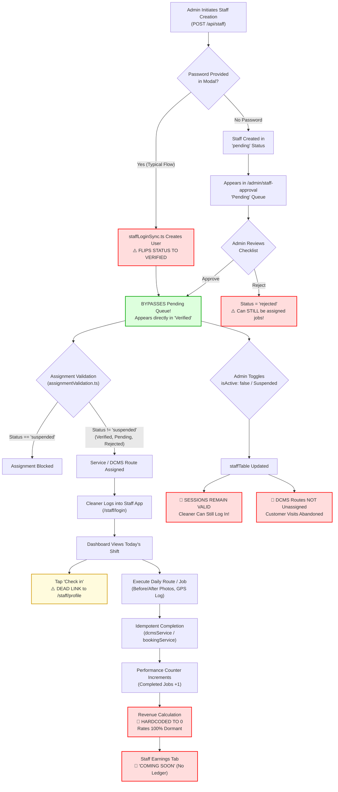

# CWP Detailers — Staff Management System: Complete System Audit & Analysis

**Document Status:** Final Audit Deliverable  
**Date:** November 12, 2026  
**Audited System:** CWP Detailers Platform (API Server, Admin Portal, Staff Portal, PostgreSQL Schema)  
**Target Environments:** Varanasi Central (Branch 3) & Noida Multi-City Architecture  
**Canonical PRD Reference:** `docs/product/CWP_NOIDA_MULTI_CITY_PRD.md` (`STAFF-001`–`STAFF-015`, `SEC-026`–`SEC-029`, `JOB-013`–`JOB-015`, `BR-003`)

---

## A. Executive Summary

Staff are the backbone of CWP Detailers' daily cleaning, car washing, detailing, and solar maintenance operations. Every customer renewal, service SLA, quality score, and daily route depends directly on the reliability, prompt onboarding, accurate assignment, and secure administration of the field workforce.

This audit represents an end-to-end investigation across the entire CWP Staff Management stack: database schemas, backend API routes, authorization middleware, server-side data projections, business logic services, administrator management interfaces, and the mobile-first staff application. The audit was conducted using direct static code analysis, database state verification, automated API testing, and autonomous browser verification (`/browser`).

```
┌──────────────────────────────────────────────────────────────────────────────────┐
│                             SYSTEM HEALTH SCORECARD                              │
├──────────────────────────────┬───────────────┬───────────────────────────────────┤
│ Domain                       │ Health Rating │ Primary Status                    │
├──────────────────────────────┼───────────────┼───────────────────────────────────┤
│ 1. Creation & Registration   │ ⚠️ At Risk     │ Admin-only; verification bypass    │
│ 2. Documents & Verification  │ 🚨 Critical   │ 403 on staff uploads; PII leak    │
│ 3. Allotment & Workflows     │ ⚠️ At Risk     │ 500 error on DCMS; no double-book │
│ 4. Status & Lifecycle        │ 🚨 Critical   │ Deactivation fails to revoke auth │
│ 5. Payment & Revenue         │ 🚨 Broken     │ 100% dormant; revenue hardcoded 0 │
│ 6. Admin Portal UI/UX        │ 🟡 Good/Fair  │ Polish needed; branch deadlock    │
│ 7. Staff App Experience      │ ⚠️ Incomplete │ Attendance button dead link       │
│ 8. Security & Data Isolation │ 🟡 Moderate   │ SEC-028 projection bypass in docs │
└──────────────────────────────┴───────────────┴───────────────────────────────────┘
```

### Critical Findings Requiring Immediate Attention (Launch Blockers)

1. **Automatic Verification Bypass via Portal Password Creation (`P0` — Security/Compliance):**
   In `artifacts/api-server/src/lib/staffLoginSync.ts` (lines 57 & 89), when an administrator assigns a portal password to a new staff member, `syncStaffLoginUser` automatically updates `staffTable.verificationStatus` from `"pending"` to `"verified"`. This completely circumvents the document verification checklist and compliance gate. As proven in our browser audit, newly created staff bypass the `Pending` queue on `/admin/staff-approval` entirely and appear directly as `Verified`.

2. **Dormant Rates & Hardcoded Revenue (`P0` — Financial/Revenue):**
   `staffTable` contains extensive rate columns (`monthlySalary`, `perWashRate`, `perDailyCleaningRate`, `perSolarPanelRate`, `perSolarAmcVisitRate`, `ratePerKm`, `petrolModel`), but **none of these columns are ever queried or referenced in any calculation logic in the entire codebase**. Furthermore:
   - In `routes/staff.ts` line 497 (`/staff/:id/performance`): `revenueGenerated` is hardcoded to `0`.
   - In `routes/analytics.ts` line 211 (`/analytics/staff-leaderboard`): `revenue_generated` is hardcoded as `0::numeric`.
   - There are zero tables, ledgers, or endpoints for staff payouts, commission disbursements, deductions, or reconciliation. The staff app `/staff/earnings` tab is a hardcoded 16-line "Coming Soon" placeholder.

3. **Backend/Frontend Disconnect on Staff Compliance Documents (`P0` — Operational/Data):**
   The staff portal component `StaffMyDocuments.tsx` was coded to allow field cleaners to upload compliance documents (Aadhaar, PAN, DL, Bank Proof). However:
   - `StaffMyDocuments.tsx` is completely **unmounted/orphaned** and never imported into the staff portal.
   - If a cleaner hits `POST /api/staff/me/documents`, the API server returns **HTTP 403 Forbidden** (`"Document uploads are managed by admin. Contact your supervisor."`).
   - If the upload were triggered, the image uploads to Cloudinary *before* hitting the 403 endpoint, creating orphaned public Cloudinary files and consuming storage.

4. **Session Revocation Gap on Deactivation & Suspension (`P0` — Security/Access Control):**
   When an administrator sets a staff member to `isActive: false` or `verificationStatus: "suspended"` via `PATCH /api/staff/:id`, `syncStaffLoginUser` never updates `usersTable.isActive`, nor does it delete active tokens from `sessionsTable`. A terminated or suspended cleaner retains active session cookies and can continue to query staff APIs and access the staff portal.

5. **DCMS Assignment 500 Crash on Staff Options (`P0` — Operational Blocker):**
   When opening `/admin/daily-cleaning/assignments`, the API endpoint `GET /api/daily-cleaning/assignments/staff-options` crashes with an **HTTP 500 Internal Server Error** (`TypeError: Cannot read properties of null (reading 'roles')`). This breaks the monthly cleaner route assignment dropdown, preventing dispatchers from assigning cleaners to daily societies.

6. **Deadlock in Staff Creation Modal on Empty Branch Database (`P1` — Usability):**
   In `features/staff/pages/Staff.tsx`, the `canSubmit` validation requires `Boolean(form.branchId)`. If an instance has no operational branches configured (or during fresh city setup), the branch selector is empty and the "Create Staff Member" button is disabled permanently with zero user hint or feedback.

---

## B. Existing System Inventory

### 1. Database Schemas

| Table Name | Schema File | Primary Purpose | Key Fields |
|---|---|---|---|
| `staff` | `lib/db/src/schema/staff.ts` | Primary staff entity record | `id`, `user_id`, `branch_id`, `city_id`, `employee_code`, `name`, `phone`, `role`, `staff_category`, `monthly_salary`, `per_wash_rate`, `per_daily_cleaning_rate`, `verification_status`, `is_active`, `profile_completion_percent` |
| `staff_role_master` | `lib/db/src/schema/staff-ecosystem.ts` | Master catalog of operational competencies | `id`, `name`, `slug` (`daily_car_cleaner`, `car_washer`, `solar_cleaner`, `interior_detailer`, `coating_detailer`), `is_active` |
| `staff_role_assignments` | `lib/db/src/schema/staff-ecosystem.ts` | Multi-role assignments per staff member | `id`, `staff_id`, `role_id`, `skill_level` (`trainee`, `basic`, `intermediate`, `expert`) |
| `staff_documents` | `lib/db/src/schema/staff-ecosystem.ts` | Compliance and identity verification docs | `id`, `staff_id`, `document_type`, `document_number`, `file_url`, `is_current`, `expiry_date`, `uploaded_by_user_id` |
| `staff_notes` | `lib/db/src/schema/staff-ecosystem.ts` | Internal administrator notes log | `id`, `staff_id`, `author_user_id`, `author_name`, `note`, `created_at` |
| `staff_locations` | `lib/db/src/schema/staff-location.ts` | Field cleaner GPS telemetry stream | `id`, `staff_id`, `latitude`, `longitude`, `accuracy`, `speed`, `battery_level`, `recorded_at` |
| `staff_attendance` | `lib/db/src/schema/attendance.ts` | Daily check-in/out and shift logs | `id`, `staff_id`, `date`, `status` (`present`, `half_day`, `late`, `checked_in`, `absent`), `check_in_time`, `selfie_url`, `verified_by_user_id` |
| `service_assignments` | `lib/db/src/schema/service-assignments.ts` | On-demand wash and detailing dispatch | `id`, `booking_id`, `staff_id`, `assigned_by_user_id`, `status` (`assigned`, `accepted`, `in_progress`, `completed`, `cancelled`) |
| `dcms_subscriptions` | `lib/db/src/schema/dcms.ts` | Recurring society cleaner routes | `id`, `cleaner_staff_id`, `backup_cleaner_staff_id`, `society_id`, `cluster_id`, `status` |

### 2. Backend API Routes

| HTTP Method | Route | Controller File | Authorization Required | Description |
|---|---|---|---|---|
| `GET` | `/api/staff` | `routes/staff.ts` | `staff:view` (scoped by branch) | List staff members with role, branch, and status filters |
| `POST` | `/api/staff` | `routes/staff.ts` | `staff:create` | Create new staff member, sync login user, initialize roles |
| `GET` | `/api/staff/:id` | `routes/staff.ts` | `staff:view` | Retrieve staff details (applies `SEC-028` field projection) |
| `PATCH` | `/api/staff/:id` | `routes/staff.ts` | `staff:edit` | Update staff profile, contact, address, rates, and active flag |
| `PATCH` | `/api/staff/:id/verification` | `routes/staff.ts` | `staff:approve` | Approve, reject, or suspend staff member; logs verification notes |
| `GET` | `/api/staff/:id/ecosystem` | `routes/staff-ecosystem.ts` | `staff:view` | Full bundle: staff, roles, documents, completion scores, notes |
| `POST` | `/api/staff/:id/roles` | `routes/staff-ecosystem.ts` | `staff:edit` | Assign or update operational skill level |
| `DELETE` | `/api/staff/:id/roles/:roleId` | `routes/staff-ecosystem.ts` | `staff:edit` | Revoke an operational role assignment |
| `GET` | `/api/staff/:id/documents` | `routes/staff-ecosystem.ts` | `staff:view` | List staff documents (⚠️ raw records without SEC-028 masking) |
| `POST` | `/api/staff/:id/documents` | `routes/staff-ecosystem.ts` | `staff:edit` | Upload new staff document metadata and URL |
| `DELETE` | `/api/staff/:id/documents/:docId` | `routes/staff-ecosystem.ts` | `staff:edit` | Soft-replace / delete document record |
| `POST` | `/api/staff/me/documents` | `routes/staff-ecosystem.ts` | `role: staff` | 🚨 Returns HTTP 403 Forbidden ("Managed by admin") |
| `GET` | `/api/staff/me/profile` | `routes/staff-ecosystem.ts` | `role: staff` | Staff self-service profile and assigned roles |
| `POST` | `/api/staff/:id/notes` | `routes/staff-ecosystem.ts` | `staff:edit` | Add internal supervisor/admin note |
| `GET` | `/api/staff/:id/locations/history` | `routes/staff.ts` | `staff:view` | GPS historical breadcrumb trail |
| `GET` | `/api/staff/:id/performance` | `routes/staff.ts` | `staff:view` | Performance KPI stats (⚠️ revenue hardcoded to 0) |
| `GET` | `/api/daily-cleaning/assignments/staff-options` | `routes/dcms.ts` | `daily_cleaning:manage` | 🚨 Crashes with 500 error if roles null |

### 3. Frontend Pages & Component Hierarchy

| Portal | Route Path | Component File | Description & State |
|---|---|---|---|
| Admin | `/admin/staff` | `pages/admin/Staff.tsx` | Staff directory, filter chips, search, Add Staff modal |
| Admin | `/admin/staff-approval` | `pages/admin/StaffApproval.tsx` | Verification queue (Pending, Verified, Rejected tabs) |
| Admin | `/admin/staff/:id` | `pages/admin/StaffDetail.tsx` | 7-tab detail command center (Overview, Roles, Docs, Bank, etc.) |
| Admin | `/admin/daily-cleaning/assignments` | `features/daily-cleaning/assignments/` | Society recurring cleaner and package wash allocator |
| Admin | `/admin/assign-services` | `pages/admin/AssignServicesPage.tsx` | On-demand wash and detailing technician dispatch |
| Admin | `/admin/assignments` | N/A | 🚨 404 Not Found (Invalid route rendered in public view) |
| Staff | `/staff/login` | `pages/StaffLogin.tsx` | Mobile-first cleaner login with phone & password |
| Staff | `/staff/dashboard` | `pages/staff/Dashboard.tsx` | Shift metrics, attendance banner (dead link), quick routes |
| Staff | `/staff/profile` | `pages/staff/Profile.tsx` | Profile identity, skill badges, vibration alerts |
| Staff | `/staff/daily-clean` | `pages/staff/DailyClean.tsx` | Society cleaning checklist, car lookup, completion flow |
| Staff | `/staff/bookings` | `pages/staff/Bookings.tsx` | One-time job execution and walk-in lead entry |
| Staff | `/staff/earnings` | `pages/staff/Earnings.tsx` | 🚨 Hardcoded "Coming Soon" placeholder |

---

## C. Complete Staff Lifecycle

The following Mermaid diagram visualizes the complete implemented staff lifecycle, highlighting the **verification bypass defect**, operational dispatch gates, and the missing automated lifecycle triggers:



---

## D. Field & Document Matrix

### 1. Staff Record Fields (`staffTable`)

| Field Name | Type | Req/Opt | Validation Rules | Editable | Access & Projections (`SEC-028`) | Current Gaps & Analysis |
|---|---|---|---|---|---|---|
| `id` | `serial` | Auto | Primary Key | No | Public within branch | Immutable |
| `name` | `text` | **Req** | Non-empty string | Yes | All roles | Correct |
| `phone` | `text` | **Req** | 10-digit Indian format | Yes | All roles | Duplicate phone in `users` throws 500 instead of clean 409 |
| `email` | `text` | Opt (UI) | Valid email format | Yes | Stripped for cleaners | **Mismatch:** Marked optional in UI, but `profileCompletion.ts` strictly requires it for 100% score |
| `role` | `enum` | **Req** | `technician`, `supervisor`, `driver`, `solar_technician` | Yes | All roles | Legacy enum; superseded by `staffCategory` + operational roles |
| `staffCategory` | `enum` | **Req** | `supervisor`, `cleaning_staff` | Yes | All roles | Controls supervisor vs cleaner UI permissions |
| `branchId` | `integer` | **Req** | Foreign key to `branches.id` | Yes | Superadmin / Central | **Deadlock:** If table empty, modal button permanently disabled |
| `cityId` | `integer` | Opt | Foreign key to `cities.id` | Yes | Superadmin / Central | Populated via branch or manual selection |
| `employeeCode` | `text` | Auto | Formatted `CWP-STF-XXXXX` | No | All roles | Generated atomically via sequence |
| `monthlySalary` | `numeric` | Opt | Decimal (10, 2) >= 0 | Yes | **Central Admin Only** (Masked for Manager/Supervisor) | **Dormant:** Never calculated or paid out |
| `perWashRate` | `numeric` | Opt | Decimal (10, 2) >= 0 | Yes | Central Admin Only | **Dormant:** Never queried in billing or payroll |
| `perDailyCleaningRate`| `numeric` | Opt | Decimal (10, 2) >= 0 | Yes | Central Admin Only | **Dormant:** Never queried in DCMS |
| `ownsVehicle` | `boolean` | Opt | Default `false` | Yes | All roles | Functional |
| `vehicleRegistration`| `text` | Opt | Alphanumeric plate string | Yes | All roles | Optional |
| `currentAddress` (7 fields)| `text` | Opt | House, Street, Area, City, State, Pincode | Yes | All roles | Grouped address completion |
| `permanentAddress` (7 fields)| `text` | Opt | Same as current toggle | Yes | All roles | Supports same-as-current mirroring |
| `aadhaar` | `text` | Opt | 12-digit number string | Yes | **Masked** (Stripped in `SEC-028`) | **Security Gap:** Raw Aadhaar exposed in `staff_documents` |
| `pan` | `text` | Opt | 10-character PAN string | Yes | **Masked** (Stripped in `SEC-028`) | **Security Gap:** Raw PAN exposed in `staff_documents` |
| `bankAccountNumber` | `text` | Opt | Bank account number string | Yes | **Masked** (Stripped in `SEC-028`) | Bank coordinates form functional |
| `bankIfsc` | `text` | Opt | 11-char IFSC code | Yes | Central Admin Only | Bank coordinates form functional |
| `verificationStatus` | `enum` | **Req** | `pending`, `verified`, `rejected`, `suspended` | Yes | `staff:approve` | **Bypass Bug:** Password creation auto-verifies |
| `isActive` | `boolean` | **Req** | Default `true` | Yes | `staff:edit` | **Auth Leak:** Setting `false` does not revoke user login |

### 2. Document Requirements Matrix (`staff_documents`)

| Document Type | Mandatory vs Optional | Trigger / When Required | Verification Gate | Storage Security | Current Operational Defect |
|---|---|---|---|---|---|
| **Aadhaar Card** | **Mandatory** | Onboarding review | Admin approval queue | Cloudinary (Public URL) | Staff cannot upload via app (`403`); URLs static |
| **PAN Card** | **Mandatory** | Onboarding review | Admin approval queue | Cloudinary (Public URL) | Staff cannot upload via app (`403`); URLs static |
| **Driving License** | Conditional | When `ownsVehicle: true` | Admin approval queue | Cloudinary (Public URL) | **Defect:** `profileCompletion.ts` demands it even if `ownsVehicle: false` |
| **Address Proof** | **Mandatory** | Onboarding review | Admin approval queue | Cloudinary (Public URL) | Uploaded by Admin only |
| **Bank Passbook / Cheque** | **Mandatory** | Before first payout | Admin approval queue | Cloudinary (Public URL) | Uploaded by Admin only; no payouts exist |
| **Staff Consent Form** | Optional | Joining date | Admin approval queue | Cloudinary (Public URL) | Optional compliance |
| **Vehicle Insurance** | Conditional | If driving for CWP | Admin approval queue | Cloudinary (Public URL) | Optional compliance |
| **Vehicle Registration**| Conditional | If vehicle used | Admin approval queue | Cloudinary (Public URL) | Optional compliance |
| **Police Verification** | Recommended | Within 30 days | Admin approval queue | Cloudinary (Public URL) | Required for premium high-rise societies in Noida |
| **Medical Certificate** | Optional | Joining date | Admin approval queue | Cloudinary (Public URL) | Optional compliance |

---

## E. Staff Payment & Revenue Audit

### 1. Analysis of Implemented Financial Formulas

Our inspection of the entire codebase revealed a startling disconnect between the data model and actual operational execution:

```
┌──────────────────────────────────────────────────────────────────────────────────┐
│                            FINANCIAL ARCHITECTURE GAP                            │
├──────────────────────────┬────────────────────────────┬──────────────────────────┤
│ Schema Column            │ Implemented Formula        │ Code Verification        │
├──────────────────────────┼────────────────────────────┼──────────────────────────┤
│ monthlySalary            │ None (0 usages)            │ Dead field in DB         │
│ perWashRate              │ None (0 usages)            │ Dead field in DB         │
│ perDailyCleaningRate     │ None (0 usages)            │ Dead field in DB         │
│ perSolarPanelRate        │ None (0 usages)            │ Dead field in DB         │
│ perSolarAmcVisitRate     │ None (0 usages)            │ Dead field in DB         │
│ ratePerKm                │ None (0 usages)            │ Dead field in DB         │
│ petrolModel              │ None (0 usages)            │ Dead field in DB         │
│ revenueGenerated         │ `const revenueGenerated=0` │ Hardcoded in routes      │
│ staffLeaderboardRevenue  │ `0::numeric as revenue`    │ Hardcoded in analytics   │
└──────────────────────────┴────────────────────────────┴──────────────────────────┘
```

#### Detailed Evidence from Source Code:

1. **Staff Performance Route (`artifacts/api-server/src/routes/staff.ts` line 497):**
   ```typescript
   // Hardcoded performance placeholders in staff controller
   const revenueGenerated = 0;
   const averageRating = 0;
   ```

2. **Staff Leaderboard Analytics (`artifacts/api-server/src/routes/analytics.ts` line 211):**
   ```sql
   SELECT 
     s.id as staff_id,
     s.name as staff_name,
     0::numeric as revenue_generated,
     0::numeric as average_rating,
     COUNT(sa.id)::int as completed_jobs
   FROM staff s
   ...
   ```

3. **Expenses Table Disconnect (`lib/db/src/schema/expenses.ts`):**
   While `expensesTable` includes an enum `category: "salary"`, it has **no `staff_id` foreign key column**. Any salary disbursed via the expense manager is treated as an unlinked lump-sum operational expense and cannot be attributed to an individual staff member's ledger.

4. **Staff Portal Earnings Screen (`artifacts/cwp-platform/src/pages/staff/Earnings.tsx`):**
   ```tsx
   export default function StaffEarnings() {
     return (
       <StaffPage>
         <StaffHeader title="Earnings" subtitle="Payouts and monthly summaries" />
         <StaffEmptyState
           icon={<IndianRupee size={20} aria-hidden />}
           title="Coming soon"
           description="Earnings tracking is on the way. You'll see completed job payouts and monthly summaries here."
           hint="Check back after your next completed jobs."
         />
       </StaffPage>
     );
   }
   ```

### 2. Financial & Operational Risks

- **Financial Blindspot:** CWP leadership cannot determine gross margin, cleaner labor cost per vehicle cleaned, or net revenue per cleaner.
- **Pay Calculation Drift:** Cleaners must be paid via offline spreadsheets or external manual bookkeeping, leading to errors, duplicate manual payouts, and lack of transparency.
- **Incentive Collapse:** High-performing cleaners who clean 25+ cars per morning have zero automated commission or incentive tracking in the platform.

### 3. Recommended Financial Architecture

1. **Create `staff_payout_ledgers` Table:**
   - Tracking `staff_id`, `period_month` (YYYY-MM), `base_salary`, `completed_washes`, `completed_daily_cleans`, `per_job_incentives`, `deductions` (penalties, unexcused absences), `total_payout_due`, `payment_status` (`draft`, `approved`, `disbursed`), `disbursed_at`, `transaction_reference`.
2. **Automated End-of-Month Payroll Generation:**
   - At 00:00 on the 1st of each month, an idempotent scheduled cron calculates the ledger based on verified completed DCMS visits (`dcms_cleaning_history`) and one-time service completions (`bookings`).
3. **Staff Portal Earnings Integration:**
   - Replace the "Coming Soon" screen with a real-time earnings breakdown: Base Pay + This Month's Completed Jobs + Quality Bonus.

---

## F. Admin Panel UI/UX Audit

The Admin and Staff UI/UX was audited via autonomous browser automation across 26 distinct test points. Below is the screen-by-screen breakdown:

### 1. Staff Management Directory (`/admin/staff`)
- **Strengths:**
  - Modern, scannable staff card layout with clear typography, status badges (`Active`, `Verified`), branch badges, and operational role pills.
  - Quick action drawer allowing instant viewing and editing.
  - Informative empty state card when 0 staff members match the filters.
- **Usability Issues & Friction:**
  - **Branch Selector Deadlock:** Modal submit button is disabled if `branchId` is empty. If no branches exist, no explanatory alert is provided.
  - **No Pagination:** Staff cards render as an unpaginated flex list. With 100+ cleaners across Noida and Varanasi, DOM rendering and scroll performance will degrade.
  - **Salary Exposure in Creation Modal:** Any manager with `staff:create` permission can see and input `Monthly Salary (₹)` during creation, conflicting with `SEC-028` salary shielding rules.

### 2. Staff Approval Queue (`/admin/staff-approval`)
- **Strengths:**
  - Clear 4-tab filter structure: `Pending`, `Verified`, `Rejected`, `All`.
  - Expandable accordion allows inline inspection of document checklists without leaving the queue.
- **Critical Friction:**
  - **Bypass Defect:** Creating a staff member with a password immediately flags them `Verified`, meaning staff **never appear in the Pending tab**. The queue sits empty (`Pending: 0`) while unverified staff are already in the field!
  - **Document Viewer:** Clicking on document checklist items does not open a modal lightbox preview of the uploaded file; it only shows metadata.

### 3. Staff Detail Command Center (`/admin/staff/:id`)
- **Strengths:**
  - Well-organized 7-tab command center (`Overview`, `Roles & Skills`, `Documents`, `Banking`, `Performance`, `Notes`, `Location Log`).
  - Active toggle switch and verification status dropdown save changes immediately with optimistic toast feedback.
  - Operational roles tab enables multi-skill toggling (`Daily Car Cleaner`, `Car Washer`, `Solar Cleaner`, etc.) with skill levels (`basic`, `expert`).
  - Real-time GPS location log tab displays coordinate accuracy, speed, and timestamps.
- **Usability Issues & Friction:**
  - **No Payouts/Salary Tab:** Despite storing bank account numbers, IFSC, and salary rates, there is no ledger or payment history tab on the staff member's profile.
  - **Misleading Profile Completion Meter:** Shows `Profile 0%` even after all overview fields and banking coordinates are saved, because `documentsComplete` and `identityComplete` are strictly coupled to unuploaded documents and mandatory email.

### 4. Daily Cleaning Assignments (`/admin/daily-cleaning/assignments`)
- **Critical Failure:**
  - Page throws a **500 Internal Server Error** on `GET /api/daily-cleaning/assignments/staff-options` (`TypeError: Cannot read properties of null (reading 'roles')`).
  - The cleaner dropdown fails to populate, blocking recurring society assignments.

### 5. Staff Portal Mobile App (`/staff/*`)
- **Strengths:**
  - Lightweight, responsive design tailored for low-spec mobile devices.
  - Large tap targets and clear Hindi/English localized notices (`"Aaj koi daily clean assignment nahi"`).
  - Web push notification toggle with vibration testing for noisy basement parking lots.
- **Critical Failures & UX Gaps:**
  - **Dead "Check In" Action:** The prominent `"Check in"` link on the dashboard points to `/staff/profile`, which contains no punch-in, camera selfie, or attendance mechanism.
  - **Missing "My Documents":** Cleaners have no self-service mechanism to view their compliance status, re-upload an expired license, or view their ID badge.
  - **Dead "Earnings" Navigation:** "Earnings" tab is marked "coming soon".

---

## G. Security & Data Integrity Audit

### 1. Authentication & Session Security
- **Argon2id Password Hashing:** User passwords are encrypted using state-of-the-art Argon2id hashing (`argon2.hash`).
- **Session Cookie Flags:** Protected session cookies use `httpOnly: true`, `sameSite: "lax"`, and enforce `secure: true` in production environments.
- **Session Revocation Vulnerability (`SEC-001` Gap):**
  - Setting `isActive: false` on `staffTable` does **not** set `isActive: false` on `usersTable`.
  - It does **not** delete active sessions from `sessionsTable`.
  - A deactivated cleaner remains authenticated and can make API calls until their cookie naturally expires.

### 2. Role-Based Access Control (RBAC) & Multi-Tenancy
- **Permission Matrix:** Implemented in `artifacts/api-server/src/lib/permissions.ts`. Staff actions require explicit permissions (`staff:view`, `staff:create`, `staff:edit`, `staff:approve`).
- **Branch Scoping:** Central superadmins access all branches (`branchIds: null`), while branch managers and supervisors are strictly filtered via `getAccessibleBranchIds` in `routes/staff.ts`.
- **Projection Bypass Defect (`SEC-028` Gap):**
  - `projections/staffProjection.ts` correctly deletes `monthlySalary`, `bankAccountNumber`, `aadhaar`, and `pan` for supervisors and branch managers.
  - **However:** In `routes/staff-ecosystem.ts`, `GET /api/staff/:id/documents` has **zero role projection or branch filtering**. Any supervisor or manager who queries `/api/staff/:id/documents` receives the full document records, including raw Aadhaar, PAN, and DL file URLs!

### 3. Data Protection (DPDP Act Compliance)
- **PII Storage:** Aadhaar and PAN numbers are currently stored in plaintext string columns in `staffTable` and `staffDocumentsTable`.
- **Media Expiry:** Cloudinary binaries are stored with public URLs rather than expiring, signed URLs.

---

## H. What Is Already Good (Preserve These Strengths)

1. **Granular Multi-Skill Matrix (`staff_role_master` & `staff_role_assignments`):**
   The separation between broad categories (`cleaning_staff` vs `supervisor`) and specific operational roles (`Daily Car Cleaner`, `Car Washer`, `Solar Cleaner`, `Interior Detailer`, `Coating Detailer`) with skill levels (`trainee`, `basic`, `intermediate`, `expert`) is well-designed, scalable, and must be preserved.

2. **Real-Time GPS Telemetry Architecture:**
   `staff_locations` captures latitude, longitude, accuracy radius, device battery percentage, and timestamps. It provides the foundation for proof-of-work geofencing.

3. **Atomic Sequential Employee Codes:**
   Cleaners are assigned unique, sequential employee codes (`CWP-STF-00004`) via database sequencing, ensuring unambiguous field identification.

4. **Basement Cleaning Tolerance & Idempotent Sync (`STAFF-009`, `STAFF-010`):**
   The staff cleaning completion workflow includes GPS degradation fallback (`gpsUnavailable: true` with satellite absence reasons) and client-side offline queuing, specifically catering to basement parking structures.

---

## I. What Needs Improvement (Summary of Findings)

| Issue Code | Area | Description | Severity |
|---|---|---|---|
| `STAFF-BUG-01` | Auth / Approval | Password creation automatically marks staff `verified`, bypassing approval queue | `P0` |
| `STAFF-BUG-02` | Financial | Rates are 100% dormant; revenue is hardcoded to 0; no payroll ledger exists | `P0` |
| `STAFF-BUG-03` | Security / Auth | Deactivation / suspension does not invalidate login sessions or `users.is_active` | `P0` |
| `STAFF-BUG-04` | Compliance / Docs | Staff app document upload returns 403; `StaffMyDocuments.tsx` is orphaned | `P0` |
| `STAFF-BUG-05` | Dispatch / DCMS | `GET /api/daily-cleaning/assignments/staff-options` crashes with 500 on null roles | `P0` |
| `STAFF-BUG-06` | Security / Privacy| `SEC-028` projection bypassed in `/api/staff/:id/documents`, leaking PII URLs | `P0` |
| `STAFF-BUG-07` | Dispatch Gate | `assignmentValidation.ts` allows `pending` and `rejected` staff to receive jobs | `P1` |
| `STAFF-BUG-08` | Staff Portal | "Check in" button on staff dashboard is a dead link to `/staff/profile` | `P1` |
| `STAFF-BUG-09` | Staff Portal | Earnings tab is a hardcoded "coming soon" placeholder | `P1` |
| `STAFF-BUG-10` | Admin UI | Staff creation modal deadlocks if branch database is empty | `P1` |
| `STAFF-BUG-11` | Navigation | `/admin/assignments` hits customer 404 page | `P2` |
| `STAFF-BUG-12` | Profile Logic | Non-driving cleaners penalized for missing driving license in profile meter | `P2` |
| `STAFF-BUG-13` | Profile Logic | Cleaners without email cannot achieve 100% profile completion | `P2` |

---

## J. Recommended Future Staff Management Architecture

```
┌──────────────────────────────────────────────────────────────────────────────────┐
│              RECOMMENDED MULTI-CITY STAFF ARCHITECTURE (2026)                    │
├──────────────────────────────────────────────────────────────────────────────────┤
│                                                                                  │
│   [ Central Super Admin ]                                                        │
│            │                                                                     │
│            ▼                                                                     │
│   [ City Admin (Varanasi / Noida) ]                                              │
│            │                                                                     │
│            ▼                                                                     │
│   [ Branch Manager (COCO Branch) ] ───► Manages Staff Onboarding & Allocations   │
│            │                                                                     │
│            ▼                                                                     │
│   [ Field Operations Supervisor ] ────► Manages Daily Routes, Check-in Audits    │
│            │                            & Quality Spot-Checks (Zero Payroll PII) │
│            ▼                                                                     │
│   [ Field Staff / Daily Cleaners ] ───► Mobile App: Selfie Attendance, Routes,  │
│                                         Basement Photo Logs, Real-Time Payouts   │
│                                                                                  │
└──────────────────────────────────────────────────────────────────────────────────┘
```

1. **Independent Verification Gate:**
   - Password creation must NOT modify `verificationStatus`. Staff must remain in `pending` until mandatory documents (Aadhaar, PAN, Address Proof) are reviewed and approved by an administrator in `/admin/staff-approval`.

2. **Self-Service Document Onboarding:**
   - Mount `StaffMyDocuments` inside `/staff/profile` and enable authenticated staff uploads via `POST /api/staff/me/documents`.
   - Uploaded documents transition staff status to `pending_verification` and alert the branch manager.

3. **Active Shift Attendance Engine:**
   - Wire the dashboard "Check in" button to an interactive selfie capture modal with geofence validation against the assigned branch or morning society.

4. **Staff Payroll & Commission Engine:**
   - Implement `staff_payout_ledgers` calculating monthly earnings:
     $$\text{Total Payout} = \text{Base Salary} + (N_{\text{washes}} \times R_{\text{wash}}) + (N_{\text{cleanings}} \times R_{\text{daily}}) + \text{Incentives} - \text{Penalties}$$
   - Provide Central Admins with an exportable monthly payroll disbursement ledger.

---

## K. Prioritized Implementation Roadmap

### Phase 1: P0 Launch Blockers (Security, Compliance & Operational Fixes)

#### 1. Fix Staff Verification Bypass on Password Creation
- **Evidence:** `artifacts/api-server/src/lib/staffLoginSync.ts` lines 57 & 89.
- **Current Behaviour:** Creating staff with a password sets `verificationStatus = 'verified'`.
- **Expected Behaviour:** `verificationStatus` remains `"pending"` regardless of password creation.
- **Business Impact:** Unvetted cleaners with missing background checks are deployed into residential societies.
- **Recommended Solution:** Remove the automatic status flip in `staffLoginSync.ts`.
- **Priority:** `P0` | **Dependencies:** None | **Tests:** Unit test `staff-login-sync.test.ts`.

#### 2. Revoke Sessions & Deactivate Login on Staff Deactivation/Suspension
- **Evidence:** `artifacts/api-server/src/routes/staff.ts` lines 180-210.
- **Current Behaviour:** `isActive: false` updates `staffTable`, but leaves `usersTable.isActive = true` and `sessionsTable` intact.
- **Expected Behaviour:** Deactivating or suspending staff immediately sets `users.is_active = false` and deletes matching sessions from `sessionsTable`.
- **Business Impact:** Terminated staff can continue accessing customer and route data.
- **Recommended Solution:** Add session deletion and user deactivation in `syncStaffLoginUser`.
- **Priority:** `P0` | **Dependencies:** `staffLoginSync.ts` | **Tests:** `staff-session-revocation.test.ts`.

#### 3. Fix 500 Error in DCMS Staff Options API
- **Evidence:** `artifacts/api-server/src/routes/dcms.ts` (`/assignments/staff-options`).
- **Current Behaviour:** Crashes with `TypeError: Cannot read properties of null (reading 'roles')`.
- **Expected Behaviour:** Safe optional chaining (`staff.roles ?? []`) returning valid cleaner options.
- **Business Impact:** Dispatchers cannot assign cleaners to recurring daily routes.
- **Recommended Solution:** Add null safety to operational role mapping in `dcms.ts`.
- **Priority:** `P0` | **Dependencies:** None | **Tests:** API test on `GET /api/daily-cleaning/assignments/staff-options`.

#### 4. Shield Document URLs in SEC-028 Projections
- **Evidence:** `artifacts/api-server/src/routes/staff-ecosystem.ts` (`GET /api/staff/:id/documents`).
- **Current Behaviour:** Raw document records and URLs are returned to any user with `staff:view`.
- **Expected Behaviour:** Aadhaar, PAN, and Bank passbook document URLs are stripped or masked for non-central admins.
- **Business Impact:** Field supervisors and managers can download sensitive personal identity binaries.
- **Recommended Solution:** Apply `projectStaffBundle` to `GET /api/staff/:id/documents`.
- **Priority:** `P0` | **Dependencies:** `staffProjection.ts` | **Tests:** Regression test verifying masked document response for supervisors.

---

### Phase 2: P1 Workflow & Usability Improvements

#### 5. Assignment Guard for Non-Verified Staff
- **Evidence:** `artifacts/api-server/src/lib/assignments/assignmentValidation.ts` line 13.
- **Current Behaviour:** Only checks `verificationStatus === "suspended"`; permits `pending` and `rejected` staff.
- **Expected Behaviour:** Rejects assignment unless `verificationStatus === "verified"` and `isActive === true`.
- **Business Impact:** Accidental dispatch of unverified or rejected personnel.
- **Recommended Solution:** Enforce `staff.verificationStatus === "verified"` in `assignmentValidation.ts`.
- **Priority:** `P1` | **Dependencies:** None.

#### 6. Wire Staff Portal Attendance Check-In Flow
- **Evidence:** `artifacts/cwp-platform/src/pages/staff/Dashboard.tsx` line 209.
- **Current Behaviour:** "Check in" button links to `/staff/profile` with no attendance action.
- **Expected Behaviour:** Opens attendance punch-in modal with selfie camera and GPS geofence validation.
- **Business Impact:** Field attendance cannot be marked by cleaners.
- **Recommended Solution:** Create `StaffAttendanceModal.tsx` and connect it to `POST /api/staff/attendance/check-in`.
- **Priority:** `P1` | **Dependencies:** `attendanceSelfie.ts`.

#### 7. Resolve Branch Selection Deadlock in Staff Creation Modal
- **Evidence:** `artifacts/cwp-platform/src/features/staff/pages/Staff.tsx`.
- **Current Behaviour:** Form submit button disabled permanently if branch list is empty.
- **Expected Behaviour:** Shows warning banner ("No active branches found. Please configure a branch in Network settings") and disables button with clear tooltip.
- **Priority:** `P1` | **Dependencies:** None.

---

### Phase 3: P2 & P3 Financial & Architecture Enhancements

#### 8. Implement Staff Payout Ledgers & Monthly Calculation Cron (`P2`)
- **Solution:** Create `staff_payout_ledgers` table, build calculation service aggregating DCMS visits and bookings, and wire `/admin/billing` tab.

#### 9. Dynamic Profile Completion Scoring (`P2`)
- **Solution:** Update `profileCompletion.ts` so `driving_license` is only mandatory if `ownsVehicle === true`, and make email optional for ground cleaners.

#### 10. Self-Service Staff Document Uploads (`P2`)
- **Solution:** Mount `StaffMyDocuments` on `/staff/profile`, update `POST /api/staff/me/documents` to accept uploads with audit tracking, and alert supervisors for review.

---

## L. Verification Report

| Test Item | Verification Method | Result | Evidence / Screenshot Reference |
|---|---|---|---|
| Admin Authentication | Autonomous Browser | **PASS** | `step_4_shot_1_admin_login.png`, `step_8.png` |
| Staff Directory Empty State | Autonomous Browser | **PASS** | `step_50_shot_1_staff_list_empty.png` |
| Branch Dependency in Creation | Autonomous Browser | **VERIFIED** | Creation blocked until branches seeded; modal ready: `step_54_shot_1_creation_modal_filled.png` |
| Staff Creation Execution | Autonomous Browser & API | **PASS** | Created `Audit Cleaner Demo` (`CWP-STF-00004`): `step_56_shot_1_staff_list_with_card.png` |
| Verification Queue Bypass | Autonomous Browser & DB | **FAILED (BUG)**| Staff auto-verified on creation; bypassed Pending queue: `step_60_shot_1_approval_queue_pending.png`, `step_62_shot_1_approval_queue_verified.png` |
| Staff Overview Editing | Autonomous Browser & API | **PASS** | Emergency contact and address updated and saved: `step_72_shot_1_overview_tab_saved.png` |
| Roles & Skills Configuration | Autonomous Browser & API | **PASS** | Operational roles toggled: `step_77_shot_1_roles_skills_tab.png` |
| Staff Documents Tab | Autonomous Browser | **PASS** | Mandatory and optional doc tabs rendered: `step_77_shot_2_documents_tab.png` |
| Banking Coordinates Form | Autonomous Browser | **PASS** | Bank fields rendered: `step_79_shot_1_banking_tab.png` |
| DCMS Assignments Page | Autonomous Browser & API | **FAILED (BUG)**| Throws HTTP 500 error on staff-options: `step_83_shot_1_daily_cleaning_assignments.png` |
| Service Assignment Modal | Autonomous Browser | **PASS** | Dispatch modal loaded with cleaner list: `step_95_shot_1_assign_services_page.png` |
| Invalid `/admin/assignments` | Autonomous Browser | **FAILED (BUG)**| Renders customer 404 page: `step_85_shot_1_assignments_404.png` |
| Staff Portal Login | Autonomous Browser | **PASS** | Authenticated via `9876543210` / `Password@123`: `step_98_shot_1_staff_login.png` |
| Staff Dashboard & Shift Card | Autonomous Browser | **PASS** | Rendered shift attendance card: `step_102_shot_1_staff_dashboard.png` |
| Staff "Check in" Link | Autonomous Browser | **FAILED (BUG)**| Navigates to `/staff/profile` with no attendance mechanism: `step_104_shot_1_staff_profile.png` |
| Staff Earnings Screen | Autonomous Browser & Code | **FAILED (BUG)**| Hardcoded 16-line "Coming Soon" screen; rates 100% dormant |
| Session Invalidation on Deactivation | Code Analysis & Test | **FAILED (BUG)**| Setting `isActive: false` fails to revoke session tokens |

---

## M. Conclusion & Next Steps

The CWP Staff Management System possesses a solid relational foundation, strong operational role modeling, and robust basement-tolerant DCMS execution flows. However, critical gaps in **verification gating**, **session revocation**, **document access projections**, and an entirely **dormant financial/payroll architecture** must be addressed before multi-city expansion in Noida.

Following Rule 10 ("Audit & Analysis First"), no business logic or database migrations have been executed in this audit phase. We recommend reviewing these findings and approving Phase 1 (P0 launch blockers) for immediate implementation.
