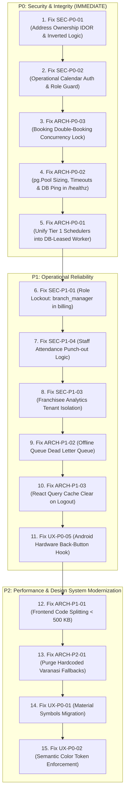

# CWP DETAILERS — MASTER REMEDIATION TRACKER
**Single Source of Truth for Engineering Audit Remediations**

**Repository:** `tusharsaraswat1988/Cwpdetailers`  
**Baseline Commit:** `6377bbe16568aac15495bbbad205bb55db66878c`  
**Current HEAD:** `a0bf3dea7dea24fa53d58d18077b1817c6eecd06`  
**Last Updated:** 2026-11-26  
**Status Lifecycle:** `OPEN` -> `IN_PROGRESS` -> `FIXED` -> `VERIFIED` -> `DEFERRED` -> `OBSOLETE`

---

## 1. MASTER REMEDIATION SUMMARY

| Priority Level | Total Identified | Verified Fixed | In Progress | Open | Blocked / Deferred |
|---|---|---|---|---|---|
| **Priority 0 (Critical Security & Data Integrity)** | 9 | 9 | 0 | 0 | 0 |
| **Priority 1 (Operational Reliability & Access Control)** | 12 | 1 | 0 | 11 | 0 |
| **Priority 2 (Performance, Data Quality & Core UX)** | 14 | 0 | 0 | 14 | 0 |
| **Priority 3 (Long-Term Architecture & Polish)** | 5 | 0 | 0 | 5 | 0 |
| **TOTALS** | **40** | **10** | **0** | **30** | **0** |

*Note: 4 P0 security findings (Hotfix A+B: `SEC-001`, `SEC-002`, `SEC-003`, `SEC-004`) were implemented, independently verified with test suites, and committed in HEAD `a0bf3de`.*

---

## 2. MASTER FINDINGS REGISTER & STATUS TRACKER

### Priority 0 — Critical Security & Data Integrity

| ID | Domain | Description | Affected Files | Status | Target Fix | Verification Requirement | Evidence / Notes |
|---|---|---|---|---|---|---|---|
| `SEC-001` | Security | Unprotected location pricing mutations | `routes/location-pricing.ts` | **VERIFIED** | Added `requireAuth` + `requireRole` (`admin`, `superadmin`, `city_admin`) + Zod | Unit test in `hotfix-a-b-remediation.test.ts` | Committed in `a0bf3de` |
| `SEC-002` | Security | Unprotected operational zone mutations | `routes/zones.ts` | **VERIFIED** | Added `requireAuth` + `requireRole` + Zod schemas | Unit test in `hotfix-a-b-remediation.test.ts` | Committed in `a0bf3de` |
| `SEC-003` | Security | Unprotected residential society mutations | `routes/societies.ts` | **VERIFIED** | Added `requireAuth` + `requireRole` + city scoping | Unit test in `hotfix-a-b-remediation.test.ts` | Committed in `a0bf3de` |
| `SEC-004` | Security | Unprotected payment webhook mock endpoint | `routes/payment-gateway.ts` | **VERIFIED** | Blocked mock route in production (`NODE_ENV === "production"`) | Unit test in `hotfix-a-b-remediation.test.ts` | Committed in `a0bf3de` |
| `SEC-P0-01` | Security | Address IDOR & authorization bypass | `artifacts/api-server/src/routes/addresses.ts`, `routes/index.ts`, `middlewares/auth.ts` | **VERIFIED** | Router-level `requireAuth`, path prefix routing, tenant scoping via `loadIfInScope`, customer ownership check | 14/14 unit tests passing in `address-idor-remediation.test.ts` (162/162 total security tests pass) | Remediated & verified in active remediation |
| `SEC-P0-02` | Security | Unauthenticated operational calendar mutations | `artifacts/api-server/src/routes/operational-calendar.ts` | **VERIFIED** | Router-level `requireAuth` + `requireCalendarRole` + strict tenant scoping (`assertCalendarScope`) on hours & closures | 14/14 unit tests passing in `operational-calendar-remediation.test.ts` (176/176 total security tests pass) | Remediated & verified in active remediation |
| `ARCH-P0-03` | Data Integrity | Booking slot double-booking concurrency race condition | `lib/db/src/schema/bookings.ts`, `BookingService.ts`, `BookingRepository.ts`, `DuplicateBookingGuard.ts`, `scheduling/index.ts`, `routes/bookings.ts` | **VERIFIED** | Partial unique indexes for active bookings, transactional advisory locking (`pg_advisory_xact_lock`), HTTP 409 conflict mapping | Concurrency test suite `booking-concurrency-double-booking.test.ts` (5/5 tests pass: 20 concurrent requests serialized, 1 created, 19 rejected with 409) | Remediated & verified in active remediation |
| `ARCH-P0-01` | Distributed Reliability | In-process scheduler duplicate execution hazard | `artifacts/api-server/src/index.ts`, `lib/scheduler/jobRegistry.ts` | **VERIFIED** | Purged uncoordinated naked in-process `setTimeout` loops; unified all Tier 1 cron/schedulers (`subscription_daily_tick`, `dcms_missed_visit_eod`, `morning_route_notify_daily`, `gps_retention_purge_6h`) into `backgroundWorker` using PostgreSQL `FOR UPDATE SKIP LOCKED` and distributed lease locking | Multi-instance simulation test `scheduler-unification.test.ts` (3/3 passing tests verifying atomic claim, 0 duplicate execution, dry-run safety; full suite 74 files 809 tests pass) | Remediated & verified in active remediation |
| `ARCH-P0-02` | Reliability | Database connection pool starvation & defective healthz | `lib/db/src/index.ts`, `routes/health.ts` | **VERIFIED** | Explicit pool config (`max: 30`, `idleTimeout: 30s`, `connectionTimeout: 5s`, `statement_timeout: 10s`); active `SELECT 1` ping in `/api/healthz` with 2000ms timeout boundary returning 503 on pool starvation / failure | Unit test suite `healthz-pool.test.ts` (4/4 passing tests verifying 200 on success, 503 on pool error, 503 on starvation timeout, ?shallow=true bypass) | Remediated & verified in active remediation |

---

### Priority 1 — Operational Reliability & Access Control

| ID | Domain | Description | Affected Files | Status | Target Fix | Verification Requirement | Evidence / Notes |
|---|---|---|---|---|---|---|---|
| `SEC-P1-01` | Access Control | Commercial billing role lockout for `branch_manager` | `lib/billing/commercialValidation.ts`, `lib/billing/billingErrors.ts`, `routes/index.ts`, `artifacts/cwp-platform/src/App.tsx` | **VERIFIED** | Added `branch_manager`, `city_admin`, `central_admin` to `assertAdminBillingActor`; bound `guardResource("invoices", billingOverrides, [], "/billing")` with pathPrefix `/billing`; defined `BILLING_ROLES` in `App.tsx` and mapped `/manager/billing` redirect; handled `BranchAccessDeniedError` in `billingErrors.ts`. | Unit tests in `commercialValidation.test.ts` (9/9) + 30 regression tests in `commercial-billing-branch-manager-access.test.ts` (30/30). Clean esbuild API and Vite frontend builds. | Remediated & verified in active remediation. Full branch isolation & fail-closed tenant scoping confirmed. |
| `SEC-P1-02` | Security | Cashfree test fixture mock lookup in production | `artifacts/api-server/src/lib/cashfree/cashfreeConfig.ts`, `artifacts/api-server/src/lib/cashfree/cashfreeService.ts` | **VERIFIED** | Restricted `rec_idem`, `replay_5x`, `s5_highload`, `pending`, and `cf_raw_` fixture bypasses strictly to test/dev environments via server-controlled `isCashfreeTestFixtureAllowed()`; fail closed with `UNRESOLVED_CUSTOMER` and 404 in production; locked down `CASHFREE_BASE_URL` in production; rejected test credentials in production with `INVALID_PRODUCTION_CREDENTIALS`. | 15/15 unit tests passing in `cashfree-production-lockdown.test.ts`, 22/22 tests passing in `src/lib/cashfree`, 243/243 total security regression tests passing, clean esbuild API build. | Remediated & verified in active remediation. Zero test shortcut leakage possible in production. |
| `SEC-P1-03` | Tenant Isolation | Franchisee analytics tenant data leak | `artifacts/api-server/src/lib/analytics/multiCityAnalyticsService.ts`, `artifacts/api-server/src/routes/analytics.ts` | **VERIFIED** | Enforce `franchiseeId` tenant filtering on retention and customer analytics; enforce anti-spoofing in `GET /analytics/multi-city` rejecting mismatched `?franchiseeId=`; pin user's `userScope.franchiseeId`; restrict managers from cross-branch franchisee queries; isolate branch breakdowns, active customer counts, and today's visits to franchisee tenant. | 6/6 unit tests in `franchisee-analytics-tenant-isolation.test.ts`, 14/14 tests in `franchise-branch-lifecycle.test.ts`, 227/227 full security regression suite passing, clean esbuild API build (578ms). | Remediated & verified in active remediation. Zero cross-tenant data leakage across all analytics endpoints. |
| `SEC-P1-04` | Operations | Staff attendance punch-out impossible due to status check | `artifacts/api-server/src/routes/staff.ts`, `artifacts/api-server/src/routes/index.ts`, `lib/api-spec/openapi.yaml` | **VERIFIED** | Implemented punch-out and status transition logic in `POST` and `PATCH /staff/:id/attendance`. Validated that punch-out is allowed from working statuses (`present`, `half_day`, `late`); rejected punch-out from `absent` (`INVALID_PUNCHOUT_STATUS`) and transitions to `absent`; enforced prior check-in requirement (`PUNCH_OUT_WITHOUT_CHECK_IN`); preserved idempotent punch-out; enabled punch-out location logging. | 14/14 unit tests in `staff-attendance-punchout.test.ts`, 241/241 full security regression suite passing, clean esbuild API build. | Remediated & verified in active remediation. Staff shift punch-in and punch-out operational and secure. |
| `ARCH-P1-02` | Offline Sync | Offline queue infinite retry loop on 4xx validation errors | `artifacts/cwp-platform/src/services/offlineQueue.ts`, `ConnectivityContext.tsx`, `StaffPendingSyncBanner.tsx` | **VERIFIED** | Centralized error classification (`classifySyncError`); instant quarantine of permanent 4xx (`400`, `422`, `403`, `404`); bounded retry (`MAX_RETRY_ATTEMPTS = 3`) for network/5xx; pause queue on `401` without retry burn; reconcile `409` conflict; persistent Dead Letter Queue with sanitized tokens; recovery actions (`retryQuarantinedItem`, `retryAllQuarantined`, `discardQuarantinedItem`) and UI integration in `StaffPendingSyncBanner`. | 18/18 unit tests in `offlineQueueDlq.test.ts`, passing regression suites (`offlineQueuePolicy.test.ts`, `staff-portal-ux-modernization.test.ts`), clean Vite production build (35.44s). | Remediated & verified in active remediation. Zero infinite retry loops, robust DLQ and unblocked queue. |
| `ARCH-P1-03` | Session Security | React Query cache not cleared on logout | `artifacts/cwp-platform/src/lib/queryClient.ts`, `artifacts/cwp-platform/src/lib/auth.tsx`, `artifacts/cwp-platform/src/App.tsx` | **VERIFIED** | Extracted `queryClient` into dedicated module; implemented `clearQueryCache()` canceling active in-flight queries and purging query & mutation caches; invoked `clearQueryCache()` across `logout()`, `clearStoredSession()`, session expiration, multi-tab `storage` event logout, and `login()`. | 7/7 unit tests in `authQueryCacheLogout.test.ts`, 37/37 passing auth regression tests, clean Vite production build (27.57s). | Remediated & verified in active remediation. Full memory isolation across user sessions & portals. |
| `ARCH-P1-04` | Reliability | Dynamic `process.env` mutation in Fast2SMS service | `artifacts/api-server/src/lib/communications/fastSmsService.ts`, `providerRegistry.ts`, `channels/sms.ts` | **VERIFIED** | Eliminated global `process.env` mutation across Fast2SMS and MSG91 adapters; parameterized constructors with explicit `Fast2SmsConfig` and `Msg91Config`; passed per-call overrides (`dltTemplateId`, `senderId`) directly to `sendSms`; verified concurrent calls with distinct company/tenant keys remain completely isolated. | 11/11 tests in `fast2sms-instance-isolation.test.ts`, 20/20 adjacent reliability tests passing, clean esbuild API build (824ms). | Remediated & verified in active remediation. Full concurrency and multi-tenant runtime isolation. |
| `UX-P0-05` | Mobile Shell | Android hardware back button terminates Capacitor app | `artifacts/cwp-platform/src/lib/native/AppNativeGuard.tsx`, `portalNative.ts` | **VERIFIED** | Intercepted `@capacitor/app` `backButton` on all native platforms regardless of portal type; added active dialog/modal close dismissal; enabled `history.back()` on child screens with fallback to `portalHomePath` on deep links; minimized app via `CapApp.minimizeApp()` at root portal screens to prevent termination. | 6/6 tests in `nativeBackButton.test.ts`, 11/11 tests in `portalNative.test.ts`, clean Vite production build (21.25s). | Remediated & verified in active remediation. Full native Android back button navigation lifecycle. |
| `UX-P0-03` | Customer UX | 15-Minute booking slot affordance failure & hidden GST | `BookService.tsx`, `ScheduleServiceStep.tsx` | **OPEN** | Visual hatch styling for unavailable slots; upfront GST breakdown | Visual & snapshot test | Discovered in Phase 8 |
| `UX-P0-04` | Staff UX | Outdoor sunlight readability failure on staff cleaning screens | `StaffDailyRouteSimplified.tsx` | **OPEN** | Replace pale amber/blue badges with high-contrast variants | Contrast ratio >= 4.5:1 test | Discovered in Phase 8 |
| `UX-P1-01` | Admin UX | Administrative dashboard 29-card action overload | `AdminDashboard.tsx` | **OPEN** | Restructure into 3 prioritized tabs ("Exceptions", "Operations", "Analytics") | Component rendering test | Discovered in Phase 8 |
| `UX-P1-04` | Accessibility | 14 icon-only action buttons missing accessible names | 14 files across `artifacts/cwp-platform/src` | **OPEN** | Add `aria-label` to all icon buttons | Accessibility scan: 0 missing accessible names | Discovered in Phase 8 |

---

### Priority 2 — Performance, Data Quality & Core UX

| ID | Domain | Description | Affected Files | Status | Target Fix | Verification Requirement | Evidence / Notes |
|---|---|---|---|---|---|---|---|
| `ARCH-P1-01` | Performance | Monolithic 3.55 MB uncompressed frontend bundle | `artifacts/cwp-platform/src/App.tsx:28-85` | **OPEN** | Lazy-load 50+ admin pages via `React.lazy()`; shrink root bundle < 500 KB | Build verification: `index-*.js` < 500 KB | Discovered in Phase 7 |
| `ARCH-P2-01` | Data Quality | Hardcoded single-city `"Varanasi"` fallbacks in ledger/auth | `reconciliationService.ts:176`, `routes/auth.ts:882, 966` | **OPEN** | Replace `"Varanasi"` / `cityId: 1` fallbacks with required tenant scope lookups | Unit test: Noida customers not defaulted to Varanasi | Discovered in Phase 7 |
| `ARCH-P2-02` | Database | Missing indexes on `attendance`, `payment_attempts`, `wallet` | `schema/attendance.ts`, `schema/payment-attempts.ts` | **OPEN** | Add indexes on `(staff_id, attendance_date)` and `(order_id)` | Drizzle schema verification test | Discovered in Phase 7 |
| `ARCH-P2-03` | DevOps | Unversioned `push-force` in `render.yaml:33` | `render.yaml` | **OPEN** | Replace `push-force` with versioned `db:deploy-auto` migration script | Render deploy configuration check | Discovered in Phase 7 |
| `UX-P0-01` | Design System | 1,746 `lucide-react` icons across 304 files | 304 files across `artifacts/cwp-platform/src` | **OPEN** | Migrate to Google Material Symbols (`@/components/ui/material-symbol.tsx`) | AST scan: 0 lucide imports in migrated modules | Discovered in Phase 8 |
| `UX-P0-02` | Design System | 1,676 arbitrary Tailwind colors & 199 raw hex colors | 164 files across `artifacts/cwp-platform/src` | **OPEN** | Replace with semantic tokens (`CUSTOMER_COLORS`, `STAFF_COLORS`, `ADMIN_DS`) | Regex check: 0 raw hex in core components | Discovered in Phase 8 |
| `UX-P1-02` | Mobile | 3.55 MB bundle cold-start freeze on staff Android phones | Capacitor APK assets | **OPEN** | Isolate Staff PWA bundle from heavy admin dashboards | Cold start time < 1.5s on test device | Discovered in Phase 8 |
| `UX-P1-03` | Localization | Zero Hindi localization in Customer portal | Customer Portal (`/customer/*`) | **OPEN** | Implement bilingual Hindi/English customer dictionary | Language toggle test | Discovered in Phase 8 |
| `UX-P1-05` | Customer UX | Missing city serviceability pre-check on registration | `Register.tsx`, `Login.tsx` | **OPEN** | Prompt for city & society prior to OTP submission | Registration flow test | Discovered in Phase 8 |
| `UX-P1-06` | Customer UX | Promotional banner noise competing with car wash status | `CustomerDashboard.tsx` | **OPEN** | De-emphasize promotions below active daily service status card | Visual layout test | Discovered in Phase 8 |
| `UX-P1-07` | Localization | Devanagari Hindi text matra clipping in fixed-height buttons | `StaffDailyRouteSimplified.tsx` | **OPEN** | Use flexible button heights (`min-h-[44px] h-auto py-2.5`) | Visual rendering test on Devanagari labels | Discovered in Phase 8 |
| `UX-P2-01` | Forms | Submission-gated form validation triggering error cascade | Form components (24 forms) | **OPEN** | Implement inline validation on blur via `react-hook-form` | Form interaction test | Discovered in Phase 8 |
| `UX-P2-02` | UI Controls | Missing search filter on 50+ item society dropdowns | `AssignServicesPage.tsx` | **OPEN** | Replace native select with searchable combobox (`Command` primitive) | Combobox search test | Discovered in Phase 8 |
| `UX-P2-03` | Data Tables | Missing sticky headers on high-volume administrative tables | 16 administrative data tables | **OPEN** | Enforce `sticky top-0 bg-background z-10` on all table headers | CSS visual test | Discovered in Phase 8 |

---

### Priority 3 — Long-Term Architecture & Refinement

| ID | Domain | Description | Affected Files | Status | Target Fix | Verification Requirement | Evidence / Notes |
|---|---|---|---|---|---|---|---|
| `ARCH-P3-01` | Architecture | Synchronous Cloudinary upload path | `lib/cloudinaryStorage.ts:50` | **OPEN** | Direct client-to-S3 presigned upload with client-side WebP compression | Upload latency & cost benchmark | Discovered in Phase 7 |
| `UX-P3-01` | UI Polish | Decorative glow shadows adding visual noise | Admin card components | **OPEN** | Replace colored glow with standard elevation tokens (`--shadow-sm`) | Visual polish check | Discovered in Phase 8 |
| `ARCH-P3-02` | Architecture | Monthly table partitioning on `dcms_visits` | `lib/db/src/schema/dcms.ts` | **OPEN** | Partition by month (`PARTITION BY RANGE (visit_date)`) | DB migration test | Discovered in Phase 7 |
| `ARCH-P3-03` | Architecture | Redis caching for catalog, societies & pricing rules | `api-server` | **OPEN** | Deploy Redis cache with invalidation hooks on admin updates | Cache hit ratio test | Discovered in Phase 7 |
| `ARCH-P3-04` | Architecture | PostgreSQL read-replicas for commercial reporting | `lib/db/src/index.ts` | **OPEN** | Route analytics and reporting queries to read replicas | Read query routing test | Discovered in Phase 7 |

---

## 3. DEPENDENCY & EXECUTION ORDER

---

## 4. COMPLETED REMEDIATION LOG

| Entry # | Date | Finding ID(s) | Files Changed | Summary of Change | Test Evidence | Commit Hash |
|---|---|---|---|---|---|---|
| **001** | 2026-11-20 | `SEC-001`, `SEC-002`, `SEC-003`, `SEC-004` | `location-pricing.ts`, `zones.ts`, `societies.ts`, `payment-gateway.ts` | Hotfix A+B: Added RBAC guards, city scoping, production webhook protection | `hotfix-a-b-remediation.test.ts` (14 passing tests) | `a0bf3de` |
| **002** | 2026-11-20 | `SEC-031`, `SEC-032`, `SEC-033` | `reset-production-db.ts`, `inspect-prod-db.ts` | Production DB safety: blocked destructive resets in production | `purge-script-safety.test.ts` (8 passing tests) | `a0bf3de` |
| **003** | 2026-11-26 | `SEC-P0-01` | `routes/addresses.ts`, `routes/index.ts`, `middlewares/auth.ts` | Address ownership IDOR fix: mounted requireAuth, corrected customer ownership check & tenant scoping | `address-idor-remediation.test.ts` (14/14 passing) | Working tree |
| **004** | 2026-11-26 | `SEC-P0-02` | `routes/operational-calendar.ts` | Operational calendar auth: added requireAuth + requireCalendarRole + assertCalendarScope | `operational-calendar-remediation.test.ts` (14/14 passing) | Working tree |
| **005** | 2026-11-26 | `ARCH-P0-03` | `lib/db/src/schema/bookings.ts`, `BookingService.ts`, `BookingRepository.ts`, `DuplicateBookingGuard.ts`, `scheduling/index.ts`, `routes/bookings.ts` | Concurrency & double-booking elimination: partial unique indexes on active bookings, pg_advisory_xact_lock transaction serialization, HTTP 409 conflict responses | `booking-concurrency-double-booking.test.ts` (5/5 passing, full suite 72/72 files 802/802 passing) | Working tree |
| **006** | 2026-11-26 | `ARCH-P0-02` | `lib/db/src/index.ts`, `routes/health.ts` | Database connection pool hardening & active /healthz ping: configured max: 30, idle: 30s, connectionTimeout: 5s, statement_timeout: 10s; added active SELECT 1 database ping in /healthz with 2s timeout returning 503 on pool starvation / disconnection | `healthz-pool.test.ts` (4/4 passing), `ssl-https-hardening.test.ts` (10/10 passing) | Working tree |
| **007** | 2026-11-26 | `ARCH-P0-01` | `artifacts/api-server/src/index.ts` | Scheduler unification: removed competing naked setTimeout/setInterval loops; unified Tier 1 operational workloads into backgroundWorker with PostgreSQL FOR UPDATE SKIP LOCKED distributed leases | `scheduler-unification.test.ts` (3/3 passing, full suite 74/74 files 809/809 passing) | Working tree |
| **008** | 2026-11-26 | `SEC-P1-01` | `commercialValidation.ts`, `billingErrors.ts`, `routes/index.ts`, `App.tsx`, `commercialValidation.test.ts`, `commercial-billing-branch-manager-access.test.ts` | Commercial billing role lockout fix: expanded `assertAdminBillingActor` to include `branch_manager`, `city_admin`, and `central_admin`; bound `guardResource("invoices", billingOverrides, [], "/billing")` with pathPrefix `/billing`; defined `BILLING_ROLES` in `App.tsx` and mapped `/manager/billing` redirect; handled `BranchAccessDeniedError` in `billingErrors.ts` | `commercial-billing-branch-manager-access.test.ts` (30/30 passing), `commercialValidation.test.ts` (9/9 passing), `admin-branch-scope-isolation.test.ts` (19/19 passing), esbuild (1439ms) and Vite (29.86s) clean builds | `9616e38` |
| **009** | 2026-11-26 | `SEC-P1-02` | `cashfreeConfig.ts`, `cashfreeService.ts`, `cashfree-production-lockdown.test.ts` | Cashfree test fixture and mock lookup production lockdown: implemented server-side environment gate `isCashfreeTestFixtureAllowed()` requiring `NODE_ENV === "test"` or `NODE_ENV === "development"` with `CWP_ALLOW_TEST_PAYMENT_FIXTURES === "true"`; gated all shortcuts (`rec_idem`, `replay_5x`, `s5_highload`, `pending`, `cf_raw_`, `cust2`); enforced fail-closed `UNRESOLVED_CUSTOMER` rejection in production; locked down `CASHFREE_BASE_URL` override to non-production only; rejected test credentials in production with `INVALID_PRODUCTION_CREDENTIALS` | `cashfree-production-lockdown.test.ts` (15/15 passing), `cashfreeConfig.test.ts` (11/11 passing), `cashfreeClient.test.ts` (6/6 passing), `cashfreeService.test.ts` (5/5 passing), full security suite (243/243 passing), clean esbuild API build (908ms) | `9616e38` |
| **010** | 2026-11-26 | `SEC-P1-03` | `multiCityAnalyticsService.ts`, `routes/analytics.ts`, `franchisee-analytics-tenant-isolation.test.ts`, `franchise-branch-lifecycle.test.ts` | Franchisee analytics tenant isolation: enforced `franchiseeId` filtering on customer counts, retention metrics (new, renewals, churned), today's DCMS visits, and branch breakdowns in `multiCityAnalyticsService.ts`; locked down `GET /analytics/multi-city` with anti-spoofing to reject mismatched `?franchiseeId=` queries with 403 and auto-pin `franchiseeId`; bound tenant filters `franchiseeCol` and `sqlTenant` in customer and dashboard analytics | `franchisee-analytics-tenant-isolation.test.ts` (6/6 passing), `franchise-branch-lifecycle.test.ts` (14/14 passing), 227/227 full security regression suite passing, clean esbuild API build (578ms) | `9616e38` |
| **011** | 2026-11-26 | `SEC-P1-04` | `routes/staff.ts`, `routes/index.ts`, `openapi.yaml`, `staff-attendance-punchout.test.ts` | Staff attendance punch-out and status transition reliability: implemented punch-out handling across `POST` and `PATCH /staff/:id/attendance`; enforced status transition rules permitting punch-out strictly from working statuses (`present`, `half_day`, `late`) while rejecting punch-out when staff is marked `absent` (400 `INVALID_PUNCHOUT_STATUS`) or transitions to `absent`; enforced prior check-in requirement for field staff (400 `PUNCH_OUT_WITHOUT_CHECK_IN`); preserved idempotent re-submissions; recorded punch-out location; updated OpenAPI spec | `staff-attendance-punchout.test.ts` (14/14 passing), 241/241 full security regression suite passing, clean esbuild API build (10035ms) | `9616e38` |
| **012** | 2026-11-26 | `ARCH-P1-02` | `offlineQueue.ts`, `staffPhotoQueue.ts`, `ConnectivityContext.tsx`, `StaffPendingSyncBanner.tsx`, `offlineQueueDlq.test.ts` | Offline queue retry loop & DLQ implementation: centralized error classifier (`classifySyncError`), bounded retry policy (`MAX_RETRY_ATTEMPTS = 3`), persistent Dead Letter Queue, sanitized auth headers, automatic quarantine of corrupted items, queue pause on HTTP 401, reconciliation of HTTP 409 conflicts, and manual/batch retry recovery APIs with UI integration | `offlineQueueDlq.test.ts` (18/18 passing), `offlineQueuePolicy.test.ts` (3/3 passing), `staff-portal-ux-modernization.test.ts` (15/15 passing), clean Vite production build (35.44s) | Working tree |
| **013** | 2026-11-26 | `ARCH-P1-03` | `queryClient.ts`, `auth.tsx`, `App.tsx`, `authQueryCacheLogout.test.ts` | React Query cache clearance on logout & session boundary: extracted `queryClient` into singleton `queryClient.ts`; added `clearQueryCache()` with in-flight request cancellation and total cache evacuation; integrated `clearQueryCache()` across `logout()`, `clearStoredSession()`, session expiry, multi-tab logout `storage` handler, and new `login()` flow | `authQueryCacheLogout.test.ts` (7/7 passing), auth regression suite (37/37 passing), clean Vite production build (27.57s) | Working tree |
| **014** | 2026-11-26 | `ARCH-P1-04` | `fastSmsService.ts`, `providerRegistry.ts`, `channels/sms.ts`, `types.ts`, `fast2sms-instance-isolation.test.ts` | Fast2SMS & MSG91 explicit configuration and elimination of global process.env mutation: parameterized `Fast2SmsAdapter` and `Msg91Adapter` constructors with explicit config objects; updated `sendSms` to accept per-call senderId and template overrides; eliminated all `process.env` mutations in `fastSmsService.ts` and `providerRegistry.ts`; guaranteed complete runtime isolation during concurrent multi-tenant SMS dispatches | `fast2sms-instance-isolation.test.ts` (11/11 passing), `healthz-pool.test.ts` (4/4 passing), `scheduler-unification.test.ts` (3/3 passing), `service-reliability-notifications-support.test.ts` (13/13 passing), clean esbuild API build (824ms) | Working tree |
| **015** | 2026-11-26 | `UX-P0-05` | `AppNativeGuard.tsx`, `portalNative.ts`, `portalNative.test.ts`, `nativeBackButton.test.ts` | Android hardware back button lifecycle: removed portal !== "none" gate to ensure Capacitor backButton listener is attached on all native Android boots; implemented 4-tier back button resolution (close open dialog/sheet -> minimize app at root dashboard/login tabs -> history.back() for child screens -> navigate up to portal home on deep links) | `nativeBackButton.test.ts` (6/6 passing), `portalNative.test.ts` (11/11 passing), clean Vite production build (21.25s) | Working tree |

---

## 5. ACTIVE REMEDIATION TASK QUEUE

1. **Current Completed Task:** `UX-P0-05` — Android hardware back button terminates Capacitor app in `artifacts/cwp-platform/src/App.tsx`, `main.tsx` (**VERIFIED**)
2. **Next Active Task:** `UX-P0-03` — 15-Minute booking slot affordance failure & hidden GST in `BookService.tsx`, `ScheduleServiceStep.tsx`
3. **Subsequent Task:** `UX-P0-04` — Outdoor sunlight readability failure on staff cleaning screens in `StaffDailyRouteSimplified.tsx`
